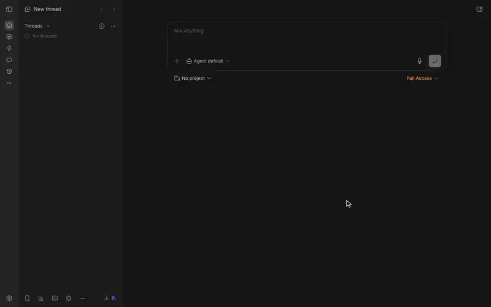

# bb-box

[](docs/media/demo.mp4)

Computers for [BB](https://getbb.app) threads. Each thread gets boxes of its own: Linux, macOS or Windows, virtual or physical, with or without a desktop. You and the thread's agent both use them from BB.

## Why bb-box

- **Each thread gets its own computers.** Boxes have the thread's Git access, its variables and BB itself.
- **Any provider.** Docker, Proxmox, microsandbox, Macs with Tart, machines over SSH, or cloud machines from Hetzner Cloud, Namespace and boat.dev, made when boxes need them.
- **Phones and tablets to test apps on.** An iPhone or iPad in the iOS Simulator, or a Pixel phone, foldable or tablet in the Android emulator. See [device boxes](docs/guide/devices.md).
- **Ready in seconds.** A box is usually ready in seconds, and a warm box at once.
- **Keep boxes as your own machines.** Threads can run on them, such as an always-on agent with its own desktop.
- **Shared desktops.** You and the agent use the same screen. The agent waits while you have control.
- **Recordings that show the work.** An agent records its test run as a short clip, with each step and its result captioned. See [Recordings](docs/guide/recording.md).
- **Every machine at a glance.** The Monitor, in BB's sidebar, shows CPU, memory, disk, network and processes for BB's server, your machines and every box. It can warn you when BB's server is under pressure. See [the Monitor](docs/guide/monitor.md).

*bb-box assumes one trusted user. It is not a sandbox for code you do not trust.*

## Quick start

You need a Linux machine that runs BB and Docker, with about 10 GB of disk free and at least 8 GiB of memory, or 12 GiB for a desktop box.

Boxes join BB by reaching BB's server. If BB is signed in to your bb account, bb connect does that. If it is not, start BB with `npx bb-app --server-bind-host 0.0.0.0`, then in BB's settings, under Machines, set Machine access to **Manual** with this machine's address on your network, such as `http://192.0.2.10:38886`. See [when a box does not join BB](docs/guide/boxes.md#when-a-box-does-not-join-bb).

1. In BB, open Settings, then Installed plugins, then the arrow beside **New plugin**, then **Install from source**, and enter:

   ```text
   git:https://github.com/moonstead/bb-box.git@stable
   ```

   Or with BB's command line, `bb`, or `npx --package bb-app bb` where `bb` is not installed:

   ```sh
   bb plugin install git:https://github.com/moonstead/bb-box.git@stable
   ```

   It asks you to confirm. An agent or a script adds `--yes`, as it cannot answer.

   `stable` is the release branch. `main` is where new work lands first and is tried before it reaches `stable`; install `@main` only to try that work.

2. Open a thread's **Box** panel, or BB Box in BB's settings, and select **Use Docker on this machine**, or have an agent run `bb box setup docker`. The Linux image usually builds in 5 to 12 minutes, depending on the machine.
3. Select the plus, then **Create box**. Or ask the thread's agent: "Get a Linux box and run uname -a in it."
4. For a desktop, select the plus, choose **Desktop**, and under Display X11 or Wayland, then **Build and create**. bb-box builds that desktop's image before the first one, usually in 4 to 10 minutes.

`bb box doctor` checks the setup. If a box says 'Could not join BB', see [when a box does not join BB](docs/guide/boxes.md#when-a-box-does-not-join-bb).

## Backends and boxes

| Backend | Boxes | Where they run |
| --- | --- | --- |
| [Docker](setup/docker/README.md) | Linux; Linux desktop on the CPU or an NVIDIA GPU; Wayland desktop on the CPU | containers on the machine that runs BB, another host over SSH, or a BB machine with Docker, such as a [Windows PC with WSL](setup/docker-wsl/README.md) |
| [microsandbox](setup/microsandbox/README.md) | Linux; Linux desktop on the CPU | microVMs, each with a kernel of its own, on a Linux host with KVM or a Mac with Apple silicon: an option beside Docker, not the default |
| [Proxmox LXC](setup/proxmox-lxc/README.md) | Linux; Linux desktop on the CPU or a GPU; Wayland desktop on the CPU | containers on a Proxmox VE host |
| [Proxmox QEMU](setup/proxmox-qemu/README.md) | Windows desktop; Linux with a kernel of its own, and KVM where the host allows | virtual machines on a Proxmox VE host |
| [Tart](setup/tart/README.md) | macOS, with or without a desktop; Linux on arm64, with or without a desktop; Windows desktop on arm64 | virtual machines on your Macs with Apple silicon |
| [SSH host pool](setup/ssh-pool/README.md) | Linux; macOS, with or without a desktop | machines over SSH, physical or a VPS |
| [Hetzner Cloud](docs/guide/hetzner.md) | Linux; Linux desktop on the CPU; Wayland desktop on the CPU; Linux on arm64, with or without a desktop | containers on x86 or Arm Docker hosts bb-box rents in your Hetzner Cloud project as boxes need them, and deletes when idle |
| [Namespace](docs/guide/namespace.md) | macOS, with or without a desktop; Linux, with KVM; Linux desktop on the CPU; Wayland desktop on the CPU | a Namespace machine for each box, a Mac or a Linux machine, rented by the minute in your Namespace workspace, within its plan's limits |
| [boat.dev](docs/guide/boat.md) | Linux, with KVM; Linux desktop on the CPU | a boat.dev sandbox for each box, a Linux VM forked from bb-box's template in seconds and billed by the second |

Every kind of box, and its sizes, is in [kinds and sizes](docs/reference/kinds.md).

## What still waits on BB

Some things wait on features BB does not have yet, listed in [what bb-box asks of BB](docs/bb-requests.md). You will notice them in five places. A thread cannot start on a new Windows box from BB's new-thread screen, though Windows boxes join BB as machines. A box's terminal is bb-box's own tab, not BB's terminal with its tabs and history. When BB's server is busy for a moment, every desktop's picture and input wait for it, so a drag can lag. A file over 16 MiB copies to or from a box only while the machine that holds it is connected to BB. An agent's command that runs longer than about 4.5 minutes goes on as a job, which the agent checks later, as BB ends a tool call after about five minutes.

## Documentation

- [User guide](docs/guide/README.md)
- [Setting up bb-box](setup/README.md)
- [Reference](docs/reference/README.md)
- [Architecture](docs/architecture.md)
- [Developing bb-box and writing a backend](docs/development.md)
- [Decision records](docs/decisions)
- [Research notes](docs/research)
- [Design specs](docs/design)
- [What bb-box asks of BB](docs/bb-requests.md)

## Licence

bb-box is under the [MIT licence](LICENSE). The software it bundles, and the software it installs on hosts and in images, keeps its own licence: see [Third-party software](THIRD-PARTY.md).
