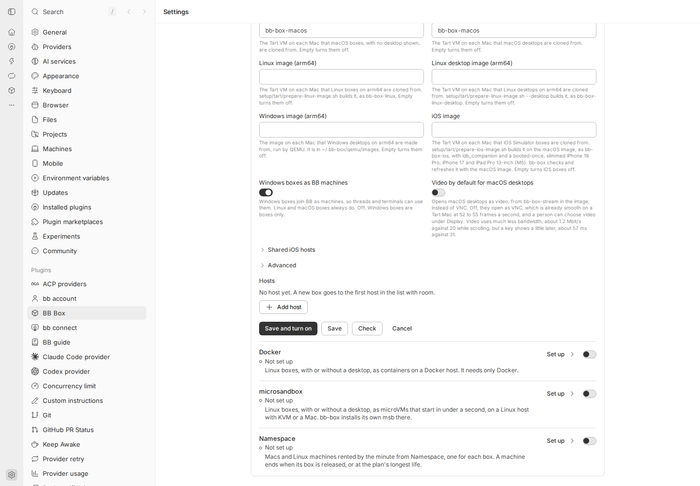
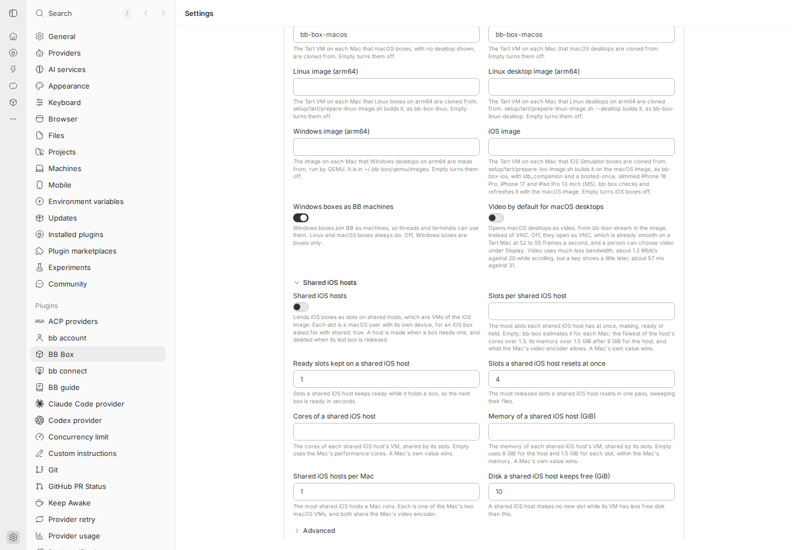

# 067 results

What was built and checked for each unit of
[067](067-settings-page.md). Each unit keeps to its own section.

## Unit 1: views, the overview and its switches

Built on 29 October 2026. The page is now an overview with a page one step
in for each backend, kind and option, chosen by the URL's hash. Each part's
page holds today's form for that part, unchanged, so no setting is lost
before later units replace them. [The design note](../design/settings.md)
is rewritten to it.

### What changed

- `SettingsSection` is the view: it reads the hash, keeps a history entry
  for each view with the row it was opened from and the scroll, moves focus
  to a page's heading on opening it and back to the row on return, and
  slides a page 12 px over 220 ms for pointer navigation only.
- The overview: first run or the setup job's progress, as before; Status,
  with its honest line, Check all and the callout; Backends; Kinds in three
  groups, with folded kinds; Options. Machines left the page: Your machines
  opens the Boxes page on its Machines tab, through its new sub-path
  `machines`.
- Pages: a backend (header, switch, health, today's setup form; for Docker
  on a BB machine, today's Docker on BB machines list), a kind (header,
  Make default, switch, today's editor), Boxes, Images, Devices, Network,
  Monitor, Configuration, Add a backend, and setting up a backend, which is
  replaced in history by the backend's page once saved.
- One at-once write path for every switch and the default kind's menu. It
  sends the latest document with one change and its revision; says Saved
  only once BB Box confirms; on a newer revision takes the document the
  refusal carries and tries again, at most 3 times, or says it was already
  so; says why when refused; and after a lost reply reads the configuration
  again and says what is stored, never calling it saved.
- `SettingsLink` and `openSettingsView` for links into the page from other
  parts of bb-box. The Monitor panel's header has one, a settings button to
  `#option/monitor`.
- A thread's own machine in the Box panel, and the agent tools' refusals,
  now say "Remove or stop it on the Boxes page, under Machines".
- The user guide, the setup guides and three server messages use the new
  names: Boxes join BB as machines, Rebuild each night, Network, Add backend.

Files: new `src/app/settings-route.ts`, `settings-nav.ts`,
`settings-link.tsx`, `settings-status.ts`, `settings-instant.ts`,
`settings-context.tsx`, `settings-overview.tsx`, `settings-pages.tsx`,
`settings-parts.tsx` and `test/settings-view.test.tsx`. Shared files
touched: `src/app/settings.tsx`, `settings-machines.tsx` (its section went;
`MachineRow` stays), `desktop.tsx` (the `machines` sub-path), `box-row.tsx`,
`monitor/status.tsx` (the settings button), `src/plugin/tools.ts`,
`src/plugin/images.ts`, `src/plugin/setup.ts`, `src/core/checks.ts`,
`test/app.test.tsx`, `test/plugin.test.ts`, `test/image-jobs.test.ts`, and
docs.

### Checked

On a Linux box, rebased onto unit 2's server part: `tsc` clean; the node
suite 2,733 tests, 2,445 passed, 288 skipped, 0 failed; vitest 4 files
passed; the docs test 5 passed.

The live check ran on a separate BB in a second Linux box: BB 0.48.0 from
a fresh `npx bb-app` with no account and its own data folder, bb-box
installed from this branch with `bb plugin install` of its path, Docker on
the box set up with Use Docker on this machine (its Linux image built), and
a Proxmox LXC backend saved off part way, so Not finished. A script drove
headless Chromium at 1440 by 1000. Each row is what the page showed after
the step; "focus" is the element focused.

| Step | Result |
| --- | --- |
| Open `#backend/proxmox-lxc` directly | Its page, heading Proxmox LXC |
| Open `#option/monitor` directly | The Monitor page |
| Select the Configuration row with the pointer | `#option/configuration`; focus on its heading; scroll 0 |
| Browser back | The overview, in the same document; focus on the Configuration row; scroll back to 199 px |
| Forward, then reload | The Configuration page each time |
| BB Box settings in the top row | The overview by history back; focus on the row |
| Devices, then Android emulator from it | `#kind/android`; the top row says "Back to Devices · BB Box settings › Android emulator" |
| Back to Devices | `#option/devices`; focus on the Android emulator row |
| BB's sidebar: General, then browser back | `/settings`, then `#option/devices` again |
| The Monitor panel's settings button, from BB's home page | `#option/monitor`, the Monitor page |
| `#kind/no-such-kind`, `#backend/removed-backend`, `#setup/nothing` | "This kind is not here", "This backend is not here", "This kind of backend is not here", each with Go to BB Box settings, which opens the overview |
| Monitor's switch off, then on | Saved each time; stored `monitor.enabled` false, then the default; "The sidebar's machine status changes when BB next loads", with Reload BB now |
| Proxmox LXC's switch on, while not finished | Put back off: "Proxmox LXC was not changed: Set the Proxmox API URL. Set the Proxmox API token ID. Set the Proxmox API token secret."; no Saved; stored off |
| Monitor's switch during a write storm: a second tab writing the configuration as fast as it could, about 60 saves a second | The first tries were saved after retries. In each of 3 runs, the third or fourth try was refused 3 times in a row and put back: "The Monitor was not changed: the configuration changed 3 times while saving. It is on; try again." |

| A lost reply: BB restarted with `BB_BOX_LIVE_CHECKS=1`, `bb box config drop-replies`, then Monitor's switch off | Stored off at revision 3353; the switch stayed off and said "Not confirmed: BB Box did not reply (BB Box saved this and dropped its reply, as a live check asked). The Monitor is off now, at revision 3353."; no Saved |
| After Check all, the Docker backend's most boxes changed with `config.apply` | Its row and Status said "Not checked since it changed"; after Check all again, Ready |

The steps were run again on the commit rebased onto unit 2's server part,
with the same results.

The lost reply was checked once unit 2's server part, merged while this
unit was built, gave BB Box a switch that drops a reply after storing.

The keyboard-only pass, on the same BB:

- Tab from the overview's heading reaches 18 stops in order: Check all,
  Open in the callout, Add backend, each backend row and its switch, Change
  the default, the kind row, the folded kinds, each option row, the
  Monitor's switch, Configuration and Your machines. Each showed a focus
  ring. The default kind's switch is disabled, so it is skipped.
- Enter on the Monitor row opened its page with focus on its heading;
  Shift+Tab reached BB Box settings, and Enter returned to the overview
  with focus on the Monitor row.
- Space on the Monitor's switch saved it off; Space again saved it on.
  The first run of this pass found that a switch lost focus while it saved,
  as it was disabled; it now stays focusable and ignores presses until the
  save ends.
- No animation ran after keyboard navigation (`document.getAnimations()`
  was empty).

### Screenshots

At 1440, 760 and 390 px, light and dark, of the overview, a backend's page,
a backend not finished, a kind, the Boxes and Monitor options, Add a
backend and the Boxes page's Machines tab: 48 in all, in the thread's
storage. A selection is in
[067-settings-page/unit-1](067-settings-page/unit-1/), with the box's own
name replaced by bb-1:
[overview](067-settings-page/unit-1/overview-1440-light.png),
[dark](067-settings-page/unit-1/overview-1440-dark.png),
[760](067-settings-page/unit-1/overview-760-dark.png),
[390](067-settings-page/unit-1/overview-390-light.png),
[a backend](067-settings-page/unit-1/backend-1440-light.png),
[not finished at 390](067-settings-page/unit-1/unfinished-390-dark.png),
[a kind](067-settings-page/unit-1/kind-760-light.png),
[Monitor at 390](067-settings-page/unit-1/monitor-390-dark.png),
[Add a backend](067-settings-page/unit-1/add-1440-dark.png),
[the Boxes page](067-settings-page/unit-1/boxes-page-1440-dark.png),
[refused](067-settings-page/unit-1/live-23-refused.png),
[refused 3 times](067-settings-page/unit-1/live-24-raced.png),
[not here](067-settings-page/unit-1/live-17-kind-not-here.png),
[the Monitor panel's button](067-settings-page/unit-1/keys-00-monitor-panel.png),
[focus ring](067-settings-page/unit-1/keys-01-focus-ring.png).

### Every setting is still reachable

| Setting | Where |
| --- | --- |
| First run and the image build | The overview, as before |
| Your machines | The Boxes page's Machines tab, from Options |
| A backend on or off | Its overview row and its page |
| A backend's fields, Macs or hosts, Check, the guide | Its page, today's form |
| Setting up a new backend | Add backend, then the backend |
| Docker on BB machines | Add backend, and a BB machine's Docker page |
| A kind on or off | Its overview row and its page |
| A kind's sizes, default size, largest, warm counts, spares | Its page, today's editor |
| Default kind | Options, Boxes; and Make default on a kind's page |
| Boxes per thread, joining BB, video, files for every box | Options, Boxes |
| Rebuild each night, Rebuild now | Options, Images |
| Tailnet | Options, Network |
| The Monitor's four settings | Options, Monitor; machine status also on its row |
| iOS video encoding, sharing the encoder, the test device | Options, Devices shows them; set with `bb box config`, as before 067 |
| A backend's label, removing a backend, projects' images, export, import, the copy of BB's earlier settings | `bb box config` and `bb box image`, as before 067; Configuration lists the commands |

### Deviations from 067

- No Find yet: it is unit 11. The overview has no top row, and inner
  pages' top rows have no Find field.
- "Not checked since it changed" uses the check revisions of unit 2's
  server part, merged while this unit was built. A check from before that
  part has no revision, and is taken as current.
- Status does not list failed image rebuilds or failing Docker machines in
  use: `images.list` has no run state yet (unit 8) and Docker machines
  join Backends in unit 5. Kinds that "backends that are on cannot make
  now" are those whose only backends that are on have settings with a
  problem.
- The saving rule's words say "Fields wait for their Save, or save when you
  leave them", since Boxes per thread and Refresh every still save on
  leaving the field until unit 2.
- In BB 0.48.0 the Monitor panel is not on screen while BB's settings
  show: BB's settings replace the sidebar, footer included. So the panel's
  link was driven from BB's home page, and the in-place path, a link while
  settings show another view, is checked by vitest with
  `openSettingsView` on a kind's page.
- Leaving by BB's sidebar and coming back with back restores the view but
  not focus on its heading: BB's back is not a view change the page makes.
- Saved shows and goes without a fade.

## Unit 2: the server part

Built on 29 October 2026. The changes 067 lists under "Changes on the
server", for unit 2's editing engine to build on. Nothing on the page
changes but what keeps today's form working.

### What changed

| Change | How |
| --- | --- |
| Operation receipts | `config.apply` takes `operation`, an ID the page makes, and `submission`, the edits it froze. An ID is applied at most once: sent again with the same submission, the answer is the first save's receipt, `replayed: true`, and nothing is saved, whatever revision it names. Sent with another submission, it is refused as a problem at the path `operation`. Without a submission, the draft is the submission. A save without an ID, as today's page and `bb box config apply` make, works as before and has no receipt |
| The same write | A new storage key, `config/saved`, holds the document with its receipts, each secret's version and each backend's last change, in one value: BB's plugin storage writes one key at a time, with no transaction. `config/document` is still written after it, as a copy an earlier bb-box reads. A start takes whichever of the two is newer |
| Receipts kept | Those of the last 24 hours, and at least the last 100. `config.get` lists them as `{ operation, revision, at }`; the hash of the submission stays in bb-box |
| Secret versions | Each secret in `config.get` and in `config.apply`'s answer reads `{ set, version }`: the revision that last set or cleared it. Backends' secrets, files' contents and the tailnet's credentials all have one. A draft may send them back. `bb box config show --json` and `apply --json` leave them out |
| Never reused | Each save compares a SHA-256 of each secret's value with the one it stored. A secret changed outside bb-box's saves, as by a write cut short or an earlier bb-box, gets a new revision at the next start, so no version repeats. A first start after this release takes the current revision as every version, without a new revision |
| Check revisions | A backend's state has `changed`, the revision its configuration last changed at, from a SHA-256 of what its driver reads, inherited values and Macs' switches included. Each doctor run has `revision`, the revision it tested; runs from before have `null` |
| Setup done | `config.get` has `setupDone`, `{ at, revision }`, recorded once, the first time a backend that is on makes a kind, or bb-box finds it has made a box before |
| Explicit empty | A driver lists the fields where empty turns its boxes off (`offWhenEmpty`): 24 image and template fields across Docker, microsandbox, Hetzner Cloud, Proxmox LXC, Proxmox QEMU and Tart. `draftFields` keeps such a field empty where the stored document has it, so a field saved or cleared to off stays off. A field never set still takes its default, as before |
| `ios-hosts` | The shared iOS host fields of Tart (8, and each Mac's 3), the SSH host pool (4) and Namespace (5) are a group of their own. Today's form shows it as "Shared iOS hosts", folded like Advanced |
| `config.migrated.remove` | Removes the copy of BB's settings, as `bb box config migrated --remove` does, and answers `{ removed, state }` |
| The reply-drop switch | Only with `BB_BOX_LIVE_CHECKS=1` in BB's server's environment does `bb box config drop-replies [--count n] [--off]` exist. It makes the next saves from the settings page that store something answer with an error after storing |

The reference names the secret's version and the receipt
([configuration reference](../reference/configuration.md)).

### Tests

`test/saves.test.ts`, 20 tests, among them: the receipt and document in
one value, and a failed write that stores neither; the same operation sent
twice at once, applied once; a replay on a newer revision; the same ID with
another submission refused; 105 receipts kept within 24 hours and 100
after; a secret replaced, cleared and set back to its first value, four
versions; versions for files and the tailnet; a secret changed outside a
save, given a new revision at the next start; a document an earlier
bb-box wrote; `changed` and the doctor's revision through `config.check`
and `bb box doctor`; setup done kept with every backend off and across a
start; the reply-drop switch, and that without the variable it does not
exist and replies are answered.

On a Linux box, 8 cores, after the rebase onto unit 4 (`2f7f7c22`):

| Check | Result |
| --- | --- |
| `tsc` | passes |
| Node suite | 2,733 tests: 2,445 pass, 0 fail, 288 skipped (the live suites, skipped as on main), 4 min 4 s |
| vitest | 256 pass |
| `test/docs.test.ts` and `scripts/reference.ts --check` | pass |

Two earlier runs, before the rebase, each had one test fail that waits a
fixed 20 ms or so for background work: Namespace's older probe, then Tart's
Windows video. Each passed alone, 5 of 5 and 3 of 3 times, and neither
touches the configuration.

### Live check on a separate BB

A fresh `npx bb-app` (0.48.0) with no account, its own data folder and
port, in a Linux box, started with `BB_BOX_LIVE_CHECKS=1`, and bb-box
installed from the branch's path. The RPCs were called over BB's HTTP API,
as the page calls them. Values were made up. The same script gave the same
answers before and after the rebase onto unit 4.

| Step | Result |
| --- | --- |
| Apply with operation `live-op-1`: a Hetzner Cloud backend, off, with a token; a file for every box; the tailnet with its credentials | Saved at revision 2 in 17 ms, receipt `{ live-op-1, 2 }`; `config.get` listed it; the token, the file's content and the client secret each `{ set: true, version: 2 }`; no value in the answer |
| `live-op-1` again, naming revision 1 | `replayed: true`, the same receipt, still revision 2 |
| `live-op-1` with another submission | Refused at `operation`: "Operation live-op-1 was saved at revision 2 with other changes, so these were not saved. A new save needs a new operation ID." Still revision 2 |
| `live-op-twice` sent twice at once | Both answered with the receipt for revision 3, one `replayed`; revision 2 to 3 |
| Token and file replaced, token cleared, token set back to its first value | Versions 4, 5 (`set: false`) and 6; the client secret kept 2 |
| `bb box config drop-replies`, then a save | HTTP 500, "BB Box saved this and dropped its reply, as a live check asked."; `config.get` then showed revision 7, the change, and the receipt for revision 7 |
| The dropped operation sent again | `replayed: true`, the receipt for revision 7 |
| The next save | Answered at once, receipt for revision 8 |
| A save without an operation ID | Saved at revision 9, no receipt |
| `config.migrated.remove` | `removed: false` on a BB that never moved settings |
| BB's storage | One row, `config/saved`, 1,845 bytes: the document at revision 9 and the 7 receipts |
| Today's settings page, in headless Chromium: Boxes per thread set to 6, saved as the field lost focus | Saved at revision 10, without a receipt, as before |
| BB stopped and started | Revision 10, 7 receipts and every version as before |

`bb box config show/check/apply` for a person: two more fresh BBs, one
with bb-box from main (`2f7f7c22`), one from the branch, both without
the variable. The same 15 commands on each (show, show --json, check,
check --json, check with problems, apply, apply with problems, apply
--json, a stale apply, apply --replace, migrated, migrated --remove)
gave byte-identical output and exit codes. No made-up value was in any
output, and `drop-replies` was not a command.

Today's form for Tart, with the new group folded and open:

### Deviations from 067

- The same write is a new key, `config/saved`, not `config/document`. An
  earlier bb-box reading a document with receipts in it would list them in
  every export and refuse every save, so a rollback would break.
  `config/document` is kept as a copy.
- At most 500 receipts are kept, within 24 hours, so the stored value
  stays well under BB's 256 KB for one value.
- The same ID with another submission is refused as a problem at the path
  `operation`, so every caller of `config.apply` keeps working.
- A dropped reply is an error answer after the save, not silence: a
  plugin's RPC cannot leave BB's request open. The page sees a failed call,
  as for a reply lost on the way.

### Not done here

- The page's engine, which sends operation IDs and reads receipts and
  versions: unit 2's next part.
- A real Mac's Tart backend, for the `ios-hosts` group on a page: unit 3.

## Unit 2: the page's engine

Built on 29 October 2026, on unit 2's server part. Every write the
settings page makes now goes through one draft registry, as an operation
with an ID, confirmed only by BB Box's reply or its receipt. The Boxes and
Monitor pages are the first forms on it. Other pages keep the forms they
had before 067 until their units.

### What changed

- The draft registry (`src/app/settings-drafts.ts`) lives outside the
  page's components. Each part, such as `option/monitor` or `files`, holds
  its edits and, while a save is out, that save's operation: its ID, its
  frozen submission and its phase (sending, looking for its receipt, or
  not confirmed). The save runs in the registry, so it finishes, and its
  state shows, when the person has left and come back.
- An edit is a setting's path, its value and the stored value it started
  from (`src/app/settings-paths.ts`); a file's content starts from its
  version. A change made elsewhere to another setting shows as stored; to
  an edited one it is a conflict on its row at once, with Use theirs and
  Keep mine, or Keep the saved one and Keep mine for a file. Save waits
  for each choice.
- Save freezes the submission. On a refusal for a newer revision it checks
  that submission against the configuration the refusal carries, and saves
  on it or stops with conflicts; after 3 refusals it stops. Typing during
  a save stays a change; only edits still as sent are cleared. A lost
  reply is confirmed by the receipt, or said as not confirmed, and Save
  again resends the same operation. A save whose receipt BB Box may no
  longer keep is never sent again. A confirmed save names what changed
  elsewhere since.
- New files have provisional identities (`files/@new-…`) until their save
  is confirmed; then their edits move to the saved file, with its version
  as their base. A new file with the path of an existing one replaces it,
  from that file's version. Problems the server reports resolve to the
  draft's field.
- Session storage keeps each part's edits without file contents, and its
  pending save. File contents are kept in memory only. After a reload a
  note brings the draft back and says which contents to paste again; the
  browser asks before the tab closes with a draft.
- `useDraft`, `useInstant`, `SaveBar`, `ConflictNote` and `RestoredNote`
  (`src/app/settings-saving.tsx`) and the draft fields
  (`settings-draft-fields.tsx`). The bar's words are those of 067 section
  4. While it saves, Save stays focusable and ignores presses; focus stays
  in the bar when its buttons go; a conflict's choice and Add file move
  focus to the field.
- Boxes: Boxes per thread waits for Save, or Enter; files for every box are
  a form of their own with Save files. A file's editor closes once its new
  content is confirmed, and stays open with its text after a refusal or
  with newer text. Remove asks first and is an operation. Monitor: Refresh every waits for Save. The saving rule under
  their headers now says "Fields, checkboxes and radio choices wait for
  Save".
- Every switch, the default kind's menu, Make default, a file's removal and
  the Docker on BB machines switches send an operation ID and read their
  receipts. `docker.host.set` takes an optional operation ID for this.
- The overview marks the Boxes and Monitor rows "Unsaved changes" while a
  draft waits.
- A failed reload of the configuration no longer replaces the page with
  the error: the page keeps what it last read and says so above it.
- The receipt constants moved to `src/core/receipt-window.ts`, with the
  page's rule for when a receipt may be gone.

New: `src/app/settings-drafts.ts`, `settings-paths.ts`,
`settings-saving.tsx`, `settings-draft-fields.tsx`,
`src/core/receipt-window.ts`, `test/settings-drafts.test.ts`, and
`067-settings-page/unit-2/live-check.mjs` and `screens-and-keys.mjs`.
Changed: `settings.tsx`, `settings-context.tsx`, `settings-pages.tsx`,
`settings-files.tsx`, `settings-overview.tsx`, `settings-parts.tsx`,
`settings-docker-hosts.tsx`, `src/core/saves.ts`, `src/plugin/contract.ts`,
`rpc.ts`, `setup.ts`, `test/app.test.tsx`, `test/settings-view.test.tsx`
and `docs/design/settings.md`. Gone: `settings-instant.ts`, whose writes
the registry runs now.

### Tests

`test/settings-drafts.test.ts`, 19 tests, runs the registry against the
real `Configuration` class, with a transport that can lose a request,
drop a reply after the store, hold a request or a reply, send a request
twice at once, and let another writer save first. It covers the merge and
conflict choices, checked retries, G1 for a field and a file, G2 to G5, a
lost reply with a file replaced since, a request that never arrives and
Save again, a request sent twice, a late reply after the receipt was
seen, a receipt aged out by count and by time, three refusals, problems
at new files' fields and server problems resolved through the submission,
the memory-only rule and restore after a reload, a pending save restored
with and without its receipt, and switches.

`test/app.test.tsx` has three new tests through the page (a conflict on
its row with both choices and Show; a draft kept on leaving, marked on the
overview, restored after a reload without the pasted content, and the
browser's warning; Save again after a request that never arrived), and the
Boxes, files and switch tests now check operation IDs.

On a Linux box, 8 cores, on the code delivered:

| Check | Result |
| --- | --- |
| `tsc` | passes |
| Node suite | 2,770 tests: 2,482 pass, 0 fail, 288 skipped (the live suites, skipped as on main), 3 min 17 s |
| vitest | 264 pass, in 4 files |
| `test/docs.test.ts` and `scripts/reference.ts` | pass; the reference is unchanged |

### Live check on a separate BB

A fresh `npx bb-app` (0.48.0) with no account, its own data folder and
port, in a Linux box, started with `BB_BOX_LIVE_CHECKS=1` and nothing else
from the box's environment; bb-box installed from this branch with `bb
plugin install` of its path. The script,
[`live-check.mjs`](067-settings-page/unit-2/live-check.mjs), drives
headless Chromium at 1440 by 1000. "Another tab" is a second browser
context, or a save through BB's HTTP API as the page makes it; "an agent"
is `bb box config show --json` and `bb box config apply`. Network faults
are made with Playwright's request routing on the page's own calls: a
request aborted before it leaves, a reply held, a request sent twice. A
lost reply is BB Box's `bb box config drop-replies`, which stores and then
answers with an error. Where a check needs the page not to look yet, the
script holds the page's `config.get` calls: without that, BB's change
signal often lets the page find the receipt before the dropped reply
comes back, which the page then rightly reports as Saved (the first run
of the script found this). Each check passed 3 runs in a row, 51 of 51,
on the code delivered. Before the series, two single runs found faults in
the script itself: two locators, and the need to hold reads. The series of
3 runs then ran six times as main moved and the code was polished. One of
them failed a check 3 times on a bug in a screenshot line the script had
just gained, after the check's own assertions had passed; the other five
passed 51 of 51.

| Check | What the page said, and what BB Box stored | Runs |
| --- | --- | --- |
| An agent's `bb box config apply` while Refresh every is 12 in a draft: the agent sets it to 8, boxes per thread to 4 and background monitoring on | On the field's row at once: "Changed elsewhere to 8 while you edited.", with Use theirs and Keep mine. The field kept 12, the background monitoring switch showed on, and the bar said "A setting you changed was changed elsewhere too. Choose for each, then save." After Keep mine and Save: 12 stored, with the agent's 4 and on | 3 of 3 |
| Two tabs, the same field: A types 12, B types 15, A saves | A: "Saved." B, at once: "Changed elsewhere to 12 while you edited." B chose Keep mine and saved: 15 stored, and A showed 15 | 3 of 3 |
| Two tabs, different fields, saved at the same moment: A's boxes per thread, B's new file | One "Saved.", the other "Saved at revision N, on top of a change made elsewhere." Both stored, the file's content as sent | 3 of 3 |
| A lost reply after a store, with the file's content replaced in another tab before the page looks | "Save not confirmed: BB Box did not reply. Looking for this save's receipt…", then "Saved at revision N. The reply was lost; BB Box's receipt for this save confirms it. Since then, changed elsewhere: the content of ~/.cfg/lost-1.json (revision N+1)." One receipt; the other tab's content stored | 3 of 3 |
| A request that never arrives, then Save again | "Save not confirmed: BB Box has no receipt for it yet. Your changes are still here. Saving again resends the same request, which BB Box applies at most once." Nothing stored. Save again sent the same operation ID and submission: "Saved.", one revision more, one receipt | 3 of 3 |
| The same request sent twice at once | "Saved." One revision more, one receipt, and one of the two answers was a replay | 3 of 3 |
| A late reply after leaving the page: the reply held, the page left by BB's sidebar, the reply let go, then back | "Saved.", from the one request's reply; the field showed the stored value, not marked Changed | 3 of 3 |
| A receipt aged out: a lost reply while the page's reads are held, the page left, 505 saves with receipts by another writer, the page back | BB Box listed 500 receipts, not this one. "Save not confirmed: this save is older than the receipts BB Box keeps. What is saved now matches your changes." Never sent again, and no Save again | 3 of 3 |
| Three refusals in a row, for a form and for a switch: another writer saves before each request | "Not saved: the configuration changed three times while saving. Your changes are still here." The switch put back: "Background monitoring was not changed: the configuration changed 3 times while saving. It is off; try again." | 3 of 3 |
| Typing during a save: boxes per thread 6 then 7; a file's content A then B | "Saved. Your newer change is not saved yet." each time; 6 and A stored; 7 and B still in their fields | 3 of 3 |
| A reload with a draft: Refresh every 18, and a new file with pasted content | "Your unsaved changes to the Monitor are back: 1 change." and "Your unsaved changes to files for every box are back: 1 change. For safety the content of ~/.cfg/reload-1.json you pasted was not kept; paste it again." The content was in neither session nor local storage, the path was in session storage, and closing the tab asked first | 3 of 3 |

The gates, scripted as 067 gives them:

| Gate | Steps | Passes when, and what the page said | Runs |
| --- | --- | --- | --- |
| G1, a field | Boxes per thread 6 and Save; another writer saves first, so it retries; 7 typed while the retry is held | 6 stored, 7 not, shown as Changed: "Saved at revision N, on top of a change made elsewhere. Your newer change is not saved yet." Both requests had the same ID and submission, and the bar named nothing else | 3 of 3 |
| G1, a file | The same with a file's content, A then B | A stored, B in the editor; the same words | 3 of 3 |
| G2 | A new file given an existing file's path ("~/.cfg/g2-1.json is already a file here. Saving replaces it."); another tab replaces that file | "Replaced elsewhere while you edited, at revision N. Saving yours replaces that one.", with Keep the saved one and Keep mine; Save files waits; theirs stays stored until Keep mine, then mine; one file | 3 of 3 |
| G3 | A new file saved while its request is held; newer content typed; then another tab changes the file; Save again | "Saved. Your newer change is not saved yet."; no `@new-` path in the page or in session storage; the newer text on the saved file; then a conflict on it, Save waits, and still one file | 3 of 3 |
| G4 | Monitor 12 and Save, with a lost reply held; leave by BB's sidebar; back to "Saving…"; type 15; the reply let go; leave and come back again | 12 stored once: one revision, one receipt, one request. 15 shown and marked Changed. "Saved at revision N. The reply was lost; BB Box's receipt for this save confirms it. Your newer change is not saved yet." | 3 of 3 |
| G5 | A file's content replaced and Save files, held; leave and come back; newer text typed | On return the editor was open with the text being saved; then "Saved. Your newer change is not saved yet.", with the newer text in the open editor and the first content stored | 3 of 3 |

### Keyboard only

On the same BB, by keys alone ([`screens-and-keys.mjs`](067-settings-page/unit-2/screens-and-keys.mjs)):

- Monitor, from its heading: Tab reached Machine status, then Refresh
  every; typing 12 and Enter saved it: "Saved."
- With a conflict from another writer: Tab reached Use theirs and Keep
  mine. Enter on Keep mine put focus back on the field. Tab went through
  the two switches to Discard and Save; Enter on Save saved, and focus
  stayed on the bar's words, "Saved.", with a ring.
- Boxes: Enter on Add file put focus on the new file's path; Tab to its
  content, then Don't add it, Discard and Save files; Enter saved, and the
  file was listed.
- Every stop showed a focus ring, and no animation ran
  (`document.getAnimations()` was empty).
- The first pass found focus falling to the page after Keep mine, and Add
  file leaving focus four stops from the new fields; both were fixed and
  the pass run again.

### Screenshots

At 1440, 760 and 390 px, light and dark: Monitor with a draft, with a
conflict and not confirmed; the overview with Unsaved changes; Boxes with
a field, a replaced file and a new file that replaces another; Boxes
restored after a reload. 36 in the thread's storage, and the live
checks' own. A selection:

[a conflict](067-settings-page/unit-2/monitor-conflict-1440-light.png),
[at 390](067-settings-page/unit-2/monitor-conflict-390-dark.png),
[not confirmed](067-settings-page/unit-2/monitor-not-confirmed-760-dark.png),
[Unsaved changes on the overview](067-settings-page/unit-2/overview-unsaved-760-light.png),
[Boxes with drafts](067-settings-page/unit-2/boxes-drafts-1440-dark.png),
[restored after a reload](067-settings-page/unit-2/boxes-restored-390-light.png),
[focus after Save](067-settings-page/unit-2/keys-03-after-save.png),
and from the live checks:
[a lost reply confirmed by its receipt](067-settings-page/unit-2/live-lost-reply-receipt.png),
[a receipt aged out](067-settings-page/unit-2/live-receipt-aged-out.png),
[three refusals](067-settings-page/unit-2/live-three-refusals.png),
[G2](067-settings-page/unit-2/live-g2-conflict.png),
[G4](067-settings-page/unit-2/live-g4-after.png).

### Deviations from 067

- `docker.host.set` takes an operation ID, a small server change, so a
  BB machine's Docker switch has a receipt like every other switch.
- No motion: the save bar does not rise and Saved does not fade, as the
  owner asked for no page motion after 067 was written.
- A save may have aged out when BB Box lists at least 100 receipts and the
  oldest is newer than the save could be, or when it is 24 hours old by
  the page's clock. This is by revisions, not the server's clock, and errs
  towards "not confirmed".
- Words 067 does not give: "Already saved: the same was saved elsewhere,
  at revision N"; for an aged-out save, "Save not confirmed: this save is
  older than the receipts BB Box keeps", then either "Your changes are
  still here, checked against what is saved now" or "What is saved now
  matches your changes"; for a save restored after a reload with a pasted
  content and no receipt, "Save not confirmed: BB Box has no receipt for it
  yet. What you pasted was not kept when the page reloaded, so it cannot be
  sent again: paste it again, then save"; and a switch's later receipt,
  "Saved at revision N: BB Box did not reply, and its receipt for this
  change confirms it".
- An edit typed back to the stored value, or one saved the same elsewhere,
  stops being a change, unless a save of that part is out.
- Switches still save one at a time, as in unit 1: a press while another
  switch saves is ignored.
- Check and its fingerprint are unit 3's: Boxes and Monitor have no Check.
- This section replaces a stray merge marker that unit 1's results left in
  this file.

### Not done here

- The backend's page, a kind's page, the tailnet and setting up a backend
  still save with their forms from before 067, without operation IDs:
  units 3, 6, 7 and 9 move them onto the registry, with secrets' versions
  and Macs' provisional identities.

## Unit 4: the drivers' help text

Built on 29 October 2026, for the owner's approval. Words only: no
behaviour and no layout changed.

### What changed

- Every backend field's help now starts with a sentence of its own that
  says what the field is for. The page can show that sentence and keep the
  rest behind More, as section 3 of 067 asks. The rest keeps the format,
  the examples, what empty means and the setup scripts.
- Kinds are named as people read them, such as "Linux desktops on a GPU"
  or "iOS Simulator boxes", not by their IDs. The [kinds
  reference](../reference/kinds.md) maps names to IDs.
- Stale words went: Tart's "ios boxes are not offered yet"; Hetzner's
  desktop image saying "when GPU desktops are on", as Hetzner has no GPU
  desktops; and Proxmox QEMU's line "Windows desktops as VMs", as it also
  makes Linux boxes and Android emulators.
- "Unset" became "Empty", as the page has it.
- Five labels: four SSH host pool labels said "ios" and "sweeps", and one
  Tart label said "sweeps". They now say "iOS" and "resets", like
  Namespace's.
- Three driver lines and two kind descriptions were long or stale, and
  were rewritten the same way (below).
- `helpParts` in `src/backends/types.ts` splits a help text into its first
  sentence and the rest: up to the first full stop, question mark or
  exclamation mark followed by a space. Unit 3's More should use it, so the
  test and the page agree on what "the first sentence" is.
- The reference, `docs/reference/configuration.md` and `kinds.md`, is
  regenerated. It still shows each help text in full.

### Measured

Over all 129 help texts: the 123 backend fields and Tart's 6 fields for
each Mac. Measured by a script over the drivers' descriptors, before and
after, splitting at the same rule as `helpParts`.

| | Before | After |
| --- | --- | --- |
| Help texts changed | | 104 of 129 |
| Longest first sentence | 226 characters | 107 characters |
| Median first sentence | 80 characters | 62 characters |
| First sentences over 120 characters | 19 | 0 |
| First sentences over 100 characters | 44 | 2 |
| Text a page shows with help one step in (first sentences only) | 17,934 characters, as today's page shows every help text in full | 7,665 characters |
| Full help, with what is behind More | 17,934 characters | 19,407 characters |

The full help grew by 8%, because most fields gained an opening sentence
on what they are for. What is behind More is the old text, kept so that no
field loses what a person needs to fill it in.

### Nothing needed went; where words moved

- Defaults: "Off by default" (Tart's shared iOS hosts and video) and
  "Empty, the default" (Tart's iOS image) went from the help. The page
  shows each default beside its field, as 067 section 3 says ("Empty: 4096,
  the default"), and the reference has a Default column.
- Namespace's API token: "It is kept as a secret and never shown" went. The
  page marks it as a secret.
- microsandbox's host: "in a folder of its own" went. "bb-box installs its
  own msb there" stays.
- Kind IDs in help went, for names. A box asked for as `linux-kvm` is still
  named, as an agent asks for it by that word.
- Everything else moved behind More: units, ranges, examples, what empty
  means, the setup scripts and the measured video numbers.

### Driver lines and kind descriptions

| Where | Before | After |
| --- | --- | --- |
| Proxmox QEMU's line | Windows desktops as VMs on a Proxmox VE host. | Windows desktops, Linux boxes and Android emulators, as VMs on a Proxmox VE host. |
| Hetzner Cloud's line | Linux boxes on x86 or Arm, with or without a desktop, as containers on Docker hosts that bb-box makes in a Hetzner Cloud project as boxes need them, and deletes once they are idle. | Linux boxes on x86 or Arm, with or without a desktop, on Hetzner Cloud hosts bb-box makes as boxes need them. Each box is a container on a Docker host, and a host is deleted once it is idle. |
| Namespace's line | Macs and Linux machines rented by the minute from Namespace, one machine for each box, ended when the box is released or at the plan's longest life. | Macs and Linux machines rented by the minute from Namespace, one for each box. A machine ends when its box is released, or at the plan's longest life. |
| The iOS Simulator kind | An iOS Simulator device, an iPhone or iPad, on a macOS VM, or in a slot on a shared Mac or VM: for installing, running and testing iOS apps, shared with a person in the panel. | An iPhone or iPad in the iOS Simulator, for installing, running and testing iOS apps. It runs on a macOS VM, or in a slot on a shared Mac or VM, and is shared with a person in the panel. |
| The Android emulator kind | An Android emulator device, a phone, foldable or tablet, on a Linux VM: for installing, running and testing Android apps, shared with a person in the panel. | A phone, foldable or tablet in the Android emulator, for installing, running and testing Android apps. It runs on a Linux VM, and is shared with a person in the panel. |

Agents read the kind descriptions too, in `box_list` and `bb box kinds`;
they keep every fact.

### Every changed help text

"After: shown" is the first sentence, which the page shows. "After: behind
More" is the rest. A label that changed says what it was.

#### Proxmox LXC

| Field | Before | After: shown | After: behind More |
| --- | --- | --- | --- |
| API URL | For example https://192.0.2.10:8006/api2/json, as the setup guide's token file gives it. | The Proxmox API's address, from the setup guide's token file. | For example https://192.0.2.10:8006/api2/json. |
| TLS fingerprint | The SHA-256 fingerprint of the Proxmox API's certificate, from the setup guide's token file. bb-box then trusts that certificate alone. Leave empty to check the certificate against its CA. | Pins the Proxmox API's certificate, so bb-box trusts that certificate alone. | Paste its SHA-256 fingerprint from the setup guide's token file. Leave it empty to check the certificate against its CA instead. |
| CA certificate | PEM certificate of the CA that signed the Proxmox API's certificate, when there is no TLS fingerprint. Leave empty for a publicly trusted one. | The CA that signed the Proxmox API's certificate, for when there is no TLS fingerprint. | Paste it as a PEM certificate. Leave it empty when the API's certificate is publicly trusted. |
| API token ID | For example bbbox@pve!plugin. The setup guide lists the privileges it needs. | The Proxmox API token bb-box signs in with, such as bbbox@pve!plugin. | The setup guide lists the privileges it needs. |
| SSH private key | The unencrypted OpenSSH private key the templates were built with (the setup guide's BBBOX_SSH_KEY). Leave empty and bb-box makes one and shows its public key, which the templates must then accept. | The SSH key bb-box reaches boxes with. | Paste the unencrypted OpenSSH private key the templates were built with, the setup guide's BBBOX_SSH_KEY. Leave it empty and bb-box makes one and shows its public key, which the templates must then accept. |
| Resource pool | Boxes are made in this pool. The token needs rights on it. | The Proxmox resource pool boxes are made in. | The token needs rights on it. |
| Linux templates | VMIDs of the CT templates linux boxes are linked clones of, separated by spaces or commas. Empty turns them off. | The CT templates Linux boxes are linked clones of. | List their VMIDs, separated by spaces or commas. Empty turns Linux boxes off. |
| GPU desktop templates | One line per GPU desktop template that linux-desktop boxes are linked clones of: its VMID, a space and the ID of the GPU it carries, such as the UUID nvidia-smi -L shows. Empty turns them off. | The CT templates Linux desktops on a GPU are linked clones of, each with the GPU it carries. | One line per template: its VMID, a space and the GPU's ID, such as the UUID nvidia-smi -L shows. Empty turns these desktops off. |
| CPU desktop templates | VMIDs of the CPU-only desktop templates linux-desktop-cpu boxes are linked clones of, separated by spaces or commas. Empty turns them off. | The CT templates Linux desktops drawn by the CPU are linked clones of. | List their VMIDs, separated by spaces or commas. Empty turns these desktops off. |
| CPU Wayland desktop templates | VMIDs of the CPU-only Wayland desktop templates linux-desktop-wayland-cpu boxes are linked clones of, separated by spaces or commas. Empty turns them off. | The CT templates Linux desktops on Wayland are linked clones of. | List their VMIDs, separated by spaces or commas. Empty turns these desktops off. |
| Desktops per GPU | A new linux-desktop box goes to the GPU with the fewest desktops, and is refused when every GPU runs this many. 0 means no limit. | The most Linux desktops each GPU runs at once. | A new one goes to the GPU with the fewest, and is refused when every GPU runs this many. 0 means no limit. |
| Network bridge | The bridge boxes attach to. | The Proxmox network bridge boxes attach to. |  |
| Subnet | The bridge's subnet in CIDR form. Boxes get static addresses; there is no DHCP. | The bridge's subnet, in CIDR form such as 10.200.0.0/24. | Boxes get static addresses from it; there is no DHCP. |
| Box addresses | The range bb-box hands out. The n-th VMID gets the n-th address. Leave empty to use the whole subnet except the gateway. | The range of addresses boxes get, inside the subnet. | The n-th VMID gets the n-th address. Empty uses the whole subnet except the gateway. |
| First box VMID | Boxes take VMIDs from this range. Keep other guests out of it. | The first VMID boxes take. | Keep other guests out of the range. |
| Last box VMID | The end of the range boxes take VMIDs from. | The last VMID boxes take. |  |
| Memory kept free (MiB) | A new box is refused if the node would have less memory than this left. | Memory the node keeps for itself. | A new box is refused if the node would have less than this left. |
| Disk kept free (GiB) | A new box is refused if the template's storage has less free space than this. | Disk the node keeps free. | A new box is refused if the template's storage has less free space than this. |

#### Proxmox QEMU

| Field | Before | After: shown | After: behind More |
| --- | --- | --- | --- |
| API URL | For example https://192.0.2.10:8006/api2/json, as the Proxmox LXC setup guide's token file gives it. Leave it, the token, the fingerprint and the CA certificate empty to use Proxmox LXC's. | The Proxmox API's address, from the Proxmox LXC setup guide's token file. | For example https://192.0.2.10:8006/api2/json. Leave it, the token, the fingerprint and the CA certificate empty to use Proxmox LXC's. |
| TLS fingerprint | The SHA-256 fingerprint of the Proxmox API's certificate, from the setup guide's token file. bb-box then trusts that certificate alone. Leave empty to check the certificate against its CA. | Pins the Proxmox API's certificate, so bb-box trusts that certificate alone. | Paste its SHA-256 fingerprint from the setup guide's token file. Leave it empty to check the certificate against its CA instead. |
| CA certificate | PEM certificate of the CA that signed the Proxmox API's certificate, when there is no TLS fingerprint. Leave empty for a publicly trusted one. | The CA that signed the Proxmox API's certificate, for when there is no TLS fingerprint. | Paste it as a PEM certificate. Leave it empty when the API's certificate is publicly trusted. |
| API token ID | For example bbbox@pve!plugin. The setup guide lists the privileges it needs. | The Proxmox API token bb-box signs in with, such as bbbox@pve!plugin. | The setup guide lists the privileges it needs. |
| SSH private key | Paste BBBOX_SSH_KEY, the private key build.sh put in the template, or leave it empty to use Proxmox LXC's. With neither, bb-box makes a key, which the template does not accept until you add its public key. | The SSH key bb-box reaches boxes with. | Paste BBBOX_SSH_KEY, the private key build.sh put in the template, or leave it empty to use Proxmox LXC's. With neither, bb-box makes a key, which the template does not accept until you add its public key. |
| Resource pool | Boxes are made in this pool. The token needs rights on it. | The Proxmox resource pool boxes are made in. | The token needs rights on it. |
| Windows templates | VMIDs of the Windows templates windows-desktop boxes are linked clones of, separated by spaces or commas. setup/proxmox-qemu/build.sh builds one. A new box is cloned from the least used. | The templates Windows desktops are linked clones of. | List their VMIDs, separated by spaces or commas; a new box is cloned from the least used. setup/proxmox-qemu/build.sh builds one. Empty offers no Windows desktops. |
| Linux templates | VMIDs of the Linux templates that linux boxes as VMs are linked clones of, separated by spaces or commas, for a box with its own kernel. setup/proxmox-qemu/build.sh linux builds one. Empty offers no Linux VMs. | The templates Linux boxes as VMs are linked clones of, for a box with its own kernel. | List their VMIDs, separated by spaces or commas. setup/proxmox-qemu/build.sh linux builds one. Empty offers no Linux VMs. |
| Linux desktop templates | VMIDs of the Linux desktop templates that linux-desktop-cpu boxes as VMs are linked clones of, separated by spaces or commas, for a desktop with its own kernel. setup/proxmox-qemu/build.sh linux-desktop builds one. Empty offers no Linux desktop VMs. | The templates Linux desktops as VMs are linked clones of, for a desktop with its own kernel. | They are drawn by the CPU. List their VMIDs, separated by spaces or commas. setup/proxmox-qemu/build.sh linux-desktop builds one. Empty offers no Linux desktop VMs. |
| Android templates | VMIDs of the Android templates, separated by spaces or commas: the Linux template with the Android SDK, the emulator and a booted device for each model. setup/proxmox-qemu/build.sh android builds one, on a host with nested virtualization, and the nightly job refreshes it monthly. bb-box offers android boxes from it while linux-kvm is on and its record lists its devices. | The templates Android emulator boxes are linked clones of. | Each is the Linux template with the Android SDK, the emulator and a booted device for each model. List their VMIDs, separated by spaces or commas. setup/proxmox-qemu/build.sh android builds one, on a host with nested virtualization, and the nightly job refreshes it monthly. bb-box offers Android boxes while KVM in Linux VM boxes is on and the template's record lists its devices. |
| Windows boxes as BB machines | Windows boxes join BB as machines, so threads and terminals can use them, as Linux and macOS boxes do. Off, they are boxes only. | Windows boxes join BB as machines, so threads and terminals can use them. | Linux and macOS boxes always do. Off, Windows boxes are boxes only. |
| KVM in Linux VM boxes | Linux VM boxes can run VMs of their own through /dev/kvm, and linux-kvm asks for one. Turn it on when the host allows nested virtualization: build.sh linux says whether /dev/kvm works in a clone. | Lets Linux VM boxes run VMs of their own through /dev/kvm. | A box asked for as linux-kvm gets one, and Android emulator boxes need it. Turn it on when the host allows nested virtualization: build.sh linux says whether /dev/kvm works in a clone. |
| Network bridge | The bridge boxes attach to. | The Proxmox network bridge boxes attach to. |  |
| Subnet | The bridge's subnet in CIDR form. Boxes get static addresses; there is no DHCP. | The bridge's subnet, in CIDR form such as 10.200.0.0/24. | Boxes get static addresses from it; there is no DHCP. |
| Box addresses | The range bb-box hands out. The n-th VMID gets the n-th address. Keep it apart from the Proxmox LXC backend's. Leave empty to use the whole subnet except the gateway. | The range of addresses boxes get, inside the subnet. | The n-th VMID gets the n-th address. Keep it apart from Proxmox LXC's. Empty uses the whole subnet except the gateway. |
| First box VMID | Boxes take VMIDs from this range. Keep other guests out of it, the Proxmox LXC backend's too. | The first VMID boxes take. | Keep other guests out of the range, Proxmox LXC's boxes too. |
| Last box VMID | The end of the range boxes take VMIDs from. | The last VMID boxes take. |  |
| Memory kept free (MiB) | A new box is refused if the node would have less memory than this left. | Memory the node keeps for itself. | A new box is refused if the node would have less than this left. |
| Disk kept free (GiB) | A new box is refused if the template's storage has less free space than this. | Disk the node keeps free. | A new box is refused if the template's storage has less free space than this. |

#### SSH host pool

| Field | Before | After: shown | After: behind More |
| --- | --- | --- | --- |
| Machines | One line per machine: a name, [user@]host[:port], its kinds, and optionally via=<jump host>, reset=machine and labels=<words>. For example "build-1 192.0.2.21 linux" or "mac-mini 192.0.2.30 macos,macos-desktop". ios on a Mac lends iOS slots there, each a macOS user with its own device, for ios boxes asked for with shared: true; ios:<slots> sets how many, where bb-box would estimate them from the Mac. setup/ssh-pool/setup.sh, or setup-mac.sh on a Mac, prints the line for each machine. | Your machines, one line each, with the kinds of box each serves. | A line is a name, [user@]host[:port], its kinds, and optionally via=<jump host>, reset=machine and labels=<words>, such as "build-1 192.0.2.21 linux" or "mac-mini 192.0.2.30 macos,macos-desktop". setup/ssh-pool/setup.sh, or setup-mac.sh on a Mac, prints the line for each machine. The kind ios on a Mac lends iOS slots there, each a macOS user with its own device, for iOS boxes asked for with shared: true; ios:<slots> sets how many, where bb-box would estimate them from the Mac. |
| Host keys | known_hosts lines for every machine and jump host, as setup.sh and setup-mac.sh print them. bb-box connects only to a machine whose key is here. | The SSH host keys of every machine and jump host. | bb-box connects only to a machine whose key is here. Paste the known_hosts lines setup.sh and setup-mac.sh print. |
| SSH private key | An unencrypted OpenSSH private key that the machines' admin user accepts. Leave empty and bb-box makes one and shows its public key, which you then give setup.sh. | The SSH key bb-box logs in to the machines with. | Paste an unencrypted OpenSSH private key that their admin user accepts. Leave it empty and bb-box makes one and shows its public key, which you then give setup.sh. |
| Slots for iOS boxes per Mac (was Slots for ios boxes per Mac) | The most iOS slots a Mac whose line lists ios has making, ready or held at once. It is lent whole only while it lends none. Unset, bb-box estimates it for each Mac: the fewest of its cores over 1.3, its memory over 1.5 GiB after 8 GiB for the Mac, and what its video encoder allows. ios:<slots> on a Mac's line wins. | The most iOS slots each Mac has at once, making, ready or held. | This counts only Macs whose line lists ios, and a Mac is lent whole only while it lends no slot. Empty, bb-box estimates it for each Mac: the fewest of its cores over 1.3, its memory over 1.5 GiB after 8 GiB for the Mac, and what its video encoder allows. ios:<slots> on a Mac's line wins. |
| Ready slots for iOS boxes kept on a Mac (was Ready slots for ios boxes kept on a Mac) | Slots a Mac whose line lists ios keeps ready while it is not lent whole, so the next ios box is ready in seconds. | Slots each Mac keeps ready, so the next iOS box is ready in seconds. | This counts only Macs whose line lists ios, while they are not lent whole. |
| Slots a Mac resets at once (was Slots a Mac sweeps at once) | The most released iOS slots whose files a Mac sweeps in one pass. | The most released iOS slots a Mac resets in one pass, sweeping their files. |  |
| Disk a Mac keeps free (GiB) (was Disk a Mac keeps free of slots (GiB)) | A Mac makes no new iOS slot while it has less free disk than this. | A Mac makes no new iOS slot while it has less free disk than this. |  |

#### Tart

| Field | Before | After: shown | After: behind More |
| --- | --- | --- | --- |
| SSH private key | The unencrypted OpenSSH private key that each Mac's user and each image's VM user accept. Leave empty and bb-box makes one and shows its public key. | The SSH key bb-box logs in to each Mac and each VM with. | Paste an unencrypted OpenSSH private key that each Mac's user and each image's VM user accept. Leave it empty and bb-box makes one and shows its public key. |
| macOS image | The Tart VM on each Mac that macos boxes, with no desktop shown, are cloned from. Empty turns them off. | The Tart VM on each Mac that macOS boxes, with no desktop shown, are cloned from. | Empty turns them off. |
| macOS desktop image | The Tart VM on each Mac that macos-desktop boxes are cloned from. Empty turns them off. | The Tart VM on each Mac that macOS desktops are cloned from. | Empty turns them off. |
| Linux image (arm64) | The Tart VM on each Mac that linux-arm64 boxes are cloned from, as setup/tart/prepare-linux-image.sh builds it (bb-box-linux). Empty turns them off. | The Tart VM on each Mac that Linux boxes on arm64 are cloned from. | setup/tart/prepare-linux-image.sh builds it, as bb-box-linux. Empty turns them off. |
| Linux desktop image (arm64) | The Tart VM on each Mac that linux-arm64-desktop-cpu boxes are cloned from, as setup/tart/prepare-linux-image.sh --desktop builds it (bb-box-linux-desktop). Empty turns them off. | The Tart VM on each Mac that Linux desktops on arm64 are cloned from. | setup/tart/prepare-linux-image.sh --desktop builds it, as bb-box-linux-desktop. Empty turns them off. |
| Windows image (arm64) | The Windows image on each Mac, in ~/.bb-box/qemu/images, that windows-arm64-desktop boxes are made from, run by QEMU. Empty turns them off. | The image on each Mac that Windows desktops on arm64 are made from, run by QEMU. | It is in ~/.bb-box/qemu/images. Empty turns them off. |
| iOS image | The Tart VM on each Mac that ios boxes are cloned from, as setup/tart/prepare-ios-image.sh builds it on the macOS image (bb-box-ios): idb_companion and a booted-once, slimmed iPhone 18 Pro, iPhone 17 and iPad Pro 13-inch (M5). bb-box checks and refreshes it with the macOS image. Empty, the default, turns it off. ios boxes are not offered yet. | The Tart VM on each Mac that iOS Simulator boxes are cloned from. | setup/tart/prepare-ios-image.sh builds it on the macOS image, as bb-box-ios, with idb_companion and a booted-once, slimmed iPhone 18 Pro, iPhone 17 and iPad Pro 13-inch (M5). bb-box checks and refreshes it with the macOS image. Empty turns iOS boxes off. |
| Shared iOS hosts | ios boxes asked for with shared: true take a slot, a macOS user with its own device, on a VM of the iOS image made as a shared host: made when a box needs one, deleted when its last box is released. Off by default. | Lends iOS boxes as slots on shared hosts, which are VMs of the iOS image. | Each slot is a macOS user with its own device, for an iOS box asked for with shared: true. A host is made when a box needs one, and deleted when its last box is released. |
| Windows boxes as BB machines | Windows boxes join BB as machines, so threads and terminals can use them, as Linux and macOS boxes do. Off, they are boxes only. | Windows boxes join BB as machines, so threads and terminals can use them. | Linux and macOS boxes always do. Off, Windows boxes are boxes only. |
| Video by default for macOS desktops | macOS desktops open as video, from bb-box-stream in the image, not VNC. Off by default: they open as VNC, which is already smooth on a Tart Mac, at 52 to 55 frames a second, and a person can choose video under Display. Video uses much less bandwidth, about 1.2 Mbit/s against 20 while scrolling, but a key shows a little later, about 57 ms against 31. | Opens macOS desktops as video, from bb-box-stream in the image, instead of VNC. | Off, they open as VNC, which is already smooth on a Tart Mac at 52 to 55 frames a second, and a person can choose video under Display. Video uses much less bandwidth, about 1.2 Mbit/s against 20 while scrolling, but a key shows a little later, about 57 ms against 31. |
| VMs per Mac | The most macOS VMs that run on each Mac at once, counting every VM Tart runs there, not only bb-box's. At most 2, which Apple's licence and the Virtualization framework allow. | The most macOS VMs each Mac runs at once, counting every Tart VM there, not only bb-box's. | At most 2, which Apple's licence and the Virtualization framework allow. |
| Memory kept free (MiB) | A new box is refused if the Mac would have less memory than this left for its own use, after its running VMs. | Memory each Mac keeps for its own use. | A new box is refused if the Mac would have less than this left, after its running VMs. |
| Disk kept free (GiB) | A new box is refused if the Mac's disk has less free space than this. | Disk each Mac keeps free. | A new box is refused if the Mac's disk has less free space than this. |
| Hours a macOS warm VM or spare is kept | A suspended macOS warm VM, or a spare that waits suspended, saved longer ago than this is replaced by a fresh one, as an old saved state may not restore. | How long a suspended macOS warm VM or spare is kept before a fresh one replaces it. | An old saved state may not restore. |
| Slots per shared iOS host | The most slots a shared iOS host has making, ready or held at once. Unset, bb-box estimates it for each Mac: the fewest of the host's cores over 1.3, its memory over 1.5 GiB after 8 GiB for the host, and what the Mac's video encoder allows. A Mac's own value wins. | The most slots each shared iOS host has at once, making, ready or held. | Empty, bb-box estimates it for each Mac: the fewest of the host's cores over 1.3, its memory over 1.5 GiB after 8 GiB for the host, and what the Mac's video encoder allows. A Mac's own value wins. |
| Slots a shared iOS host resets at once (was Slots a shared iOS host sweeps at once) | The most released slots whose files a shared iOS host sweeps in one pass. | The most released slots a shared iOS host resets in one pass, sweeping their files. |  |
| Cores of a shared iOS host | The cores of each shared iOS host's VM, shared by its slots. Unset, the Mac's performance cores. A Mac's own value wins. | The cores of each shared iOS host's VM, shared by its slots. | Empty uses the Mac's performance cores. A Mac's own value wins. |
| Memory of a shared iOS host (GiB) | The memory of each shared iOS host's VM, shared by its slots. Unset, 8 GiB for the host and 1.5 GiB for each slot, within the Mac's memory. A Mac's own value wins. | The memory of each shared iOS host's VM, shared by its slots. | Empty uses 8 GiB for the host and 1.5 GiB for each slot, within the Mac's memory. A Mac's own value wins. |
| Slots per shared iOS host (each Mac) | The most slots a shared iOS host on this Mac has, over the backend's setting and bb-box's estimate for the Mac. Empty for those. | The most slots a shared iOS host on this Mac has, in place of the backend's setting. | Empty uses the backend's setting, or else bb-box's estimate for the Mac. |
| Cores of a shared iOS host (each Mac) | The cores of a shared iOS host's VM on this Mac, over the backend's setting and the Mac's performance cores. Empty for those. | The cores of a shared iOS host's VM on this Mac, in place of the backend's setting. | Empty uses the backend's setting, or else the Mac's performance cores. |
| Memory of a shared iOS host (GiB) (each Mac) | The memory of a shared iOS host's VM on this Mac, over the backend's setting and bb-box's estimate. Empty for those. | The memory of a shared iOS host's VM on this Mac, in place of the backend's setting. | Empty uses the backend's setting, or else bb-box's estimate. |

#### Docker

| Field | Before | After: shown | After: behind More |
| --- | --- | --- | --- |
| Host | Where the Docker daemon is, as unix:///path/to/docker.sock, ssh://user@host, or bb:<machine ID> for a BB machine, which bb-box reaches through BB. Empty uses the docker CLI's own default on BB's server: DOCKER_HOST, its current context, or the local socket. Over SSH, BB's server user must log in without a prompt. | The Docker daemon boxes run on. | Give unix:///path/to/docker.sock, ssh://user@host, or bb:<machine ID> for a BB machine, which bb-box reaches through BB. Over SSH, BB's server user must log in without a prompt. Empty uses the docker CLI's own default on BB's server: DOCKER_HOST, its current context, or the local socket. |
| Linux image | The image linux boxes run. setup/docker/build.sh builds it. Empty turns them off. | The image Linux boxes run. | setup/docker/build.sh builds it. Empty turns them off. |
| Desktop image | The image linux-desktop-cpu boxes, and linux-desktop boxes when GPU desktops are on, run. setup/docker/build.sh builds it. Empty turns them off. | The image Linux desktops run: those drawn by the CPU, and those on a GPU when GPU desktops are on. | setup/docker/build.sh builds it. Empty turns them off. |
| Wayland desktop image | The image linux-desktop-wayland-cpu boxes run: Sway on Wayland, drawn by the CPU. setup/docker/build.sh builds it. Empty turns them off. | The image Linux desktops on Wayland run: Sway, drawn by the CPU. | setup/docker/build.sh builds it. Empty turns them off. |
| Docker in boxes | Give each box its own Docker daemon, started by its first docker command. Each runs as a privileged container, which can take over the Docker host. Off, or on rootless Docker, boxes say No Docker. | Gives each box its own Docker daemon, started by its first docker command. | Each box then runs as a privileged container, which can take over the Docker host. Off, or on rootless Docker, boxes say No Docker. |
| GPU desktops | Offer linux-desktop boxes on the host's NVIDIA GPUs, which the NVIDIA Container Toolkit lists as CDI devices (nvidia-ctk cdi generate). | Offers Linux desktops on the host's NVIDIA GPUs. | The NVIDIA Container Toolkit must list the GPUs as CDI devices (nvidia-ctk cdi generate). |
| Desktops per GPU | The most linux-desktop boxes that share one GPU. | The most Linux desktops that share one GPU. |  |
| Most boxes | The most bb-box containers on the host at once, running or stopped, counting those of every bb-box install that uses it. | The most bb-box containers on the host at once, running or stopped. | This counts those of every bb-box install that uses the host. |
| Memory kept free (MiB) | A new box is refused if the host would have less memory than this left, after the memory limits of the running boxes. | Memory the host keeps for itself. | A new box is refused if the host would have less than this left, after the memory limits of the running boxes. |

#### microsandbox

| Field | Before | After: shown | After: behind More |
| --- | --- | --- | --- |
| Host | The host that runs the boxes, a Linux host with KVM or a Mac: ssh://user@host, or bb:<machine ID> for a BB machine, which bb-box reaches through BB. Empty uses BB's server. bb-box installs its own msb there, in a folder of its own. | The host that runs the boxes: a Linux host with KVM, or a Mac. | Give ssh://user@host, or bb:<machine ID> for a BB machine, which bb-box reaches through BB. Empty uses BB's server. bb-box installs its own msb there. |
| Linux image | The image linux boxes run. bb-box imports it from Docker on the host, where setup/docker/build.sh builds it. Empty turns them off. | The image Linux boxes run. | bb-box imports it from Docker on the host, where setup/docker/build.sh builds it. Empty turns them off. |
| Desktop image | The image linux-desktop-cpu boxes run. bb-box imports it from Docker on the host, where setup/docker/build.sh builds it. Empty turns them off. | The image Linux desktops run, drawn by the CPU. | bb-box imports it from Docker on the host, where setup/docker/build.sh builds it. Empty turns them off. |
| Linux image (arm64) | The image linux-arm64 boxes run, on an arm64 host such as a Mac. bb-box imports it from Docker on the host, or builds it there with setup/docker/build.sh --arch arm64 in a microVM of its own. Empty turns them off. | The image Linux boxes on arm64 run, on an arm64 host such as a Mac. | bb-box imports it from Docker on the host, or builds it there with setup/docker/build.sh --arch arm64 in a microVM of its own. Empty turns them off. |
| Desktop image (arm64) | The image linux-arm64-desktop-cpu boxes run, on an arm64 host such as a Mac. bb-box imports it from Docker on the host, or builds it there in a microVM of its own. Empty turns them off. | The image Linux desktops on arm64 run, on an arm64 host such as a Mac. | bb-box imports it from Docker on the host, or builds it there in a microVM of its own. Empty turns them off. |
| Docker in boxes | Give each box its own Docker daemon, started by its first docker command, with its data on a disk of the box's own. Each box has its own kernel, so this needs no privilege on the host. | Gives each box its own Docker daemon, started by its first docker command. | Its data is on a disk of the box's own. Each box has its own kernel, so this needs no privilege on the host. |
| Network profiles | msb's network profiles for each box, comma-separated: public reaches the internet, private the host's local networks and tailnet, where BB's server often is. | What each box's network reaches, as msb's profiles separated by commas. | The profile public reaches the internet, and private reaches the host's local networks and tailnet, where BB's server often is. |
| Most boxes | The most bb-box microVMs on the host at once, running or stopped, counting those of every bb-box install that uses it. | The most bb-box microVMs on the host at once, running or stopped. | This counts those of every bb-box install that uses the host. |
| Memory kept free (MiB) | A new box is refused if the host would have less memory than this left, after the memory of the running boxes. | Memory the host keeps for itself. | A new box is refused if the host would have less than this left, after the memory of the running boxes. |

#### Hetzner Cloud

| Field | Before | After: shown | After: behind More |
| --- | --- | --- | --- |
| API token | A Read & Write API token of the Hetzner Cloud project bb-box makes its hosts in, from the project's Security page. The project should hold nothing else. | The API token of the Hetzner Cloud project bb-box makes its hosts in. | Make a Read & Write token on the project's Security page. The project should hold nothing else. |
| Location | Where hosts are made, such as nbg1 (Nuremberg), fsn1 (Falkenstein) or hel1 (Helsinki): near BB's server, as a desktop's stream crosses between them. | The Hetzner location hosts are made in, such as nbg1 (Nuremberg), fsn1 (Falkenstein) or hel1 (Helsinki). | Choose one near BB's server, as a desktop's stream crosses between them. |
| Arm server type | The type of the hosts for linux-arm64 boxes, an Ampere type such as cax31 (8 cores, 16 GB, 160 GB disk). Empty offers no arm64 boxes. Arm hosts have their own host image. | The type of the hosts for Linux boxes on arm64, an Ampere type such as cax31 (8 cores, 16 GB, 160 GB disk). | Empty offers no arm64 boxes. Arm hosts have their own host image. |
| Idle minutes | A host with no box for this long is deleted. Hetzner bills by the started hour, so a shorter time saves little and makes acquires wait for a new host more often. | How long a host with no box waits before it is deleted. | Hetzner bills by the started hour, so a shorter time saves little and makes new boxes wait for a new host more often. |
| Monthly limit (EUR) | bb-box makes no host when this calendar month's spend so far, and an hour more of every host with the new one, would pass this many euros before VAT. A busy host keeps running until it is idle. 0 sets no limit. Hetzner has no limit of its own: set a cost alert in its Console too. | The most bb-box may spend on Hetzner in a calendar month, in euros before VAT. | It makes no host when this month's spend so far, and an hour more of every host with the new one, would pass it. A busy host keeps running until it is idle. 0 sets no limit. Hetzner has no limit of its own: set a cost alert in its Console too. |
| Host image | What hosts start from. An image name, such as ubuntu-26.04, is the base of the host image bb-box builds as a snapshot, with Docker, Tailscale and the box images in it, and rebuilds weekly or when its scripts change, keeping two; until the first is built, hosts start from the image itself. A snapshot's ID makes hosts start from that snapshot, and bb-box builds none. | What hosts start from: an image name or a snapshot's ID. | An image name, such as ubuntu-26.04, is the base of the host image bb-box builds as a snapshot, with Docker, Tailscale and the box images in it. bb-box rebuilds it weekly or when its scripts change, keeping two; until the first is built, hosts start from the image itself. A snapshot's ID makes hosts start from that snapshot, and bb-box builds none. |
| SSH from | Only with the tailnet off: the addresses, as CIDRs separated by commas, that may reach a host's SSH over the internet, such as BB's server's public address. With the tailnet on, a host's SSH is reached on the tailnet alone. | The addresses that may reach a host's SSH over the internet, used only with the tailnet off. | Give CIDRs separated by commas, such as BB's server's public address. With the tailnet on, a host's SSH is reached on the tailnet alone. |
| Linux image | The image linux boxes run. setup/docker/build.sh builds it. Empty turns them off. | The image Linux boxes run. | setup/docker/build.sh builds it. Empty turns them off. |
| Desktop image | The image linux-desktop-cpu boxes, and linux-desktop boxes when GPU desktops are on, run. setup/docker/build.sh builds it. Empty turns them off. | The image Linux desktops run, drawn by the CPU. | setup/docker/build.sh builds it. Empty turns them off. |
| Wayland desktop image | The image linux-desktop-wayland-cpu boxes run: Sway on Wayland, drawn by the CPU. setup/docker/build.sh builds it. Empty turns them off. | The image Linux desktops on Wayland run: Sway, drawn by the CPU. | setup/docker/build.sh builds it. Empty turns them off. |
| Docker in boxes | Give each box its own Docker daemon, started by its first docker command. Each runs as a privileged container, which can take over the Docker host. Off, or on rootless Docker, boxes say No Docker. | Gives each box its own Docker daemon, started by its first docker command. | Each box then runs as a privileged container, which can take over the Docker host. Off, or on rootless Docker, boxes say No Docker. |
| Most boxes | The most bb-box containers on the host at once, running or stopped, counting those of every bb-box install that uses it. | The most bb-box containers on the host at once, running or stopped. | This counts those of every bb-box install that uses the host. |
| Memory kept free (MiB) | A new box is refused if the host would have less memory than this left, after the memory limits of the running boxes. | Memory the host keeps for itself. | A new box is refused if the host would have less than this left, after the memory limits of the running boxes. |

#### Namespace

| Field | Before | After: shown | After: behind More |
| --- | --- | --- | --- |
| API token | A revocable token for the Namespace workspace, from nsc token create, granted the instance actions the guide lists. It is kept as a secret and never shown. | The token bb-box calls Namespace's API with. | Make a revocable token for the workspace with nsc token create, granted the instance actions the guide lists. |
| API region | us or eu: where bb-box calls Namespace's API and its SSH gateway. Where the machines run is the workspace's regional preference, which Namespace's support sets. | Where bb-box calls Namespace's API and its SSH gateway: us or eu. | Where the machines run is the workspace's regional preference, which Namespace's support sets. |
| Longest life (hours) | How long the workspace's plan lets a machine live: 3 hours on Developer, 5 on Team, up to 24 on Business. A box ends then, and its thread hears an hour ahead. | How long the workspace's plan lets a machine live. | That is 3 hours on Developer, 5 on Team and up to 24 on Business. A box ends then, and its thread hears an hour ahead. |
| Shared iOS hosts | Whether Namespace lends ios boxes as macOS users on a shared host: a Namespace Mac made for an ios box that finds no slot on a pool Mac or a Tart host, and deleted when its last box goes. It lends once bb-box has measured that Namespace's Macs run the iOS Simulator. A host takes the workspace's one Mac, so no macos box starts on Namespace while it lives. | Lends iOS boxes as macOS users on a shared Namespace Mac. | A host is made for an iOS box that finds no slot on a pool Mac or a Tart host, and deleted when its last box goes. It lends once bb-box has measured that Namespace's Macs run the iOS Simulator. A host takes the workspace's one Mac, so no macOS box starts on Namespace while it lives. |
| Slots a host lends at most | Empty: bb-box estimates it from the Mac's cores, memory and video encoder, as for a pool Mac. | The most slots a shared host has at once, making, ready or held. | Empty, bb-box estimates it from the Mac's cores, memory and video encoder, as for a pool Mac. |
| Slots a host keeps ready | Ready slots a host keeps while it holds a box. | Slots a shared host keeps ready while it holds a box. |  |
| Slots a host resets at once | Released slots a host sweeps at once, at most. | The most released slots a shared host resets at once. |  |
| Disk a host keeps free (GiB) | Below this much free disk, a host makes no new slot. | A shared host makes no new slot while it has less free disk than this. |  |

### Not changed

These read well already, and are as they were:

- Proxmox LXC: Node; API token secret; Gateway; SSH user.
- Proxmox QEMU: Node; API token secret; Gateway; SSH user.
- Tart: VM user; Ready slots kept on a shared iOS host; Shared iOS hosts per Mac; Disk a shared iOS host keeps free (GiB); Address (each Mac); User (each Mac); Host keys (each Mac).
- Docker: Network.
- microsandbox: Docker disk (GiB); Root disk (GiB); Memory overcommit.
- Hetzner Cloud: Server type; Most hosts; Network.
- Namespace: macOS version; Most machines; Largest machine.

### Checked

- A test, `test/help-text.test.ts`: every field has help; its first
  sentence starts with a capital and ends with a full stop; every first
  sentence of a field's help, a driver's line and a kind's description is
  at most 120 characters; no field's first sentence names a kind by its ID;
  no help says "not offered yet" or "Unset". On the old text 4 of its 5
  tests fail.
- On a Linux box, from a clone of the delivered commit on origin/main:
  `tsc` passed; the full node suite ran 2,713 tests, 2,425 passed, none
  failed and 288 were skipped, each with its reason, such as a fake that
  has no desktop or a check that needs a live BB; vitest passed 256 of 256. The docs test passed, with the
  reference regenerated.
- On a separate BB in a box: a fresh `npx bb-app` 0.48.0 with no account
  and its own data folder, bb-box installed from this branch. Headless
  Chromium opened BB Box's settings and, for each of the 8 backends, opened
  its Set up form, unfolded Advanced and, on Tart, added a Mac. All 129 new
  help texts and their labels were on the page word for word, at 1440 and
  at 390 px wide. Today's page shows each help text in full;
  [Proxmox LXC](067-settings-page/unit-4/form-proxmox-lxc.png) and
  [Tart, with a Mac](067-settings-page/unit-4/form-tart.png) as they read.
- Not looked at in the owner's browser: production runs main, which does
  not have these words yet.

### Open questions for the owner

1. Approve the words above, or name the ones to change.
2. Four labels in the Shared iOS hosts card still differ by backend for
   the same setting, such as Tart's "Slots per shared iOS host" and
   Namespace's "Slots a host lends at most". Unifying them is a label
   change unit 3 could make with its cards. Not done here.

## Unit 3: each backend's page on the engine

Built on 29 October 2026, on units 1, 2 and 4 and the owner's two row
layout changes (#1250, #1251). A backend's page is now a form on the draft
registry, like Boxes and Monitor, with its health, what it holds, its
fields in cards, its Macs, and a menu. Setting up a new backend still opens
the form from before 067 until unit 7.

### What changed

- **Header**: icon, name, host chip, "BB machine" chip, description, "Saved
  changes reach new boxes; boxes already made keep theirs", the saving
  rule, then the Saved tick, "Takes new boxes" and its switch, and a menu:
  Rename…, Copy saved settings as JSON, Open the setup guide and Remove
  backend…. Rename acts at once, as an operation. Remove asks, naming the
  secrets it deletes. While the page knows of boxes the item says "Remove:
  release its 1 box first"; a box made after the page loaded is refused by
  BB Box, and the page says "Docker was not removed: Backend docker has 1
  box, so it cannot be removed or renamed. Turn it off and release them
  first." Removed, the page goes to the overview.
- **Health** uses the check revisions of unit 2's server part: "Not checked
  since it changed" and how that check went, "2 of 6 checks passed ·
  checked 6 hours ago, so it may have changed since", "Not finished" and
  what is missing. Failed checks and warnings come first with their fixes,
  then the notes; passed checks fold. With a draft, the button and the
  bar's Check say "Check with my changes" and run the checks on the same
  candidate Save would send, a new Mac and a pasted secret included. The
  result is bound to the revision and a hash of the edits
  (`settings-checks.ts`); a later edit clears it: "Your form changed after
  you checked it, so that result was cleared. Check again."
- **In use**: boxes now, the kinds it makes (each opens the kind), warm
  boxes with any shortfall.
- **Cards** in the driver's groups, with the `ios-hosts` group as "Shared
  iOS hosts". It and Advanced fold with a summary, and open by themselves
  for an edit, a conflict or a problem.
- **Fields**: the first sentence of the help, by `helpParts`, with More for
  the rest; Changed; the problem from the last save or the stored
  configuration; conflicts with both choices. An empty field shows inside
  it the value it takes, and under it where from: "Empty: 9100, the
  default", "Empty: https://…, from Proxmox LXC". A field where empty turns
  boxes off has an Offer checkbox: unticked, it is saved empty and stays
  off. On-or-off fields are checkboxes. A secret says Set or Not set and
  offers Set or Replace and Clear; replaced elsewhere while edited, it is a
  conflict that names the revision.
- **Macs**: each row has its address, the Saved tick, its switch (at once)
  and its chevron last. A row opens to its fields and "Its own shared iOS
  host size", each empty size saying "Empty: 6 cores, Tart's setting" or
  "Empty: 4 cores, bb-box's estimate for mac-1". Add Mac stages a Mac with
  a provisional identity, `backends/tart/hosts/@new-…`, named by its first
  field; on the receipt its edits, newer typing included, move to the Mac
  it made. A name already on the backend is refused at its field before
  anything is sent. Remove… asks and stages the removal until Save.
- **The engine** gained backend paths: fields, secrets with their versions,
  explicit empty, a backend's name and removal, Macs (saved, new and
  removed) and their switches. Server problems at
  `backends.tart.hosts.1.ios-hosts-cores` resolve to the field of the Mac
  that was sent as host 1. Secrets typed are kept in memory only, like
  files' contents.
- **The overview**: each backend row has its host chip from its fields (the
  Proxmox node or its API URL's host, Tart's Mac or "2 Macs", the Docker or
  microsandbox host or "this machine", an SSH host pool's machine count),
  else the name in its ID. Its chip says "Saving…" while a save of it is
  out and "Unsaved changes" while a draft waits; the option rows do the
  same.
- **Focus**: Save stays on the page. Opening the settings on an inner page,
  as BB's own back button does after leaving by BB's sidebar, focuses the
  page's heading.
- **One server addition**: a backend may report, for each host, what an
  empty host size field takes (`hostEstimates`). Tart computes it from the
  Mac it last read, with the backend's own settings, and reads a Mac it has
  not read yet in the background when the page asks, at most once a
  minute, then tells open pages (`factsChanged`).

New: `src/app/settings-backend-page.tsx`, `settings-backend-fields.tsx`,
`settings-checks.ts`, and `067-settings-page/unit-3/live-check.mjs` and
`screens-and-keys.mjs`. Changed: `settings-paths.ts`, `settings-drafts.ts`,
`settings-saving.tsx`, `settings-context.tsx`, `settings-overview.tsx`,
`settings-pages.tsx`, `settings-parts.tsx`, `settings-status.ts`,
`settings-nav.ts`, `src/backends/types.ts`, `index.ts`, `tart/backend.ts`,
`tart/ios-hosts.ts`, `tart/config.ts`, `src/plugin/configuration.ts`,
`docs/design/settings.md` and the tests.

### Tests

`test/settings-drafts.test.ts` has six more, on the real `Configuration`
with a small driver that has Macs: fields, a number typed as text, an
explicit off and its return to the default, a secret's version as its base,
Clear; G1 with a secret through a retry; a secret replaced in two tabs; G6;
G7; a Mac removed with the form, a Mac's field changed elsewhere, and a
backend removed elsewhere. `test/tart.test.ts` has one for the estimates.
`test/app.test.tsx` replaces the old form's three tests with seven: the
page's cards, help, effective values, explicit off, Check with my changes
and its clearing, and Save staying on the page; a refusal at fields and in
the bar; Not finished; Tart's Macs with a switch, own sizes, Tart's
setting, Add Mac refused by name then saved, and a staged removal; G7 with
Show; the menu's Rename and Remove, refused and confirmed; Saving… on the
overview and the host chips.

On a Linux box, 8 cores, on the commit delivered:

| Check | Result |
| --- | --- |
| `tsc` | passes |
| Node suite | 2,777 tests: 2,489 pass, 0 fail, 288 skipped (the live suites, skipped as on main), 3 min 37 s |
| vitest | 268 pass, in 4 files |
| `test/docs.test.ts` and `scripts/reference.ts --check` | pass; the reference is unchanged |

The commit delivered differs from the one tested only in this section and
its screenshots. One full run before the last rebase had two tests fail
that wait on timing under load, outside settings: a device server's
delivery and a terminal's script on a fake macOS. Each passed alone 3 of 3
times, and both passed in the runs before and after.

### Live check on separate BBs

Two fresh BBs, each `npx bb-app` 0.48.0 with no account, its own data
folder and port, started with `env -i`, `HOME`, `PATH` and
`BB_BOX_LIVE_CHECKS=1` only, with bb-box installed from this branch by `bb
plugin install` of its path:

- **Linux**: a Linux box with Docker. Docker on BB's server (its Linux image
  built by Use Docker on this machine), and a Proxmox LXC backend saved off
  with a made-up token, whose API URL is a closed local port.
- **Mac**: a macOS box (a macOS 27 VM, 4 cores, 8 GiB, Apple M4 Max
  (Virtual)), with Tart 2.41.1 installed from its release. The Linux BB
  could not reach a Mac box, nor a Mac box the Linux BB: the Mac VMs are on
  their host's own network. So the Mac box ran its own BB, with a Tart
  backend whose one Mac, mac-1, is that same Mac over SSH to 127.0.0.1.
  BB Box read it as it reads any Mac: 4 performance cores and 8 GiB, so
  its estimates for a shared iOS host were 1 slot, 4 cores and 8 GiB. It
  has no Tart images, so its checks fail on images, which the page shows.

The script, [`live-check.mjs`](067-settings-page/unit-3/live-check.mjs),
drives headless Chromium at 1440 by 1000, as unit 2's does: another tab is
a second browser context or a save through BB's HTTP API, and a held or
doubled request is Playwright's routing of the page's own calls. Secrets
are read back from BB's storage to compare them. Every check passed 3 runs
in a row, 27 of 27 (12 on Linux, 15 on the Mac), on the commit delivered.
Earlier series on the code as it was polished also passed in full; the
first single runs found one fault in the page (an empty secret input
left open after Keep the saved one) and three in the script.

| Check | What the page said, and what BB Box stored | Runs |
| --- | --- | --- |
| A Docker backend edited, refused and saved: Most boxes "lots", Host "tcp://192.0.2.1:2375", Enter | "Not saved: fix the 2 fields marked. Your changes are still here." with "Most boxes is a number." and "Docker: the host … must be unix:///path/to/docker.sock, ssh://user@host or bb:<machine ID>, or empty …" under their fields, both marked invalid; nothing stored. Then Most boxes 11, Host empty, Wayland desktop image's Offer unticked, Save: "Saved.", the page stayed, one receipt; stored `boxes` 11 and `wayland-desktop-image` "". After a reload the image is still off and its field says Off | 3 of 3 |
| A secret replaced in two tabs | B saved first; A at once: "Replaced elsewhere while you edited, at revision 300. Saving yours replaces that one.", and the bar "A setting you changed was changed elsewhere too. Choose for each, then save." Keep mine and Save stored A's secret. Again with Keep the saved one: A's typed secret went and B's stayed stored. No secret was in the page's HTML | 3 of 3 |
| A Tart backend with a real Mac's own sizes | mac-1's empty cores field held "4", and under it "Empty: 4 cores, bb-box's estimate for mac-1". With Tart's own cores at 6, unsaved: "Empty: 6 cores, Tart's setting". mac-1's own cores 2 and memory 8, Save: stored on mac-1, and its row said "its own shared iOS host size" | 3 of 3 |
| A Mac added by name, then removed | Add Mac, its name, address, user and host keys, Save: stored, its row gained its switch, no `@new-` left in the page. Remove… asked, "Removed when you save", Save: gone | 3 of 3 |
| Check with a Mac's change, cleared by a later edit | mac-1's cores 3 in the draft, Check with my changes: the check sent was of Tart, with mac-1's cores 3; the card said "Not working with your changes · macos image on mac-1: mac-1 has no Tart VM bb-box-macos." and "Checked just now, against your unsaved changes. Nothing is saved yet. 2 of 6 checks passed." Then a typed user: "Your form changed after you checked it, so that result was cleared. Check again." | 3 of 3 |
| Remove refused with boxes and confirmed without | With the page's reads held, a box made on Docker, then Remove backend… and its confirmation: "Docker was not removed: Backend docker has 1 box, so it cannot be removed or renamed. Turn it off and release them first."; still stored, the page stayed. Once the page saw the box, the item said "Remove: release its 1 box first", disabled. The box released, Remove backend…: the overview, and Docker gone | 3 of 3 |

The gates:

| Gate | Steps | Passes when, and what the page said | Runs |
| --- | --- | --- | --- |
| G1 with a secret | Replace Proxmox LXC's API token secret with A and Save; another writer saves first, so it retries; B typed while the retry is held | A stored, B not, B still in the field and marked Changed. "Saved at revision 313, on top of a change made elsewhere. Your newer change is not saved yet." Both requests had the same operation and submission, B was in neither, and the bar named nothing else | 3 of 3 |
| G6 | Add Mac review-mac and Save, held; its cores 8 typed while it saves; Save again | The name waited while the save was out. "Saved. Your newer change is not saved yet."; review-mac stored without cores; no `@new-` in the page's session storage. Save again: "Saved."; one review-mac with 8 cores; two operations | 3 of 3 |
| G7 | Add Mac small-mac with 1 core and Save; then the name mac-1 | "Not saved: fix the field marked. Your changes are still here." with "Mac small-mac: the cores of a shared iOS host on it must be a whole number from 2 to 64, or empty for bb-box's estimate." under its cores field; Show focused that field. Then "mac-1 is already a Mac on Tart." at its name field, marked invalid, and nothing sent | 3 of 3 |

### Keyboard only

On the same BBs, by keys alone
([`screens-and-keys.mjs`](067-settings-page/unit-3/screens-and-keys.mjs)):

- From the overview Tab reached the Docker row; Enter opened its page with
  focus on its heading. Tab then went: the switch, More for Docker, Check,
  the three kinds it makes, then each field in order with its More, the
  Offer checkboxes before their fields. Every stop had a focus ring.
- Typing in Most boxes and Enter saved: "Saved.", focus stayed in the
  field.
- Enter on More for Docker opened the menu on Rename…; Enter opened the
  dialog with its name selected; typing and Enter stored the new name.
  Focus went back to More for Docker.
- Leaving by BB's sidebar and coming back with BB's own back button
  focused the page's heading.
- On Tart: Enter on Add Mac put focus in the new Mac's name; Tab went to
  Takes boxes, then its fields. Enter on mac-1's row opened it, and Tab
  went to its switch. Enter on Remove mac-1… opened the dialog; its Remove
  when I save staged the removal and focus went back to mac-1's row.
- No animation ran (`document.getAnimations()` was empty).
- The first pass found two faults, both fixed and passed again: the Rename
  dialog focused Cancel, so typing went nowhere, and focus fell to the
  page after a dialog whose menu had closed.

### Screenshots

At 1440, 760 and 390 px, light and dark: the Docker page, refused, its
menu and its Remove dialog; the overview with Unsaved changes; Proxmox
LXC with a secret's conflict; Tart's page, a Mac's own sizes, a new Mac,
and a check of a draft. 60 in the thread's storage, and the live checks'
own. A selection:

[the page](067-settings-page/unit-3/backend-1440-dark.png),
[refused at its fields](067-settings-page/unit-3/refused-1440-light.png),
[Unsaved changes on the overview](067-settings-page/unit-3/overview-unsaved-760-dark.png),
[a secret's conflict at 390](067-settings-page/unit-3/secret-conflict-390-dark.png),
[the menu](067-settings-page/unit-3/menu-1440-dark.png),
[Remove at 760](067-settings-page/unit-3/remove-760-light.png),
[a Mac's own sizes](067-settings-page/unit-3/mac-sizes-1440-light.png),
[a new Mac at 390](067-settings-page/unit-3/new-mac-390-dark.png),
[a check of a draft](067-settings-page/unit-3/checked-draft-760-light.png),
and from the live checks:
[G1 with a secret](067-settings-page/unit-3/live-g1-secret.png),
[removal refused](067-settings-page/unit-3/live-remove-refused.png),
[the real Mac's sizes](067-settings-page/unit-3/live-tart-own-sizes.png),
[a check cleared](067-settings-page/unit-3/live-check-cleared.png),
[G6](067-settings-page/unit-3/live-g6.png),
[G7 with Show](067-settings-page/unit-3/live-g7-show.png).

### Deviations from 067

- One server change 067 does not list: `hostEstimates` and the background
  read of a Mac not read yet, so a Mac's empty size can say bb-box's
  estimate as a number.
- A check's result is bound to the revision as well as the edits, so a
  change elsewhere clears it too: "The configuration changed after you
  checked it, so that result was cleared." It is kept in the page's memory,
  not across a reload.
- Remove backend… is disabled while the page knows of boxes, as the
  prototype has it; the server's refusal shows when a box comes after the
  page loaded.
- A new Mac's name and Takes boxes wait while its save is out; its other
  fields stay open, as G6 needs.
- "Takes boxes" for a new Mac is a checkbox in its details, not on its
  row, which keeps no switch space under the owner's rule (#1251).
- An optional secret that is not set says Not set quietly, in amber only
  when a check or save names it.
- The Tart live checks ran on a second fresh BB on the Mac box, with that
  Mac as its own Tart host, not on the Linux BB (see above).
- Setting up a new backend keeps the form from before 067 (unit 7). A BB
  machine's Docker shows the cards without Host, then the Docker on BB
  machines list (unit 5).
- The restored note's lost items are paths now; the page names them, as
  "the API token secret", since a backend's labels need the configuration.

### Not done here

- Unit 4's second open question, unifying the Shared iOS hosts labels
  across Tart, the SSH host pool and Namespace, waits for the owner.
- A look in production in the owner's browser, after the lead deploys.

## Unit 9: Devices and Network on the engine

Built on 29 October 2026, on units 1 to 4. Devices is now a page of
settings that act at once, each an operation with its receipt. Network is
the tailnet as one form on the draft registry: the choice, the tags and
the OAuth client are saved together, and a refusal keeps every change.
The old tailnet form is gone.

### What changed

- **Devices**: Streaming holds iOS video encoding, a menu (Automatic,
  Hardware only, Software only), and "Share each Mac's encoder fairly", a
  switch. Set on other pages holds a row for each backend with shared iOS
  hosts, opening its page, and a row for each device kind's spares, "None,
  as by default" or "2 spares", opening the kind's page, under "Spares of
  device boxes are off unless you set a number: each waits with its device
  booted and its memory saved to disk, which takes up to as much disk as
  the box's memory." For testing holds the test device, a switch. Each
  writes through the shared write path: Saved only on BB Box's
  confirmation, put back with the reason on a refusal or a conflict. The
  page no longer sends people to `bb box config apply`.
- **Network**: "Join machines to the tailnet" is two radio choices. Yes
  shows Tags, empty for `tag:bb-box` ("Empty: tag:bb-box, the default"),
  and the OAuth client ID and secret, each Set or Not set with Set or
  Replace, as a backend's secrets are. All four are paths in one part,
  `option/network`: `general/tailnet/mode`, `/tags`, `/clientId` and
  `/clientSecret`. The secrets' bases are their versions, so one replaced
  in another tab is a conflict that names the revision. They are kept in
  memory only, and after a reload the page asks for them again. Save, or
  Enter in any field, sends one operation; the server's refusal, such as
  "Set the Tailscale OAuth client's secret, as the guide shows.", sits
  under the field it names, which gets focus, and nothing is stored.
  Choosing No hides the rest, drops their edits, and says "Saving No
  deletes the saved OAuth client ID and secret.", as BB Box does. The
  overview marks Network "Unsaved changes" or "Saving…".
- **The engine** gained the tailnet's paths: stored values and versions,
  the candidate (the stored secrets kept as `{ set, version }` unless
  replaced), problems at `general.tailnet.*` resolved to their fields,
  labels for "Since then, changed elsewhere", and "paste it again" for
  secrets lost in a reload.
- **Shared parts**: a backend's secret control moved into
  `SecretControl` (`settings-draft-fields.tsx`), which the tailnet uses
  too. `DraftRow` takes chips, a problem, a wide control and words for a
  conflict's value. After Enter saves a pasted secret, focus goes to its
  Replace button rather than to the page; this holds for a backend's
  secrets as well. A switch row's Saved tick now sits before its switch,
  as on a backend's page, so the switch is last.
- `DEFAULT_TAILNET_TAGS` moved to `src/core/tailnet-settings.ts`, and
  `tailnet.ts` exports it from there, so the page reads it without
  bundling the Tailscale client. The first install on the separate BB
  found this: the frontend build failed on `node:` modules.

New: `067-settings-page/unit-9/live-check.mjs` and `screens-and-keys.mjs`.
Changed: `settings-tailnet.tsx` (now the Network page), `settings-pages.tsx`
(Devices, and Network's place), `settings-paths.ts`,
`settings-draft-fields.tsx`, `settings-backend-fields.tsx`,
`settings-drafts.ts` (`NETWORK_PART`), `settings-context.tsx` (three more
settings that act at once), `settings-overview.tsx`,
`src/core/tailnet-settings.ts`, `src/core/tailnet.ts`,
`docs/design/settings.md`, `docs/guide/settings.md`,
`docs/guide/tailnet.md` and the tests. Of these, files units 5, 6 and 8
may also touch: `settings-pages.tsx` (only `DevicesOptions`,
`AtOnceSwitch`'s two lines, an import and `OptionPage`'s rule line),
`settings-paths.ts`, `settings-draft-fields.tsx`,
`settings-backend-fields.tsx` (only `SecretFieldRow`),
`settings-context.tsx`, `settings-overview.tsx` (`OPTION_PARTS`), the As
built table in `docs/design/settings.md`, and `test/app.test.tsx`.

### Tests

`test/settings-drafts.test.ts` has three more, on the real
`Configuration`: the tailnet refused part way (mode, tags and ID sent
without the secret: refused at the secret, nothing stored, every edit
kept), then saved in one operation, then tags emptied with the secrets
kept, then No deleting both; a tailnet secret replaced in two tabs, with
Keep mine; and the memory-only rule with "paste it again" after a reload.
`test/app.test.tsx` replaces the old tailnet test with four: the form
saved together with one operation, a set secret kept until replaced, and
No with its warning; refused part way, with the reason tied to its field
and focused; a secret's conflict naming the revision; and Devices, each
setting with its receipt, and the spares rows opening their kind.

On a Linux box, 8 cores, on the commit delivered:

| Check | Result |
| --- | --- |
| `tsc` | passes |
| Node suite | 2,783 tests: 2,495 pass, 0 fail, 288 skipped (the live suites, skipped as on main), 3 min 41 s |
| vitest | 283 pass, in 4 files |
| `test/docs.test.ts` and `scripts/reference.ts --check` | pass; the reference is unchanged |

The node suite ran on the code before the last change, the two lines that
move a switch row's Saved tick; `tsc`, vitest and the docs test passed
again on the commit delivered.

### Live check on a separate BB

A fresh `npx bb-app` 0.48.0 with no account, its own data folder and
port, in a Linux box, started with `env -i`, `HOME`, `PATH` and
`BB_BOX_LIVE_CHECKS=1` only, with bb-box installed from this branch by `bb
plugin install` of its path. No backend is set up. The tailnet's
credentials are made up: BB Box stores them but never uses them here, as
nothing makes a cloud machine. The script,
[`live-check.mjs`](067-settings-page/unit-9/live-check.mjs), drives
headless Chromium at 1440 by 1000. Another tab is a second browser
context; a change made elsewhere is a save through BB's HTTP API, as an
agent's `bb box config apply` makes. Secrets are read back from BB's
storage to compare them. Every check passed 3 runs in a row, 15 of 15, in
2 series on the commit delivered. The first single run found
two faults in the script (a tag that matched its own search for pasted
text, and counting rows while a menu's overlay hid the page) and one in
the page, the bundling fault above.

| Check | What the page said, and what BB Box stored | Runs |
| --- | --- | --- |
| The tailnet's choice and credentials saved together, refused part way: Yes, tags "tag:bb-box, tag:ci-check" and a made-up client ID, Save | "3 changes to the tailnet not saved", then "Not saved: fix the field marked. Your changes are still here." with "Set the Tailscale OAuth client's secret, as the guide shows." under OAuth client secret, which had focus. Nothing stored: the same revision, no tailnet, no ID. The ID, the choice and the tags stayed, through leaving by BB's sidebar and coming back. With a made-up secret and Enter: "Saved.", one revision more, the choice, both tags and both credentials stored by that one save; two operations, only the second with a receipt; no pasted credential in browser storage or in the page; both rows said Set | 3 of 3 |
| No deletes the saved credentials, and says so first | "Saving No deletes the saved OAuth client ID and secret." before Save, with nothing deleted yet; then "Saved.", and the choice and both credentials gone | 3 of 3 |
| A tailnet secret replaced in two tabs | B saved first; A at once: "Replaced elsewhere while you edited, at revision 153. Saving yours replaces that one.", the bar "A setting you changed was changed elsewhere too. Choose for each, then save.", and Save disabled. Keep mine and Save stored A's secret, with the ID kept. Again with Keep the saved one: A's typed secret went and B's stayed stored. No secret in either page | 3 of 3 |
| A reload with a tailnet draft | "Your unsaved changes to the tailnet are back: 2 changes. For safety the OAuth client secret you pasted was not kept; paste it again.", Yes chosen again, the secret in no browser storage | 3 of 3 |
| The device settings saved, and conflicting with a change made elsewhere | Encoder sharing off and the test device on, each "Saved" once with its receipt. The test device turned off elsewhere: its switch followed. With the page's reads held, iOS video encoding set to hardware elsewhere, then Software only chosen here: "iOS video encoding was not changed: it was changed elsewhere while you chose. It is hardware only now.", the menu back on Hardware only, hardware stored. Chosen again: software stored, "Saved". Both spares rows said "None, as by default", and the Android one opened `#kind/android` | 3 of 3 |

### Keyboard only

On the same BB, by keys alone
([`screens-and-keys.mjs`](067-settings-page/unit-9/screens-and-keys.mjs)):

- From the overview Tab reached the Devices row; Enter opened it with
  focus on its heading. Tab went: iOS video encoding, Share each Mac's
  encoder fairly, Spare Android emulator boxes, Spare iOS Simulator boxes,
  Test device. Every stop had a focus ring.
- Enter on iOS video encoding opened its menu on Automatic; ArrowDown and
  Enter stored hardware, and focus went back to the menu's button. Space
  on Test device stored it on. Enter on Spare iOS Simulator boxes opened
  `#kind/ios` with focus on its heading; back put focus on that row.
- On Network, Tab from the heading reached the radio choice; ArrowDown
  chose Yes. Tab then went: Tags, Set the OAuth client ID, Set the OAuth
  client secret. Enter on Set put focus in the ID's input; typing and Enter
  saved, was refused part way, and focus went to Set the OAuth client
  secret; Enter, typing and Enter saved both, and focus went to Replace
  the OAuth client secret.
- No animation ran (`document.getAnimations()` was empty).
- The first pass found focus falling to the page after Enter saved a
  pasted secret; it was fixed and the pass run again.

### Screenshots

At 1440, 760 and 390 px, light and dark: Devices; Network off, with a
draft, refused part way, with a secret's conflict, and with No about to
delete the client; the overview with Unsaved changes on Network. 45 in
the thread's storage, and the live checks' own. A selection:

[Devices](067-settings-page/unit-9/devices-1440-dark.png),
[Devices at 390](067-settings-page/unit-9/devices-390-light.png),
[and its end](067-settings-page/unit-9/devices-end-390-light.png),
[a tailnet draft](067-settings-page/unit-9/network-draft-1440-light.png),
[refused part way](067-settings-page/unit-9/network-refused-1440-dark.png),
[refused at 390](067-settings-page/unit-9/network-refused-390-dark.png),
[a secret's conflict at 390](067-settings-page/unit-9/network-secret-conflict-390-dark.png),
[No deletes the client](067-settings-page/unit-9/network-no-deletes-760-light.png),
[Unsaved changes on the overview](067-settings-page/unit-9/overview-unsaved-760-dark.png),
and from the live checks:
[refused part way](067-settings-page/unit-9/live-tailnet-refused.png),
[saved](067-settings-page/unit-9/live-tailnet-saved.png),
[two tabs](067-settings-page/unit-9/live-tailnet-secret-conflict.png),
[a device setting's conflict](067-settings-page/unit-9/live-devices-conflict.png).

### Deviations from 067

- Devices has no saving rule under its header: everything on it acts at
  once, and 067 shows the rule only on pages with a form. Network shows
  it.
- Tags take the unit 3 rule for a blank field: empty means `tag:bb-box`,
  said under the field, where the old form filled the field with it. The
  tailnet guide says to leave it empty.
- The tailnet's secrets have Set and Replace but no Clear: with Yes, BB
  Box refuses a missing one, and No deletes both.
- Choosing No drops the edits to the tags and the secrets, as they are
  hidden and No deletes them. Choosing Yes again starts them afresh.
- The rows to the shared iOS hosts open the backend's page with its
  Shared iOS hosts card folded, as Find (unit 11) has the reveal 067
  describes for a found setting.
- The spares rows link to the kind's page from before unit 6, where the
  spares are in today's kind editor.
- A switch row's Saved tick moved before its switch, on Boxes, Images and
  Monitor too, under the owner's rule that a switch is last.

### Not done here

- A look in production in the owner's browser, after the lead deploys.
- The Network page does not run the tailnet's doctor check; `bb box
  doctor` does, under Tailnet.

## Unit 8: Images

Built on 29 October 2026, on units 1 to 4 and 9. The Images page is on the
engine: every standard image with what the last rebuild did to it, Rebuild
what is due with its progress, and projects' images with their projects,
kinds and builds, when each is built ahead and Remove…. Failed rebuilds are
in the overview's Status.

### What changed

- **Standard images**: one line with how many are due and what the last
  rebuild did: "2 of 2 images due. The last rebuild ended just now: 1
  waited for room, 1 failed." Then Rebuild each night, the switch that acts
  at once, and a row for each image: its kind on its backend, and one state
  line. While a rebuild runs, or after one, that line is what the run did:
  Next, "Rebuilding · step 3 of 9", "Rebuilt, now build.…", "Waits: …",
  "Failed: …", "Skipped: …", "Not started: …", in today's words from
  `RebuildNow`'s `stateWords`. Otherwise it is the image's last rebuild
  that failed or waited, why it is due, or Up to date. After it come the
  build and its age, why it is due if the line does not say, and its name
  for `bb box images build`.
- **Rebuild what is due**: "Rebuild 2 images" starts the night's rebuild,
  as Rebuild now did. While it runs, the row becomes today's bar: "2 of 3 ·
  docker/desktop", the bar by image and step, "Started 2 min ago. One image
  at a time; it goes on if you leave this page." A run going on is not
  doubled: the refusal says why under the button. With nothing due the
  button says "Rebuild what is due", disabled.
- **Projects' images**: a row each with its name, its projects by name, its
  kinds and its builds ("Built for Linux on Docker", "Its build for Linux
  desktop on Docker failed", "Its script runs as each box starts", "Not
  built yet: it is built once two boxes use it within 14 days"), then "When
  it is built ahead", a menu that acts at once (Built when used often,
  Always built ahead, Run at each box's start), and the chevron last. The
  row opens to where its files came from and when, each build and failed
  build, its script and its check, and Remove…. Remove asks: "New Linux
  boxes in proj_example start from the standard images again, without its
  script. Its builds are deleted. Boxes already made keep what they have.
  An agent can set it again from the project's files with bb box image
  set." A refusal says "The image rust-tools was not removed: …" under its
  row. Removed, focus goes to the next row.
- **Status**: each standard image whose last rebuild failed, on a backend
  that is on: "The Linux image on Docker did not rebuild", "Failed 1 hour
  ago: … New boxes start from its last build meanwhile.", "Fix: Fix the
  cause, then run bb box images build docker/…", with Open to the Images
  page. A project image's failed build is there too, with the doctor's fix.
  The Images row says "1 failed", in amber. An image that waited for room is
  not a problem in Status; the page and the doctor still say it waited.
- **The engine** gained two paths: `images/<name>`, removed, and
  `images/<name>/bake`. Both go through the shared write path with
  operation IDs, as every switch and removal does.
- **The server**, all small. `images.progress` also lists the failures
  (`ImageJobs.failures`, from each image's stored last rebuild, which now
  keeps its kind; `ImageBakes.failures`). `images.list` gives each image's
  backend and its last outcome as data, beside today's phrase. The `images`
  view gives each project image's failed builds. And bb-box now settles
  each project image that changed with every change of the configuration,
  not only after `bb box image set` and `remove`: a removal from the page,
  or by `bb box config apply`, deletes its builds as `bb box image remove`
  does, and Always built ahead bakes at once.

New: `src/app/settings-images.tsx`, and
`067-settings-page/unit-8/live-check.mjs` and `screens-and-keys.mjs`.
Changed: `rebuild-now.tsx` (its run states and bar kept, its list of due
images now the page's rows), `settings-paths.ts`, `settings-context.tsx`,
`settings-pages.tsx` (`ImagesOptions` only, and the page's description),
`settings-overview.tsx` (Status and the Images row only),
`src/plugin/images.ts`, `bakes.ts`, `contract.ts`, `views.ts`, `rpc.ts`,
`setup.ts`, `docs/design/settings.md` and the tests. Of the files units 5,
6 and 9 also change, this unit touched `settings-pages.tsx`,
`settings-overview.tsx`, `settings-context.tsx`, `settings-paths.ts`,
`contract.ts` and `test/app.test.tsx`, each in a few lines of its own.

### Tests

`test/app.test.tsx` replaces Rebuild now's two tests with six: every image
with its build, why it is due and its last outcome, and Rebuild 2 images
refused while a run goes on; after a run, each image's state (rebuilt,
waited, failed, skipped, not started) and the summary; a run going on with
its bar and each row's state; projects' images with their projects, kinds,
builds, failed builds, script and check, and the menu acting at once,
"auto" leaving the key out; removal asked, cancelled, refused with the
reason, and confirmed with focus on the next row; failed rebuilds and a
failed project build in Status with their fixes, the Images row's "2
failed" and Open. `test/image-jobs.test.ts` has one for the failures,
waiting not counted, a removed backend's left out, and a rebuild that
passes clearing it; `test/bakes.test.ts` checks a failed bake's failure;
`test/plugin.test.ts` has one for a project image removed by `config.apply`
losing its failed build.

On a Linux box, 8 cores, on a clone of the commit delivered, on unit 9,
before this section and its screenshots were added to it:

| Check | Result |
| --- | --- |
| `tsc` | passes |
| Node suite | 2,785 tests: 2,497 pass, 0 fail, 288 skipped (the live suites, skipped as on main), 3 min 32 s |
| vitest | 287 pass, in 4 files |
| `test/docs.test.ts` and `scripts/reference.ts --check` | pass; the reference is unchanged |

### Live check on a separate BB

A Linux box with Docker, 8 cores, 16 GiB, ran a fresh `npx bb-app` 0.48.0
with no account, its own data folder and port, started with `env -i`,
`HOME`, `PATH` and `BB_BOX_LIVE_CHECKS=1` only, with bb-box installed from
this branch by `bb plugin install` of its path. It had two Docker backends
on the box's own Docker, each with a Linux image that has no record, so
both are due ("it has no record, so its age is not known"):

- **Docker**, keeping 900,000 MiB of memory free, so its rebuild waits for
  room;
- **Docker for the failing image**, on the same daemon by another socket
  path, whose rebuild runs the real `setup/docker/build.sh`. Docker Hub's
  names point at 0.0.0.0 in the box's `/etc/hosts`, so the build cannot pull
  Ubuntu and exits with 1.

And two projects' images set with `bb box image set`: rust-tools, with a
check, and go-tools, run at each box's start.

The script, [`live-check.mjs`](067-settings-page/unit-8/live-check.mjs),
drives headless Chromium at 1440 by 1000. Between runs it deletes bb-box's
stored image states from BB's database, so the failing image is tried
again rather than skipped, and sets rust-tools again. Every check passed 3
runs in a row, 12 of 12, on the commit delivered, on a second fresh BB set
up the same way; and 12 of 12 on the commit before it was rebased onto
unit 9. The first series found two faults in the script, none in
the page: it read the run before as the new one.

| Check | What the page said, and what BB Box stored | Runs |
| --- | --- | --- |
| Rebuild each night switched | Off at first; on: "Saved", `nightlyImages` true, still on after a reload; off again: stored as the default, the key left out | 3 of 3 |
| A run with a waiting and a failing image, on the page | Before: "2 of 2 images due.", each row "Due: it has no record, so its age is not known" in the first run, and the run before's state after it. Rebuild 2 images: the bar, then "Next" and "Rebuilding" on the rows; after 2 to 3 s, "Failed: setup/docker/build.sh exited with 1." and "Waits: no room for its trial box: Docker on <box> cannot take this linux box: <box> has 16 GiB of memory free and keeps 878.9 GiB free, so a box with 4 GiB does not fit. …"; the summary "The last rebuild ended just now: 1 waited for room, 1 failed."; `images.progress` listed the failing one alone | 3 of 3 |
| The same run in Status | "The Linux image on Docker for the failing image did not rebuild", "Failed just now: setup/docker/build.sh exited with 1. New boxes start from its last build meanwhile.", "Fix: Fix the cause, then run bb box images build docker:second/bb-live/fails:1."; the waiting one not listed; the Images row "Not rebuilt on a schedule · 1 failed · 2 project images"; Open went to `#option/images` | 3 of 3 |
| A project's image removed after its confirmation | rust-tools opened to its script; Remove rust-tools… asked, naming its kinds and project; Cancel stored nothing and put focus back on its row; Remove image: gone from the configuration, "Removed the image rust-tools.", its row gone, focus on go-tools | 3 of 3 |
| When a project's image is built ahead, at once | go-tools from Run at each box's start to Built when used often: "Saved", stored without `bake`; back: `never` | 3 of 3 |

### Keyboard only

On the same BB, by keys alone
([`screens-and-keys.mjs`](067-settings-page/unit-8/screens-and-keys.mjs)),
at 1440 px, dark:

- From the page's heading Tab went: Rebuild each night, Rebuild 2 images,
  go-tools, its menu, rust-tools, its menu, then BB's own sidebar. Every
  stop had a focus ring. The standard images' rows have no action, so they
  take no stop.
- Space on Rebuild each night saved it on, and again off.
- Enter on rust-tools opened it. Tab to its menu, Enter, ArrowDown, Enter
  stored Always built ahead, with focus kept on the menu; ArrowUp went back.
- Tab then went to its script and its check, each a scrollable block with a
  ring, then Remove rust-tools….
- Enter on Remove rust-tools… opened the dialog on Cancel; Escape closed it
  with focus on the row and nothing removed. Again, Tab to Remove image and
  Enter: removed, focus on go-tools.
- No animation ran (`document.getAnimations()` was empty).
- The first pass pressed ArrowDown before the menu had focused its first
  choice, so nothing changed; with 300 ms for that, as a person takes, it
  works. The script waits so.

### Screenshots

At 1440, 760 and 390 px, light and dark: the page after the run, a
project's image open, its Remove dialog, and the overview's Status. 24 in
the thread's storage, and the live checks' own. A selection:

[the page](067-settings-page/unit-8/images-1440-dark.png),
[at 760](067-settings-page/unit-8/images-760-light.png),
[at 390](067-settings-page/unit-8/images-390-light.png),
[a project's image](067-settings-page/unit-8/project-image-760-dark.png),
[a project's image at 390](067-settings-page/unit-8/project-image-390-dark.png),
[Remove](067-settings-page/unit-8/remove-760-light.png),
[Remove at 390](067-settings-page/unit-8/remove-390-dark.png),
[Status](067-settings-page/unit-8/status-1440-light.png),
[Status at 390](067-settings-page/unit-8/status-390-dark.png),
and from the live checks:
[the run ended](067-settings-page/unit-8/live-run-ended.png),
[the run in Status](067-settings-page/unit-8/live-status.png),
[the removal asked](067-settings-page/unit-8/live-remove-dialog.png),
[Rebuild each night on](067-settings-page/unit-8/live-nightly-on.png).

### Deviations from 067

- Server changes 067 does not list: the failures on `images.progress`,
  each image's outcome and backend on `images.list`, a project image's
  failed builds on its view, and settling changed project images on every
  configuration change.
- Status lists failed project builds as well as failed rebuilds of the
  standard images. It does not list an image that waited for room, as the
  prototype does not.
- What the last run did to an image (skipped and not started included)
  is the last run of this bb-box's life, as Rebuild now's was. After bb-box
  restarts, a row shows the image's own last rebuild instead: rebuilt,
  waited or failed.
- Rebuild what is due counts every image that is due. The run skips one
  whose last rebuild failed until what it is built from changes, and its
  row then says so ("Skipped: its last rebuild failed and nothing it is
  built from has changed; bb box images build … tries again").
- A project's image is set only with `bb box image set`, as 067 says; the
  page shows its script and check and does not edit them.
- The live check's failure and wait are real, but made: Docker Hub blocked
  in the box, and a memory reserve no host has. Its images are plain images
  with no record, not bb-box's built Linux image, to keep a run to seconds.

### The lead's answers

An image that waited for room stays out of Status. A failed image gets Try
again, below.

### Production look

After the deploy, in the owner's browser (Helium, its own profile, a tab of
my own through playwriter, closed after), at 1440 by 1000, looking only:
the Images page listed 22 standard images on 6 backends, "0 of 22 images
due.", each "Up to date" with its build; Projects' images said none is set;
Status said "All 11 backends ready", with no image in the callout, as
`images.progress` listed no failure; the Images row said "Rebuilt each
night". Nothing was pressed. It found two things, fixed below: two
backends both named Docker (one on a BB machine) read alike on the rows,
and "Up to date, rebuilt 6 days ago" sat beside "5 days old".

### Follow-up: Try again

- A row whose last rebuild failed has Try again. It rebuilds that image
  alone through a new RPC, `images.build`, as a run of one image: the same
  lock, room check, bar and row states as Rebuild what is due, but it
  takes the image due or not, and does not skip it for having failed with
  nothing changed. It stays on a row the last run skipped, and is disabled
  while a run goes on. A refusal says why under it. Status's fix says
  "Fix the cause, then Try again on the Images page, or run bb box images
  build …".
- Two backends with one label are told apart by their host: "Linux on
  Docker (pc-1)". An up-to-date image with a record says "Up to date",
  its build giving its age once.
- `bb box images list` says a failure's reason with one full stop.

Tests: one more in `test/app.test.tsx` (Try again on the failed row alone,
`images.build` sent, refused, disabled during a run, and kept after a
skip), one for two backends with one label; two in
`test/image-jobs.test.ts` (a one-image run, due or not and after a failure,
refused while a run goes on and for an image not there; the CLI line).
The live check gained "Try again rebuilds the failing image alone, which a
run of what is due skips": one row offered it; Rebuild 2 images skipped
the failing image; Try again rebuilt it alone, and it failed again for the
same real reason. 15 of 15 passed 3 runs in a row on a fresh BB on the
commit delivered ([Try again](067-settings-page/unit-8/live-try-again.png)).
The first series found one fault in the page, Try again gone after a skip,
and one in the run, the other images listed as skipped in a one-image
run's lines; both are fixed and tested. By keys, Try again is the second
stop on the page, with its ring.

The same suite on the commit before unit 9 passed too (2,782 tests, 0
fail; vitest 284). One full run before that, outside a git checkout, had two tests
fail: the docs test, which needs git, and a job's command outliving its
connection (#405), which failed in 15 ms under load and passed alone.

## Unit 6: each kind's page on the engine

Built on 29 October 2026, on units 1 to 4. A kind's page is now one form
on the draft registry, like a backend's, and the default kind's rule and
kinds kept in place work the same on the overview and the page.

### What changed

- **Header**: the kind's full name, its badges, "Default kind", its
  description, "Saved changes reach new boxes; boxes already made keep
  their size", the saving rule, then the Saved tick, Make default and
  "Offered to threads". Make default acts at once, shows only while the
  kind is on and not the default, and then moves focus to the kind's
  switch. A state line says "Off: no new boxes", "Not offered: its
  backends are off" and the like.
- **The default kind's rule**, on the overview's row and the page alike:
  its switch stays on. It is `aria-disabled`, not `disabled`, so it keeps
  focus and reads its reason, "The default kind stays on. Choose another
  default to turn it off."; a click or Space does nothing. The page shows
  that line with Choose another default, and the overview has Change the
  default; both open Boxes with focus on the Default kind menu. A default
  kind that is off says so as a problem, and its switch turns it on.
- **Sizes**: Small, Medium, Large and Largest by cores, memory in GiB and
  disk in GiB, with the default size as a radio in its own column. One
  radio per size: below 640 px the grid puts it beside the size's name and
  each field gets its visible label. Empty disk is the image's own;
  Largest needs one. Problems sit under their size, named, such as
  "Small: give the cores as a whole number, at least 1.", and the server's
  "the medium linux preset … is above the largest size" lands on Medium.
  Show focuses the first field of a size whose whole row is wrong.
- **Where it runs**: every backend that makes the kind, in the document's
  order, the order a new box tries them, declared by its driver or making
  it now. Each row has its name (a link to its page), its form, "Makes it
  now", "Off", "Set up not to make it" or "Cannot make it now" with why, a
  warm count where the backend keeps warm boxes of the kind, and any
  shortfall. Elsewhere the row says why it keeps none: "No warm boxes of
  this kind: it makes each box when a thread asks", or for iOS "No warm
  boxes: its shared iOS hosts keep slots ready instead" with Open its
  shared iOS hosts, which opens that card on the backend's page with focus
  on its ready slots. A stored count where it does nothing stays editable
  and says "This count does nothing here: set it to 0."
- **Spare boxes**: Spares to keep, with how many are ready or being made;
  on device kinds it says spares are off by default and why.
- **Kinds kept in place**: a kind switched on or off on the overview or its
  page keeps its place on the overview, dimmed when off, until the person
  leaves BB Box's settings (the section unmounts); then it folds.
- **The engine** gained a kind's paths: `kinds/<id>/presets/<size>/<cores |
  memoryGiB | diskGiB>`, `kinds/<id>/largest/…`, `kinds/<id>/default`,
  `kinds/<id>/spares` and `backends/<id>/warm/<kind>`, with their stored
  values, checks before sending, labels for "Since then, changed
  elsewhere", and the server's problem paths mapped to them. The part
  `kind/<id>` writes them together as changes from the shipped sizes.
- **Navigation** can focus a setting on arrival (`nav.go(view, row,
  focus)`), and a folded card on a backend's page opens when it holds
  that setting.
- **The overview**: a kind's row has "Unsaved changes" and "Saving…" like
  a backend's, and its warm count counts only backends that are on and
  keep warm boxes of the kind.

New: `src/app/settings-kind-page.tsx`, `test/warm-kinds.test.ts`, and
`067-settings-page/unit-6/live-check.mjs` and `screens-and-keys.mjs`.
`settings-kinds.tsx` now holds the page's model, the kind switch and the
kept-in-place set; the editor from before 067 is gone. Changed:
`settings-paths.ts`, `settings-overview.tsx`, `settings-pages.tsx`,
`settings-status.ts`, `settings-nav.ts`, `settings.tsx`,
`settings-saving.tsx` (Show's fallback to a row's first field),
`settings-backend-fields.tsx` (a folded card opens for the setting to
focus), `src/backends/types.ts`, `src/plugin/configuration.ts`, the
Proxmox LXC, Proxmox QEMU and Tart drivers, the labels in
`ssh-pool/config.ts`, `namespace/config.ts` and `tart/config.ts`,
`scripts/reference.ts`, the reference, `docs/design/settings.md`,
`docs/guide/settings.md`, `docs/guide/spares.md` and the tests. Files
unit 5 may also touch: `settings-overview.tsx`, `settings-pages.tsx`,
`settings-backend-fields.tsx`, `settings-status.ts`,
`docs/design/settings.md` (its As built table) and `test/app.test.tsx`.

### Why Namespace was missing from the iOS Simulator

The overview counts backends whose live state makes a kind; the kind's
editor listed backends whose driver declares it (`driver.kinds`).
Namespace declares macOS, macOS desktop and three Linux kinds, not ios: it
makes iOS boxes only through its shared iOS hosts, when they lend. So on
a BB where Namespace lends, the overview said 3 backends and the editor
listed 2. The page now lists a backend that declares the kind or makes it
now. Namespace also declares ios as a kind it makes only on its shared iOS
hosts (`sharedKinds`), so it is listed for the iOS Simulator while its
hosts do not lend too, saying whether it makes it now, and the reference
(`kinds.md` and the backends table) names it. Its `kinds` are unchanged,
so the server still refuses an ios warm count on it, and a test holds a
shared kind out of a driver's kinds and warm kinds.

### Warm counts, and which backends keep them

Looking into that showed a warm count does nothing on most backends. Only
Proxmox LXC (its four Linux kinds), Proxmox QEMU (Windows desktop) and
Tart (macOS, macOS desktop and Windows on arm64) read one; Docker,
microsandbox, Hetzner Cloud, Namespace, the SSH host pool and boat.dev do
not, and no backend keeps warm iOS boxes. With the lead's agreement, a
driver now declares `warmKinds`, read-only: the server accepts what it did
before, so no stored document is refused. The page offers a warm count
only there, and the reference's backend table gains a "Keeps warm"
column. Tests hold the declaration to the code: for Proxmox LXC, Proxmox
QEMU and Tart, `maintain` on their fakes reads the warm counts of exactly
the declared kinds; every other backend's source reads none. Adding ios to
Tart's or android to QEMU's declaration failed those tests, and passed
again once put back.

### Shared iOS hosts labels

The four settings the SSH host pool and Namespace share with Tart now read
as Tart's do, as the lead asked: "Slots per shared iOS host", "Ready slots
kept on a shared iOS host", "Slots a shared iOS host resets at once" and
"Disk a shared iOS host keeps free (GiB)". The SSH host pool's help says
that there a shared iOS host is a Mac whose line lists ios. The drivers'
messages for these fields use the same words ("resets", not "sweeps").

### Tests

`test/settings-drafts.test.ts` has three more, on the real
`Configuration`: a kind's sizes, default size, spares and a warm count
saved as one part, memory typed as 24.5 GiB stored as 25088 MiB, an empty
warm count left out and an empty disk saved as the image's own; a kind
edit racing a warm-count edit in another tab, merged on the newer revision
with the same operation, then the same warm count as a conflict, Keep mine
and saved; and the checks before sending and the server's problems
resolving to their rows. `test/app.test.tsx` replaces the old editor's two
tests with eight: the form saved by Enter as changes from the shipped
sizes; refusals at their rows; Where it runs with a live-only backend and
a stored count that does nothing; a shortfall; the default kind's switch
on both surfaces with Choose another default focusing the menu; Make
default moving focus; a default kind that is off; and kinds kept in place
until leaving. The drift tests are above.

On a Linux box, 8 cores, on the bundle delivered, rebased onto units 8
and 9, the docs site and boat.dev's phases 2 and 3, with the reference
regenerated:

| Check | Result |
| --- | --- |
| `tsc` | passes |
| Node suite | 2,802 tests: 2,514 pass, 0 fail, 288 skipped (the live suites, skipped as on main), 3 min 49 s |
| vitest | 293 pass, in 4 files |
| `test/docs.test.ts`, `test/site.test.ts` and `scripts/reference.ts --check` | pass: 8 of 8, and the reference is current |

### Live check on a separate BB

A fresh `npx bb-app` 0.48.0 with no account in a Linux box, its own data
folder and port, started with `env -i`, `HOME`, `PATH` and
`BB_BOX_LIVE_CHECKS=1` only; bb-box installed from this branch's commit by
`bb plugin install` of its path. Backends, through BB's HTTP API: Docker on
this machine (on, making Linux and the two CPU desktops), and Proxmox LXC,
Tart, the SSH host pool and Namespace saved off. The script,
[`live-check.mjs`](067-settings-page/unit-6/live-check.mjs), drives
headless Chromium at 1440 by 1000; another tab is a second browser
context, and "before the page looks" is Playwright holding the page's
`config.get`. Every check passed 3 runs in a row, 15 of 15, on the commit
delivered; the first runs found faults in the script only, and one in the
page (Show did nothing for a problem on a whole size). After the rebases
onto unit 9 and then unit 8, every check passed 3 runs in a row again, 15
of 15 each time, on another fresh BB, with Namespace listed for the iOS
Simulator.

| Check | What the page said, and what BB Box stored | Runs |
| --- | --- | --- |
| A kind edit racing a warm-count edit in another tab | Tab A typed Small cores 3 while its reads were held; tab B saved Proxmox LXC's warm 2: "Saved."; A's Save: "Saved at revision 139, on top of a change made elsewhere.", both stored, the retry with A's first operation ID. Then A typed 4 and B saved 5: at once on A's row "Changed elsewhere to 5 while you edited." and in the bar "A setting you changed was changed elsewhere too. Choose for each, then save."; nothing stored until Keep mine and Save stored 4 | 3 of 3 |
| The default kind's switch on the overview and the kind page | Linux's switch on the overview: on, `aria-disabled`, described as "2 cores · 4 GiB · 1 backend The default kind stays on. Choose another default to turn it off."; a click and Space sent nothing. Change the default opened Boxes with focus on the Default kind menu. On Linux's page the same switch and line, no Make default; Choose another default focused the menu too. Make default on Linux desktop (CPU) stored it at once, moved focus to its switch, now locked; Linux's switch was free again | 3 of 3 |
| A kind turned off stays in place until the person leaves | Linux desktop (CPU) turned off on the overview: stored off, its row stayed, at opacity 0.7, "Off: no new boxes", nothing folded. Opened and back: still there. Linux desktop on Wayland turned off on its own page: in place too on the overview. Leaving by BB's sidebar and coming back: "2 kinds off · 9 kinds no backend you have makes", both folded | 3 of 3 |
| Every backend that makes a kind is listed in its warm boxes | iOS Simulator: Tart, the SSH host pool and Namespace, each "No warm boxes: its shared iOS hosts keep slots ready instead.", no warm field; Open its shared iOS hosts opened Tart's page with focus on `ios-hosts-ahead`. macOS: Tart, the SSH host pool and Namespace, a warm field on Tart. Linux, with a warm count of 2 stored on Docker: Docker "Makes it now", its field holding 2 and "No warm boxes of this kind: it makes each box when a thread asks. This count does nothing here: set it to 0."; set to 0 and saved, it was left out and the field went; Proxmox LXC kept its field while off | 3 of 3 |
| A size above the largest is refused at its row | Medium cores 40 and Enter: "Not saved: fix the field marked. Your changes are still here.", under Medium "Medium: the medium linux preset, 40 cores, 8 GiB memory, is above the largest size, 16 cores, 32 GiB memory, 256 GiB disk.", its cores marked invalid, nothing stored; Show focused Medium's cores | 3 of 3 |

Namespace making iOS boxes now, rather than being listed off, cannot be
shown on a fresh BB without a Namespace account. A test covers a backend
listed only because it makes the kind now, and the look in production
below is the place to see Namespace say "Makes it now".

### Keyboard only

On the same BB, by keys alone
([`screens-and-keys.mjs`](067-settings-page/unit-6/screens-and-keys.mjs)):

- From the overview, Tab reached the Linux desktop (CPU) row; Enter opened
  its page with focus on its heading.
- Tab then went: Make default, the switch, Small's cores, memory and disk,
  the default size (one stop for the group), Medium's, Large's and
  Largest's fields, Docker, Proxmox LXC, its warm count, Namespace, Spares
  to keep. Every stop had a focus ring.
- Typing 1 in Spares to keep and Enter saved it; focus stayed in the
  field. Arrow down in the default size chose Medium; Enter saved it.
- Enter on Make default stored it and put focus on the switch; Space on it
  then did nothing. Enter on Choose another default opened Boxes with
  focus on the Default kind menu.
- No animation ran (`document.getAnimations()` was empty).

### Screenshots

At 1440, 760 and 390 px, light and dark: Linux's page, its Where it runs
with a count that does nothing, the iOS Simulator's Where it runs, and the
overview with a kind kept in place; refusals at 390, 760 and 1440; a warm
count's conflict. 28 in the thread's storage, and the live checks' own. A
selection:

[the page](067-settings-page/unit-6/kind-1440-dark.png),
[narrow](067-settings-page/unit-6/kind-390-dark.png),
[where it runs](067-settings-page/unit-6/kind-where-760-light.png),
[the iOS Simulator](067-settings-page/unit-6/ios-where-1440-light.png),
[a kind kept in place](067-settings-page/unit-6/overview-kept-390-light.png),
[refused at 390](067-settings-page/unit-6/refused-390-dark.png),
[a warm count's conflict](067-settings-page/unit-6/warm-conflict-1440-dark.png),
and from the live checks:
[the race merged](067-settings-page/unit-6/live-race-merged.png),
[the race's conflict](067-settings-page/unit-6/live-race-conflict.png),
[the default kind](067-settings-page/unit-6/live-default-kind.png),
[folded after leaving](067-settings-page/unit-6/live-folded-after-leaving.png).

### Deviations from 067

- Where it runs offers a warm count only where the backend keeps warm
  boxes of the kind, from the drivers' new `warmKinds`; 067 and the
  prototype have one on every row. Agreed with the lead.
- A backend is listed when its driver declares the kind, among its kinds
  or its new `sharedKinds`, or it makes the kind now.
- The default kind's switch is `aria-disabled` rather than `disabled`, so
  keyboard and screen reader users reach it and hear why; it looks
  disabled and does nothing.
- A kind kept in place is cleared when BB Box's settings unmount, as when
  the person leaves by BB's sidebar; a reload clears it too.
- The overview's kind row counts warm boxes only on backends that are on
  and keep them.
- The Largest row has no "custom" mark in the Default column, which the
  prototype has; the Sizes description says what Largest is.

### Not done here

- A look in production in the owner's browser, after the lead deploys:
  the iOS Simulator's page should list Namespace beside Tart and the SSH
  host pool, saying "Makes it now" while its shared iOS hosts lend.
- Find (unit 11) does not index a kind's settings yet.

## Unit 5: Docker on BB machines as backends

Built on 29 October 2026, on units 1 to 4, 6, 8 and 9. Each BB machine's Docker
in use is a backend row and page like the others, its Docker that cannot
host boxes says so with its fix, and Add backend offers your BB machines
first. Today's "Docker on BB machines" list is gone from the backend's
page and from Add backend.

### What changed

- **A row like the others.** A BB machine's Docker in use is a Docker row
  with a "BB machine" chip. Its state comes from the machine as well as its
  checks: "Offline in BB", or "Cannot host boxes" with why, such as
  "Docker is on lab, but BB's user, box, cannot use it", and its image
  build on a second line: "Building linux, desktop and desktop-wayland
  images · Image 1 of 3, step 4 of 4". Status says "Docker on lab is
  offline in BB", or "1 offline in BB" among several, for an offline
  machine, and "not working" for one that cannot host boxes, and the
  callout lists it with its fix: "On lab, run sudo usermod -aG docker
  box, then restart BB there. Then check again." A failed image build is
  listed too. Check all also asks each machine's Docker again.
- **One line under Backends** names the machines whose Docker could host
  boxes and those whose Docker cannot: "bb-1 has Docker and could host
  boxes. Docker on lab cannot host boxes now. See them under Add backend".
- **Its page** has a BB machine card after Health: the machine, Docker's
  state, version, cores and memory, its image build, and where it cannot
  host boxes, why, the lines that fix it, each with its own Copy, the
  restart words from first run, and Check again. Check again there runs
  the backend's checks as well, so one press clears both cards. The
  driver's Host field stays hidden, as in unit 3.
- **Add backend** starts with Docker on your BB machines: each machine
  that can host boxes, with Docker's facts and Add; each whose Docker
  cannot, with why, its fix and Check again; each added, "Added: open
  it"; each offline; and one line for the machines with no Docker, "No
  Docker on plain and quiet." Then every driver, as before. Add moves
  focus to the machine's new row.
- **On and off.** Add, and turning a machine's Docker on, go through
  `docker.host.set` with its operation ID, as before: it checks Docker
  answers and builds the images the machine lacks. Turning it off is a
  switch like any backend's, through `config.apply`, and keeps the backend
  off, so it stays a row and a page. Remove backend… in its menu removes
  it.
- **The server.** `docker.hosts` takes `recheck`, which asks one machine's
  Docker again rather than taking what it said in the last minute. Each
  machine carries `fix`, what stands in the way of its Docker that bb-box
  knows how to fix, from what its host entry last said: BB's user outside
  the socket's group, wherever Docker refuses it, in use or not; or too
  little disk for the Linux image before it is used. First-run setup uses
  the same `dockerFix`, so its words are unchanged.
- **Words.** The CLI's `docker-build`, a Docker image's fix line, the user
  guide, the Docker and cloud host guides and the design note say Add
  backend and the backend's menu instead of "Docker on BB machines".

Kept from today's code: `hostState`, `buildWords` and `dockerFacts`, moved
to `settings-machine-docker.ts`, and the permission, restart and disk
guidance of first run, word for word.

New: `src/app/settings-machine-docker.ts`, and
`067-settings-page/unit-5/live-check.mjs` and `screens-and-keys.mjs`.
Rewritten: `src/app/settings-docker-hosts.tsx`. Changed: `settings-overview.tsx`,
`settings-backend-page.tsx`, `settings-pages.tsx` (Add backend only),
`settings-status.ts`, `settings-context.tsx` (a machine's switch off),
`first-run.tsx` (`CopyLine` exported, with a name of its own),
`src/plugin/docker-hosts.ts`, `setup-offer.ts`, `setup.ts`, `contract.ts`,
`rpc.ts`, `cli.ts`, `src/backends/docker/backend.ts`, the tests, the
guides, `docs/reference/cli.md` and `docs/design/settings.md`. Shared with
unit 6's area: `settings-pages.tsx`, `settings-overview.tsx`,
`settings-status.ts` and `docs/design/settings.md`, each in a few lines.

### Tests

`test/app.test.tsx` replaces the old list's test with four: Add backend
with every kind of machine, Check again's recheck, Add and focus; the
overview's rows, build line, Cannot host boxes in Status with its fix, and
the machines line; the page's card, its fix lines and Copy names, one
Check again for both cards, off through `config.apply` keeping the
backend, and on through `docker.host.set`; and Status saying "offline in
BB" for one machine and among several. `test/docker-hosts.test.ts`
has one for `fix`; `test/setup-offer.test.ts` one for `dockerFix` in use
and before use.

On a Linux box, 8 cores, on the commit delivered:

| Check | Result |
| --- | --- |
| `tsc` | passes |
| Node suite | 2,827 tests: 2,539 pass, 0 fail, 288 skipped (the live suites, skipped as on main), 3 min 55 s |
| vitest | 296 pass, in 4 files |
| `test/docs.test.ts`, `test/site.test.ts` and `scripts/reference.ts --check` | pass; the reference changes only in `docker-build`'s words |

The commit delivered differs from the one tested only in this section and
a screenshot. A run before it had one failure outside settings, an iOS
driver test with a fake `idb_companion` that waits on timing; it passed
alone 3 of 3 times, and the full suite then passed as above.

### Live check on a separate BB

A fresh `npx bb-app` (0.48.0) with no account, its own data folder and
port, in a Linux box, started with `env -i`, `HOME`, `PATH` and
`BB_BOX_LIVE_CHECKS=1` only, with bb-box installed from this branch by `bb
plugin install` of its path. Machine access set to direct, with the box's
address. A second Linux box with Docker joined that BB as a machine named
lab, through Manual machine setup's enrollment command, with its daemon
run by hand so it could be restarted with or without the docker group
(`gpasswd -d box docker` and `usermod -aG docker box`, then the daemon
restarted through `sudo -u box`, which reads the groups again). The BB
box's own Docker shows as bb-1, a machine that could host boxes. The
script, [`live-check.mjs`](067-settings-page/unit-5/live-check.mjs),
drives headless Chromium at 1440 by 1000, one phase at a time. The series
ran once in full on the branch, and again after rebasing on main, with
the same results. On the commit delivered, rebased on unit 6, a new BB and
a new lab ran it again: Add, the images built, Check all to Ready, broken,
fixed with one Check again, and offline.

| Step | What the page said, and what BB Box stored |
| --- | --- |
| Used: Add backend, Add Docker on lab | Both machines "Can host boxes · Docker 29.1.3 · 4 cores · 8 GiB memory". After Add: lab's row "Hosts boxes · Docker on lab · Added: open it", focus on it; stored `docker:lab` on, host `bb:` and lab's ID |
| Used: the overview while it builds | "Docker on lab · BB machine · Not checked yet", and "Building linux, desktop and desktop-wayland images · Image 1 of 3, step 4 of 4". Reinstalling the plugin mid-build, for a fix, stopped that build; `bb box docker-build lab` then built the three images in 1,046 s, and the row showed its steps the same way |
| Used: built, Check all | Row "Ready · 3 kinds", Status "Docker on lab is ready". A box made on lab with `bb box acquire linux --on "Docker on lab"` in 0.9 s; the row then said "1 box" and the card "Hosts boxes, 1 box on it" |
| Broken: lab's user out of the docker group, its daemon restarted, Check all | Row "Cannot host boxes · Docker is on lab, but BB's user, box, cannot use it. Add box to the docker group, then restart BB's daemon there."; Status "Docker on lab is not working"; the callout with "Fix: On lab, run sudo usermod -aG docker box, then restart BB there. Then check again." The card: "Cannot host boxes, 1 box on it", the line `sudo usermod -aG docker box` to copy, the restart words, Check again; Health "Cannot host boxes" with the failed check |
| Fixed: back in the group, its daemon restarted, Check again in the card | One press: the card "Hosts boxes, 1 box on it", Health "Ready", the row "Ready · 1 box · 3 kinds" |
| Turned off, with its box | Row "Off · 1 box · takes no new boxes", the card "Off: takes no new boxes, 1 box on it", Health "Off"; stored off |
| On again from the page | `docker.host.set` with an operation ID; "Hosts boxes"; stored on |
| Turned off, with no box | Row "Off · takes no new boxes", the page as before; stored off, and still there. Before this unit, off with no box removed it |
| Remove backend… from its menu | The overview; no backend stored; Add backend offers lab again, "Can host boxes" |
| Broken while not in use | Add backend: lab "Cannot host boxes", why, the line to copy and Check again; the overview's line "Docker on lab cannot host boxes now." |
| Offline: lab's daemon stopped | Row "Offline in BB · The machine is offline in BB.", amber; Status "Docker on lab is offline in BB", with "Fix: Start lab, or BB on it, then check again."; the card "Offline in BB" |

### Keyboard only

On the same BB, by keys alone
([`screens-and-keys.mjs`](067-settings-page/unit-5/screens-and-keys.mjs)),
while lab built and again while it was broken:

- From the overview's heading Tab went: Check all, Open Docker on lab in
  the callout (when broken), Add backend, the Docker on lab row, its
  switch, See them under Add backend, Change the default, then the kinds.
  Every stop had a focus ring.
- Enter on the row opened its page with focus on its heading. Tab went:
  the switch, More for Docker on lab, Check again, the other checks, then
  in the BB machine card the line's Copy and Check Docker on lab again,
  then the kinds it makes and the fields.
- Enter on Check Docker on lab again checked it and kept focus on it.
- BB Box settings by Enter returned focus to the Docker on lab row.
- Enter on See them under Add backend opened Add backend with focus on
  its heading; Tab went to Add Docker on bb-1, then lab's row, then the
  drivers. Back returned focus to the link.
- Enter on Add moved focus to the machine's new row.
- No animation ran, but for BB's busy dot spinning beside a running
  build (`document.getAnimations()`).
- The first pass found every Copy named "Copy"; each now says what it
  copies, such as "Copy the command: sudo usermod -aG docker box".

### Screenshots

At 1440, 760 and 390 px, light and dark, of the overview, the page and Add
backend, in each state: building, with a box, broken, fixed, off with a
box, off, and broken while not in use. 133 in the thread's storage. A
selection, with the BB box's machine named bb-1 and the second box lab:

[building, the overview](067-settings-page/unit-5/used-overview-1440-light.png),
[the page](067-settings-page/unit-5/used-page-1440-dark.png),
[Add backend at 390](067-settings-page/unit-5/used-add-390-light.png),
[with a box](067-settings-page/unit-5/usedbox-overview-760-dark.png),
[broken at 390](067-settings-page/unit-5/broken-overview-390-dark.png),
[its page](067-settings-page/unit-5/broken-page-1440-light.png),
[at 760](067-settings-page/unit-5/broken-page-760-dark.png),
[fixed](067-settings-page/unit-5/fixed-page-1440-light.png),
[the overview fixed](067-settings-page/unit-5/fixed-overview-760-light.png),
[off](067-settings-page/unit-5/off-overview-1440-dark.png),
[off at 390](067-settings-page/unit-5/off-page-390-light.png),
[off with a box](067-settings-page/unit-5/offbox-page-760-light.png),
[removed](067-settings-page/unit-5/removed-add-1440-light.png),
[broken while not in use](067-settings-page/unit-5/cannot-add-760-dark.png),
[offline](067-settings-page/unit-5/offline-overview-1440-light.png),
[at 390](067-settings-page/unit-5/cannot-add-390-light.png).

### Deviations from 067

- Turning a BB machine's Docker off keeps its backend, off, as for any
  backend; before, off with no box removed it. So "turned off" stays a row
  and a page, and Remove backend… removes it. `docker.host.set` with
  `enabled: false` still removes it, for agents and the CLI.
- `docker.hosts` gained `recheck`, and each machine `fix`, two small server
  changes 067 does not list.
- The BB machine card's Check again also runs the backend's checks on its
  page. Under Add backend, where there is no backend yet, it asks Docker
  again only.
- A machine whose Docker answers but whose disk is too small for the Linux
  image is offered with Add and the disk's words in amber, not as Cannot
  host boxes: its Docker works, and it is the build that would fail.
- A failed image build on a BB machine in use is a Status item with its
  fix, "Run bb box docker-build lab, or turn Docker on lab off and on.",
  beside unit 8's failed rebuilds of the standard images.
- Health's words no longer shrink beside a long summary, so "Cannot host
  boxes" stays on one line (a class in unit 3's card).
- The live check's lab daemon ran by hand, not as a service, so bb-box
  could not tell how it restarts and said "restart BB there" in words. As
  a systemd user service it gives the `systemctl` line, as first run does.

### After the look in production

The look in production, in the owner's browser on 29 October 2026,
found the overview, a BB machine's Docker page and Add backend as above,
with one fault: Add backend listed "crisp-hill (spare, stopped) · Offline
in BB", a spare box of bb-box's own. Spares and kept machines join BB
through manual setup, so the filter on bb-box's machine providers missed
it. The Docker host list now also leaves out every machine that holds one
of bb-box's boxes, by its box records, unless the configuration uses it;
`test/docker-hosts.test.ts` covers a spare, one of your machines, and one the
configuration uses, which stays.

### Not done here

- A look in production in the owner's browser, after the lead deploys.
- Seen in the live check, from before this unit: a restart of bb-box
  during a machine's image build ends the build, and afterwards the row
  says nothing of it, as the build's state is kept in memory. The images
  are built again by `bb box docker-build`, or by turning the machine's
  Docker off and on.

## Unit 7: first run, Add backend and setting up a backend

Built on 29 October 2026, on units 1 to 6, 8 and 9. First run now lasts
until a backend that is on makes a kind, and never comes back once it has.
Setting up a new backend is a form on the draft registry, with a
provisional identity until its first save, and saves on in one go with its
secrets. Add backend groups every driver by where boxes run, after Docker
on your BB machines, which stays first.

### What changed

- **First run** (`settings-first-run.tsx`) shows while `config.get`'s
  `setupDone`, from unit 2's server part, is empty. "Set up BB Box", then
  one card titled for what it offers or what stands in the way, with
  `first-run.tsx`'s guidance word for word where it was there before:
  - Use Docker on this machine, with the Linux image's build estimate, the
    machine access warning, and Try again after a failed build;
  - "bb-1 has no Docker": install Docker Engine, Docker's install line to
    copy, and "Or use a BB machine that has Docker: pc-1 has Docker 29.8.1"
    with Use Docker on pc-1, when there is one;
  - "BB cannot use Docker on bb-1": the docker group line, the restart line
    or words, and what a restart ends;
  - "Not enough disk on bb-1", with the free disk and the fix;
  - Check again asks that machine's Docker again (`docker.hosts` with
    `recheck`), then reads the offer again.

  Below the card, "Finish setting up Proxmox LXC on 192.0.2.10" for each
  backend saved off and not finished, with what is missing, then Choose
  another backend, which opens Add backend. Kinds and Options fold under
  "Sizes and options: kinds, images, devices, network, Monitor and the
  configuration file, for later". Status waits until setup is done.
- **Once setup is done** the overview is the established one for good:
  with every backend off it says "Every backend is off" and keeps Kinds
  and Options. The build's progress shows above Status, then for an hour
  "Docker on this machine is ready", what to do next and Add another
  backend. Status names Docker on BB's server "Docker on this machine", as
  in "Docker on this machine is ready".
- **Add backend** (`settings-setup.tsx`): Docker on your BB machines first,
  as unit 5 made it. Then the drivers in four groups, "On BB's server or a
  machine you have", "On a Proxmox VE host", "On your Macs with Apple
  silicon" and "In the cloud, paid by use", each saying the kinds it makes
  and "You need: …". A type that allows one backend and has it says "Added:
  open it"; a type that allows several, Docker and microsandbox, says "1
  added" and Add another.
- **Setting up a backend** has four steps: 1, Prepare: the guide, what it
  needs, and its scripts in order, each a link; 2, Connect: connection,
  credentials and Macs; 3, Choose what it makes: "It can make Linux and
  Linux desktop", and the Offer boxes left unticked; 4, Check it: "Runs all
  of Proxmox LXC's checks against this form, as it will be saved, up to 30
  s. Nothing is saved", its result cleared by any later edit. The fields
  are unit 3's: help one step in, effective values, explicit off, secrets
  Set and kept in memory only. The bar offers Discard and go back, Save,
  keep it off, and Save and turn on; Enter saves nothing. Saved on with a
  field missing: "Not saved: it cannot be on without the 3 fields marked.
  Fix it, or save it off to finish later.", each problem under its field,
  and nothing stored. Saved off, it is stored, and its page says Not
  finished.
- **The engine**: a new backend's fields sit under a provisional identity,
  `backends/proxmox-lxc@new-k3x9/…`, in the part `setup/<type>`. Save adds
  an edit `new-backend` with the ID it will be saved as (its type, or
  `docker:2` and on for a type that allows several) and whether it is on.
  The candidate makes the backend under that ID; a backend added elsewhere
  with that ID is a conflict, "A Proxmox LXC backend, proxmox-lxc, was
  added elsewhere while you set this up, so this form was not saved over
  it", with Open proxmox-lxc, and for a type
  that allows several Add mine beside it takes the next free ID. Server
  problems at `backends.<id>.…` resolve to the provisional fields, a new
  Mac's included. On the receipt the registry maps the provisional
  identity to the saved backend, moves any edits typed during the save to
  the backend's own part, `backend/<id>`, with the saved values as their
  base, and the setup view is replaced in history by the backend's page,
  which shows "Saved." A second Save there updates the backend it made.
- **Two server additions**: each driver's `setup` may say what setting it
  up needs (`needs`), shown on Add backend, in step 1 and by `bb box
  backend types`; and `DriverView.several` says whether a type allows
  several backends. The CLI's refusals and words are otherwise unchanged.
- The form from before 067 (`BackendForm`, `BackendRow` and `Report` in
  `settings-backends.tsx`) is gone; nothing used it any more.

New: `src/app/settings-setup.tsx`, `settings-first-run.tsx`, and
`067-settings-page/unit-7/live-check.mjs`, `live-run.sh` and
`screens-and-keys.mjs`. Changed: `settings-paths.ts`, `settings-drafts.ts`,
`settings-saving.tsx` (`enterSaves`, the taken conflict's words),
`settings-backend-fields.tsx`, `settings-backend-page.tsx` (exports only),
`settings-overview.tsx`, `settings-pages.tsx`, `settings-status.ts`,
`settings-backends.tsx`, `first-run.tsx` (exports only),
`src/plugin/configuration.ts`, `config-cli.ts`, `src/backends/types.ts`,
each driver's `index.ts` (`needs`), the tests, `docs/reference/cli.md`
and `docs/design/settings.md`.

### Tests

`test/settings-drafts.test.ts` has three more, on the real
`Configuration`: a new backend saved on is refused at its provisional
field with nothing stored, then saved on with its secret in one go, typing
during the save moves to the backend's own part, and a second Save updates
it; saved off with a field missing it is stored off with its problem, and
a new Mac under it becomes the saved Mac; a backend added elsewhere with
the ID is a conflict, never saved over, and Add mine beside it takes
`pool:2`. `test/app.test.tsx` replaces the old setup and first-run tests
with six: first run until setup is done, its build, Kinds and Options for
later, and an established install with every backend off; the missing,
no access and low disk cards with Check again; Finish setting up; Add
backend's groups, a setup in four steps with Enter saving nothing, Check
against the form, Save and turn on with its secret and an operation ID,
landing on the backend's page with no `@new-` or secret in session
storage, then a refusal at its fields and Save, keep it off; Add another
under the next free ID; and the inherited field on a setup form.

On a Linux box, 8 cores, on the commit delivered:

| Check | Result |
| --- | --- |
| `tsc` | passes |
| Node suite | 2,835 tests: 2,547 pass, 0 fail, 288 skipped (the live suites, skipped as on main), 3 min 20 s |
| vitest | 303 pass, in 4 files |
| `test/docs.test.ts`, `test/site.test.ts` and `scripts/reference.ts --check` | pass; the reference changes only in `bb box backend types`'s summary |

### Live check on separate BBs

Fresh BBs in a Linux box with Docker 29.1.3, one for each run: `npx
bb-app` 0.48.0 with no account, its own data folder and port, started
through `sudo -u box env -i` with `HOME`, `PATH` and
`BB_BOX_LIVE_CHECKS=1` only, so the daemon reads its groups afresh, and
bb-box installed from this branch by `bb plugin install` of its path. The
box was named bb-1. The script,
[`live-run.sh`](067-settings-page/unit-7/live-run.sh), makes each state on
the machine and restarts BB between them; [`live-check.mjs`](067-settings-page/unit-7/live-check.mjs)
drives headless Chromium at 1440 by 1000 and reads `config.get` over BB's
HTTP API. Credentials are made up. Each run starts with bb-box's images
removed, so each builds the Linux image again, from Docker's cache: 8 to
10 s. Every check passed 3 runs in a row, 30 of 30, on the code as
rebased on main, and again on the commit delivered. A first series found
one fault in the script (it looked for the build inside first run, which
had ended, see below) and one in the series (runs 2 and 3 found the image
built by run 1, so showed no build).

| Check | What the page said, and what BB Box stored | Runs |
| --- | --- | --- |
| Docker missing: its daemon stopped and its CLI moved away | "bb-1 has no Docker", "bb-1, where BB runs, has no Docker. Install Docker Engine there, then check again. On Linux, Docker's install script does it:" with `curl -fsSL https://get.docker.com \| sudo sh` to copy, Check again and Choose another backend; no Kinds, Sizes and options for later. Docker put back, Check again: "Use Docker on this machine" | 3 of 3 |
| Without access: BB's user out of the docker group | "BB cannot use Docker on bb-1", "Docker is on this machine, but BB's user, box, cannot use it. Add box to the docker group, then restart BB's daemon there.", `sudo usermod -aG docker box` to copy, "Then restart BB there, or log out and in again, or reboot. That ends the turns of threads running there.", Check again | 3 of 3 |
| Too little disk: a file filling all but 6 GB | "Not enough disk on bb-1", "The Linux image needs about 10 GB free to build, and this machine has 6 GB. Free some, for example with docker builder prune, then check again." The file removed, Check again: "Use Docker on this machine" | 3 of 3 |
| A backend saved off and resumed: Choose another backend, Proxmox LXC, its API URL, Enter, then Save, keep it off | Four steps; Enter stored nothing. Saved: its page, Health "Not finished · Set the Proxmox API token ID. Finish its settings, then turn it on."; stored off. Back went to Add backend, not to the form. The overview's first run: "Finish setting up Proxmox LXC on 192.0.2.10 · Saved, not finished: Set the Proxmox API token ID." | 3 of 3 |
| Ready, and a Linux-only Docker setup: Use Docker on bb-1 | "Setting up Docker on this machine · Building the Linux image", above Status, as setup was recorded done when Docker on this machine was turned on; then "Docker on this machine is ready", "BB Box makes Linux boxes on bb-1 now…". After Check all, Status "Docker on this machine is ready · 1 off · 1 kind on offer · checked just now". No warning about desktops: the callout held only Proxmox LXC not finished, and Kinds "Linux · 1 backend" and, quietly, "11 kinds no backend you have makes" | 3 of 3 |
| Resumed and turned on: Open in the callout, its token ID and secret, Save, then its switch | "Saved."; stored on, the secret `{ set: true, version: 4 }`; no made-up value in session or local storage | 3 of 3 |
| A backend saved on in one go with its secret: Add backend, Hetzner Cloud, its API token, Save and turn on | Its page in place of the form, "Saved."; stored on with the token `{ set: true, version: 6 }` in the same save, one receipt more; the token in neither the page nor browser storage | 3 of 3 |
| Every backend turned off afterwards | "Every backend is off · 3 backends off", no first run, Kinds and Options shown; the same after a reload; `setupDone` kept from revision 3 | 3 of 3 |

### Keyboard only

On another fresh BB, by keys alone
([`screens-and-keys.mjs`](067-settings-page/unit-7/screens-and-keys.mjs)):

- From the overview's heading Tab went: How boxes join BB, Use Docker on
  bb-1, Choose another backend, Sizes and options… for later. Each had a
  focus ring.
- Enter on Choose another backend opened Add backend with focus on its
  heading; Tab reached Proxmox LXC in 5 stops, then Enter opened its setup
  with focus on its heading.
- Tab went: the setup guide, each script ("setup-host.sh, script 1 of 4"),
  then each field with its More.
- Typing the API URL and Enter saved nothing.
- Tab reached Save, keep it off; Enter saved it and opened the backend's
  page with focus on its heading.
- No animation ran (`document.getAnimations()` was empty).

### Screenshots

At 1440, 760 and 390 px, light and dark: first run, Add backend, setting
up Proxmox LXC, its refusal, setting up Tart, and after setup the
overview, a backend not finished and Add backend; and each live check's
own, about 230 in the thread's storage. The first set found the setup
bar's buttons running off a 390 px screen, and Tart's setup saying a Mac's
switch acts at once where a new Mac has none; the bar's buttons now wrap
under its words, and the Macs say each is added with the backend when you
save.
A selection, with the box named bb-1:

[first run](067-settings-page/unit-7/first-overview-1440-light.png),
[at 390](067-settings-page/unit-7/first-overview-390-dark.png),
[no Docker](067-settings-page/unit-7/live-missing.png),
[no access](067-settings-page/unit-7/live-access.png),
[too little disk](067-settings-page/unit-7/live-disk.png),
[Add backend](067-settings-page/unit-7/first-add-760-light.png),
[setting up Proxmox LXC](067-settings-page/unit-7/first-setup-1440-dark.png),
[refused, at 390](067-settings-page/unit-7/first-setup-refused-390-dark.png),
[Tart at 760](067-settings-page/unit-7/first-setup-tart-760-light.png),
[Finish setting up](067-settings-page/unit-7/live-resume.png),
[Docker on this machine is ready](067-settings-page/unit-7/done-overview-760-dark.png),
[not finished at 390](067-settings-page/unit-7/done-unfinished-390-light.png),
[saved on in one go](067-settings-page/unit-7/live-saved-on.png),
[every backend off](067-settings-page/unit-7/live-all-off.png).

### Deviations from 067

- First run ends when Docker on this machine is turned on, not when its
  image is built: the server's `setupDone` counts a backend that is on and
  offers a kind, and Docker offers Linux at once while its image builds.
  The build's progress and then "Docker on this machine is ready" show
  above Status, so the guidance is the same.
- Step 3 says the kinds the driver can make and names the Offer boxes left
  unticked, "Left out, as you unticked Offer: Wayland desktop image", not
  the kinds left: drivers do not say which kinds each field turns off.
- Two server changes 067 does not list: `setup.needs` for each driver,
  shown on the page and by `bb box backend types`, and
  `DriverView.several`. The groups of Add backend are a list in the page,
  by type; a new type falls into "Others".
- The missing-Docker card's install line is Docker's install script for
  Linux, with sudo; on a Mac or Windows the words "Install Docker Engine
  there" stand alone.
- A secret on a setup form starts as Set, as on a backend's page, not as an
  open field.
- The progress card keeps today's words, "goes on if you close this
  panel", on the settings page too.

### The owner's answers

1. The nine "You need:" lines are approved, with Proxmox QEMU's reworded
   by the lead: "A Proxmox host set up for Proxmox LXC; a Windows 11 ISO
   only for Windows desktops."
2. "Every backend is off" is also an item in the callout. Built as a
   follow-up, below.

### Not done here

- A look in production in the owner's browser, after the lead deploys.
- A map from each Offer field to the kinds it turns off, so step 3 can say
  "It will make Linux and Linux desktop", is a driver change for later.

### Follow-up: Every backend is off in the callout

With backends and none of them on, the callout's first item is "Every
backend is off", "Threads get no boxes until one is on. Boxes already made
keep working.", "Fix: Turn a backend on with its switch below.", and Show
("Show the backends' switches"), which scrolls to the first backend's
switch on the overview and focuses it, so Space turns it on. With no
backend at all there is no item: first run, or Add backend, says what to
do. Status's headline stays "Every backend is off".

Live check: three fresh BBs in a Linux box (`npx bb-app` 0.48.0, no
account, `env -i` with `BB_BOX_LIVE_CHECKS=1`, bb-box from this branch),
each with Docker on this machine set up and then turned off by its row's
switch ([`all-off-check.mjs`](067-settings-page/unit-7/all-off-check.mjs),
[`all-off-run.sh`](067-settings-page/unit-7/all-off-run.sh)). Each time the
callout said "1 thing needs you · Every backend is off · Threads get no
boxes until one is on. Boxes already made keep working. · Fix: Turn a
backend on with its switch below. · Show"; Show focused "Docker on bb-1:
takes new boxes" and stayed on the overview; Space turned it on, stored
on, and the item went. 3 of 3. A first series failed on BB's own Skip
setup screen, which the script had not passed, and then on two copies of
the series running at once; neither was in the page.

On a Linux box: `tsc` passes; the node suite 2,835 tests, 2,547 pass, 0
fail, 288 skipped; vitest 303 pass; `scripts/reference.ts --check` passes.

The production look after PR 1276 was deployed, in the owner's browser
(looking only, at revision 134, nothing changed): the overview established,
with no first run and "All 11 backends ready"; Add backend in its five
groups, each driver with what it makes and "You need: …", the approved
words, Proxmox QEMU's as reworded; Docker "1 added" with Add another, and
the types added once "Added: open it"; setting up microsandbox in four
steps, with "It can make Linux, Linux desktop (CPU), Linux on arm64 and
Linux desktop on arm64" and the bar's three buttons, and no draft in
session storage from opening it. One fault: microsandbox said "2 addeds".
It now says "2 added".

Tests: `test/settings-view.test.tsx` checks the item and that one backend
on removes it; Add another's test now has two backends of the type, "2
added", and saves the third as `other:3`; `test/app.test.tsx`'s established all-off overview checks
its words and that Show focuses the switch without leaving the overview.

## Unit 10: Configuration, export and import

Built on 29 October 2026, on units 1 to 9. The Configuration page is on
the engine: Export, Import with its change list, and the removal of the
copy of BB's earlier settings. Gates G8 and G9 pass on a separate BB.

### What changed

- **Export**: Copy as JSON and Download (`bb-box-revision-N.json`). The
  file is the text `bb box config show --json` prints, with no secret in
  it. Under it, the secrets that must be given again to set
  BB Box up from it, each by where it lives: "Hetzner Cloud: the API
  token", "Files for every box: the content of ~/.cfg/tools.json", and
  the tailnet's client ID and secret.
- **Import**: Import… opens a form on the draft registry, part
  `option/configuration`. The text is pasted, or opened from a file, and
  is an edit at `import/text` that holds a secret, so it is kept in memory
  only, valid or not (R1). Check parses it in the page; text that is not
  JSON says where ("This is not a configuration file: it is not valid
  JSON, at line 1, column 43. Nothing was checked."), and quotes none of
  it. Valid JSON goes to `config.check` with `read`. The page turns each
  difference between the configuration and the file as bb-box reads it
  into an edit of the registry at the paths the other pages use. So the
  change list names each change by its place and label, with before and
  after: "Monitor · Refresh every · 5 s → 15 s", "Kind: Linux · Medium
  memory · 8 GiB → 12 GiB", "Hetzner Cloud · Location · Empty: nbg1, the
  default → hel1". A secret or a file's content says only "Set → A new
  value (not shown)" or "Added, with its content (not shown)".
  Problems BB Box's checks find are listed above it; a file that adds a
  file for every box without its content, clears a secret the page cannot
  clear alone, or has a backend type this BB Box lacks, says why and
  Apply waits.
- **Applied safely on a moved revision**: Apply is a save of the part. Its
  submission is the checked changes, frozen, and a retry rebases them on
  the newer configuration: a change made elsewhere after the check to a
  setting the import leaves alone stays, and the bar says "Applied at
  revision 69, on top of a change made elsewhere." A change made elsewhere
  to a setting the import changes is a conflict on that row at once,
  "Changed elsewhere to 40 s while you edited.", with Use theirs and Keep
  mine, and Apply waits. The whole file is never saved over a revision
  nobody checked it against.
- **R1 and R4**: only the checked edits, without secrets, go into session
  storage, so after a reload the page says "Your import is back: what it
  would have changed, 6 changes. The configuration you pasted was not
  kept, as it may hold secrets; paste it again." Text typed after Check
  clears the change list ("Your text changed after you checked it, so
  what it changes was cleared. Check it again."). Text typed while the
  import applies stays in the editor, and completion clears only what was
  sent: "Applied. Your newer text is not applied yet."
- **The copy of BB's earlier settings**: while it is kept, a row says when
  BB Box made it and why, with Remove copy…. The dialog says what follows
  ("Once removed it cannot be got back"); Remove copy calls
  `config.migrated.remove`, and the page says "Removed the copy of BB's
  earlier settings." only once BB Box answers, or, after a lost reply,
  once the configuration read again shows it gone. Focus goes to that
  note.
- The overview's Configuration row says "Unsaved changes" while an import
  waits. "From a terminal" lists the `bb box config` commands with what
  each does.
- Server: `config.check` takes `read: true` and answers with `read`, the
  draft as bb-box reads it: the document without secrets or unknown
  backend types, and for each secret only "set" or "cleared". It is null
  when the draft's shape has problems.
- Engine: two paths, `images/<name>/definition` (a project image's whole
  entry, so an import can add or change one) and `order/backends`; the
  save bar and the restored note take their words, so the import says
  Apply, Applying… and Applied; and the registry's `replace` swaps a
  part's edits in one step. A new backend's edits move to its own page
  only from setting it up, so an import that adds backends keeps its
  newer text.

New: `src/app/settings-configuration.tsx`, `settings-import.ts`,
`test/settings-import.test.ts`, and
[`live-check.mjs`](067-settings-page/unit-10/live-check.mjs) and
[`screens-and-keys.mjs`](067-settings-page/unit-10/screens-and-keys.mjs).
Changed: `settings-drafts.ts`, `settings-paths.ts`, `settings-saving.tsx`,
`settings-pages.tsx`, `settings-overview.tsx`,
`src/plugin/configuration.ts`, `contract.ts`, `rpc.ts`,
`test/app.test.tsx`, `docs/design/settings.md` and the bb-box-setup skill.

### Tests

`test/settings-import.test.ts`, 6 tests, against the real `Configuration`
class: `config.check`'s read has no secret value and is null for a wrong
shape; an export imported unchanged changes nothing; a changed one lists
each change with before and after, no secret in the list, and applies a
field, a secret, a host, a new backend with its key, a removed backend
and its secrets, a file's content, a kind's size, two images and the
backends' order; the same file again only gives its secrets again; a
moved revision keeps the change made elsewhere, and a conflict stops it
until Keep mine; G8; G9 for valid text, text that is not JSON and the
checked form; and the imports the page cannot apply. `test/app.test.tsx`
has two through the page: export, a check of text that is not JSON, the
change list, nothing pasted in session storage, Apply and Import… again;
and Remove copy… with Cancel and confirmation.

On a Linux box, 8 cores, in a fresh clone of the commit delivered, after
`npm ci`:

| Check | Result |
| --- | --- |
| `tsc` | passes |
| Node suite | 2,841 tests: 2,553 pass, 0 fail, 288 skipped (the live suites, skipped as on main), 3 min 42 s |
| vitest | 306 pass |
| `test/docs.test.ts` (in the node suite) and `scripts/reference.ts --check` | pass; the reference is unchanged |
| The site: `npm ci`, `npm run build` and `npm run check-links` | pass: 19,100 internal links and assets on 117 pages, none broken |

An earlier run of the node suite, before the rebase onto main, had one
test fail that waits a fixed time for background work, Namespace's older
probe, as in unit 2; it does not touch the configuration, and passed in
the run above.

### Live check on a separate BB

A fresh `npx bb-app` 0.48.0 with no account, its own data folder and
port, in a Linux box, started with `env -i`, `HOME`, `PATH` and
`BB_BOX_LIVE_CHECKS=1` only, with bb-box installed by `bb plugin install`
from a clone of this branch's commit. The script,
[`live-check.mjs`](067-settings-page/unit-10/live-check.mjs), drives
headless Chromium at 1440 by 1000. A change made elsewhere is a save
through BB's HTTP API, as an agent's `bb box config apply` makes; the CLI
is that BB's `bb box config`. Secrets and file contents are made up, and
read back from BB's storage to compare them. The copy of BB's earlier
settings is written into BB's storage first, as a move from an earlier
bb-box leaves it, since a fresh BB never moves any. Every check passed 3
runs in a row, 12 of 12, on the code delivered, as in a series before
the rebase. The first single run found one fault in the page: after an
import was applied, Import… did not open again, as the applied result kept
the editor shut. It was fixed, with a test.

| Check | What the page said, and what BB Box stored | Runs |
| --- | --- | --- |
| Export, change, import against a moved revision | Download gave `bb-box-revision-N.json`, the same text as `bb box config show --json` printed, compared without the line breaks at its ends, with neither the token nor the file's content in it; the page listed "Hetzner Cloud: the API token" and "Files for every box: the content of ~/.cfg/live-import.json" to give again. In the file, Refresh every 15, boxes per thread 2, a new token and a new content. Check: "What it changes against revision N: 4 changes", with "Refresh every 5 s → 15 s", "Boxes per thread 0 → 2", "The API token Set → A new value (not shown)" and the file's "New content (not shown)"; no pasted secret on the page outside the editor or in browser storage. With the page's reads held, another writer turned background monitoring on, then Apply: "Applied at revision N+2, on top of a change made elsewhere.", one revision past the other writer's; 15, 2, the new token and the new content stored, and background monitoring still on. The import closed. Again with Refresh every 30, then 40 set elsewhere: at once "Changed elsewhere to 40 s while you edited." on the row, the bar "A setting the import changes was changed elsewhere after you checked it. Choose for each, then apply.", Apply disabled; Keep mine and Apply stored 30 | 3 of 3 |
| G8 import-newer-typing | An import setting Refresh every to 15 checked; Apply with its request held; the text changed to 20; the request let go: "Applied. Your newer text is not applied yet.", 15 stored, one revision more, the editor open with the text saying 20, no change list until it is checked, and Check offered | 3 of 3 |
| G9 import-secret-storage | Pasted: a file with a made-up token, a second backend's made-up token and private key, and a file's made-up content. Nothing of them in session or local storage before or after a reload without Check or Apply; after it, "The configuration you pasted was not kept, as it may hold secrets; paste it again.", the editor empty. The same for text that is not valid JSON holding a token, a content and a key: the part's draft in session storage held its `import/text` edit without the text | 3 of 3 |
| The kept copy removed after its confirmation | `bb box config migrated` showed the copy; the page's row "Settings moved from BB"; Remove copy… asked "Remove the copy of BB's earlier settings?"; Cancel kept it; Remove copy: "Removed the copy of BB's earlier settings.", focus on those words, the row gone, `config.get` with no copy, and `bb box config migrated` "There is no copy of BB's settings" | 3 of 3 |

### Keyboard only

On the same BB, by keys alone ([`screens-and-keys.mjs`](067-settings-page/unit-10/screens-and-keys.mjs)), at 1440, dark:

- From the page's heading, Tab went to Copy as JSON, Download, Import…
  and Remove copy…, each with a ring.
- Enter on Import… put focus in the text. With a file pasted, one Tab
  reached Check; Enter listed "What it changes against revision 29: 6
  changes", and focus stayed on Check again. Two Tabs reached Apply;
  Enter applied it, and focus went to "Applied.", with a ring.
- Enter on Remove copy… opened the dialog with focus on Cancel; Escape
  closed it with focus back on Remove copy…; Enter, Tab and Enter removed
  the copy, and focus went to "Removed the copy of BB's earlier
  settings.", with a ring.
- No animation ran (`document.getAnimations()` was empty).
- The first pass found focus falling to the page after Apply, as the
  editor closed, and after Escape from the dialog, which BB's dialog does
  not give back without its own trigger. Both were fixed, and the pass
  run again.

### Screenshots

At 1440, 760 and 390 px, light and dark: the page with the copy kept;
text that is not JSON; a checked import with its change list; a conflict
on a row; the import back after a reload; and the Remove copy dialog. 36
in the thread's storage, and the live checks' own. A selection:

[the page](067-settings-page/unit-10/configuration-page-1440-light.png),
[a checked import](067-settings-page/unit-10/configuration-checked-1440-dark.png),
[at 390](067-settings-page/unit-10/configuration-checked-390-light.png),
[a conflict on a row](067-settings-page/unit-10/configuration-conflict-760-dark.png),
[back after a reload](067-settings-page/unit-10/configuration-restored-390-dark.png),
[text that is not JSON](067-settings-page/unit-10/configuration-invalid-390-dark.png),
[Remove copy](067-settings-page/unit-10/configuration-copy-760-light.png),
[focus after Apply](067-settings-page/unit-10/keys-02-applied.png),
and from the live checks:
[checked](067-settings-page/unit-10/live-import-checked.png),
[a conflict](067-settings-page/unit-10/live-import-conflict.png),
[G8](067-settings-page/unit-10/live-g8.png),
[G9 after a reload](067-settings-page/unit-10/live-g9-broken.png),
[the copy removed](067-settings-page/unit-10/live-copy-removed.png).

### Deviations from 067

- An import applies the changes it was checked with, not the whole file:
  on a moved revision a change made elsewhere to another setting stays,
  as section 4 says for every save. `bb box config apply` still refuses a
  file whose revision is not the current one, and `--replace` saves it
  over, as before.
- A secret given in a file is always a change ("A new value (not shown)"),
  as secrets are never compared; importing the same file again lists them
  again. An export's `{"set": false}` reads as clearing; the page clears
  only a secret that is set.
- The page cannot import a new file for every box without its content, a
  file's content cleared, a tailnet secret cleared alone, or a backend
  type this BB Box lacks. Each is said as a problem; `bb box config apply`
  takes such a file.
- The removal of the copy has no operation ID or receipt: it is not a
  `config.apply`, and removing twice removes once. A lost reply is settled
  by reading the configuration again. Its state is in the page's memory,
  so it shows after leaving and coming back, but not after a reload.
- "Applied." names no revision unless the save was rebased or its reply
  lost, as 067's words for G8 have it. A conflict on the import's row says
  "while you edited", as on every page.
- Nothing fades or moves, under the owner's rule of no page motion.

### The lead's answer

- An import applied on a moved revision keeps the change made elsewhere,
  as now and as section 4 says for every save. `bb box config apply
  --replace` stays the way to save a whole file over the configuration.

### Production look

After the deploy of PR 1280 (main `66682093`), in the owner's browser
(Helium, a tab of my own through playwriter, closed after, its session
deleted), at 1440 by 1000, looking only: nothing on the page was pressed,
and the settings stayed at revision 134. The Configuration page said
"Revision 134" with the saving words; Export with Copy as JSON and
Download, and "To set BB Box up from it, give these 7 secrets again",
each by its backend or Network, with no value; Import with Import…; the
row "Settings moved from BB", "29 days ago", with Remove copy…; and the
`bb box config` commands. The overview's Configuration row said
"Revision 134", with no Unsaved changes, and session storage held no
draft of bb-box's after the page was opened. The page's console had no
error from bb-box.

One thing for later: at 1440 px the command `bb box config show --json`
in Export's description wraps in the middle, as "bb box config" and
"show --json" on two lines.

### Not done here
- `bb box config check` does not print the change list the page shows; it
  could, from the same `read`.
- Find (unit 11) does not index the Configuration page's rows.

## Unit 11: Find a setting

Built on 29 October 2026. Find is a field in the top row of every view:
alone at full width on the overview, and at the right of "where you are"
on every inner page. It searches every setting the units built, and
opening a result shows the setting on screen, focused and ringed.

### What changed

- `settings-find-index.ts` builds the index from `config.get`, not by
  hand: every field of every backend from its driver's descriptors, each
  Mac's or host's own fields and switch, each backend's switch and name,
  each kind's switch, its four sizes, default size, warm count on each
  backend that keeps warm boxes for it, and spares, and every setting of
  Boxes, Images, Devices, Network, Monitor and unit 10's Configuration
  (Export, Import and the copy of BB's earlier settings), with each file
  for every box and each project's image. Each result says where it is and its
  value: what is stored, Set or Not set for a secret, and for an empty
  field what it takes, such as "Empty: 4096 MiB, the default" or "Empty:
  10 cores, bb-box's estimate".
- Each word of the query must match a label, the place, help, key or
  value. Synonyms are added beside a word and matched against labels
  only: "ram" finds Memory kept free and the kinds' sizes, whose labels
  are their columns Cores, Memory and Disk, but not Background monitoring,
  whose help says memory. "turn", "on" and "off" need not match when other
  words do, and put switches first. A size opens at the cell the words
  name: "linux desktop gpu medium ram" focuses the Medium size's memory.
- `settings-find.tsx`, the field: a combobox with a listbox of the first
  40, "79 matches, the first 40 listed; add a word to narrow them", the
  count in a polite live region, arrow keys that stop at the first and
  last result shown, Enter to open, Escape to clear, and no animation. The
  query is kept in module memory, so it is there on return; back puts
  focus on Find. It leaves the browser's own Find alone.
- `settings-reveal.ts` and the nav's `find`: a result on another page
  pushes the view as any row does; one on the same page reveals in place.
  The reveal waits for the setting to appear and to hold still for three
  looks 40 ms apart, as the Images page and Macs load late; then it
  scrolls it to the middle, focuses it, or the first control in its row
  when the field is disabled, and rings the row for 1.4 s (with reduced
  motion the ring goes at the end without fading). Folded cards and Macs
  open for it, on mount and in place. A setting hidden for now, the
  tailnet's tags and OAuth client while machines do not join it, opens
  the choice that shows them.
- Targets: switches, the backend menu (for its name), the iOS video menu
  and each project image's menu now carry `data-draft-path`, and
  `SettingRow` and the Mac's switch carry their row, so every result has
  something to focus and ring.
- Devices' rows to a backend's shared iOS hosts now open that card, the
  unit 9 deviation that waited for this unit.

Files: new `src/app/settings-find-index.ts`, `settings-find.tsx` and
`settings-reveal.ts`; changed `settings.tsx`, `settings-nav.ts`,
`settings-pages.tsx` (the top row, the switches' targets, Devices' rows),
`settings-backend-fields.tsx`, `settings-backend-page.tsx`,
`settings-kind-page.tsx`, `settings-kinds.tsx`, `settings-images.tsx`,
`settings-files.tsx`, `settings-configuration.tsx`, `settings-parts.tsx`, `settings-paths.ts`,
`test/app.test.tsx` and `docs/design/settings.md`.

### Tests

`test/app.test.tsx` has seven more, the last covering unit 10's page too: the index holds every field with its
value, a Mac's own fields and estimate, sizes, warm counts only where
kept, and every option; the matching, synonyms against labels only,
several words, no match and a size's cell; from the overview to a folded
Advanced field and back with the query kept; on the page itself, a folded
card and a Mac's field; a kind's size and options from another option
page; arrow keys at both ends of 40 results and of a few; and a guard
that every control on Boxes, Images, Devices, Network and Monitor is in
the index, and every option the index opens is on its page.

On a Linux box, 8 cores, on the commit delivered:

| Check | Result |
| --- | --- |
| `tsc` | passes |
| Node suite | 2,841 tests: 2,553 pass, 0 fail, 288 skipped (the live suites, as on main), 3 min 49 s |
| vitest | 313 pass, in 4 files |
| `test/docs.test.ts`, `test/site.test.ts` and `scripts/reference.ts --check` | pass |

The run before, on the same code but for Export's ring, had one failure
outside the settings: the conformance suite's test device server came
back 2,004 ms after being killed, against a limit of 2,000 ms. It passed
on the run above.

### Live check on a separate BB

A fresh BB in a Linux box named bb-1: `npx bb-app` 0.48.0 with no account,
its own data folder and port, started with `env -i` and only `HOME`,
`PATH` and `BB_BOX_LIVE_CHECKS=1`, and bb-box installed from this branch
with `bb plugin install` of its path.
[`live-check.mjs`](067-settings-page/unit-11/live-check.mjs) drives
headless Chromium at 1440 by 1000, by keys for everything after the first
click on Find, and before each run sets the configuration over BB's HTTP
API: Docker on this machine on, Proxmox LXC off with a made-up token, and
Tart off with a Mac, mac-1. "On screen" means the focused element is the
setting, its row is ringed, and it is inside the viewport. Every check
passed 3 runs in a row, 21 of 21, before unit 10 landed; then, rebased on
unit 10 with its Configuration page indexed, on another fresh BB, 24 of
24.

| Check | What the page did | Runs |
| --- | --- | --- |
| Every field: "proxmox token secret" from the overview | 1 result, "API token secret · Proxmox LXC › Credentials · Set"; Enter opened `#backend/proxmox-lxc` with its Replace button focused, ringed, 495 px down | 3 of 3 |
| A folded field: "proxmox desktops per gpu" from the overview | "Desktops per GPU · Proxmox LXC › Advanced · Empty: 0, the default" first; Advanced opened and the field focused and ringed on screen | 3 of 3 |
| A Mac's own field: "mac-1 cores" from the overview | 1 result, "Cores of a shared iOS host on mac-1 · Tart › Macs › mac-1"; `#backend/tart` with mac-1 open and the field focused and ringed, 713 px down | 3 of 3 |
| A kind's size, by several words: "linux desktop gpu medium ram" | 1 result, "Medium size · Kinds › Linux desktop (GPU) › Sizes · 8 cores · 16 GiB · the image's disk"; `#kind/linux-desktop` with the Medium memory cell focused | 3 of 3 |
| Unit 10's page: "export json" from a kind's page, then "import file" on the page itself | "Export · Options › Configuration" alone; `#option/configuration` with Copy as JSON focused and the Export block ringed, 512 px down. Then Import… focused in place | 3 of 3 |
| Several words: "turn off monitor" | "Machine status · Options › Monitor · On" first of 5; its switch focused | 3 of 3 |
| No match: "zebra quartz" | "No setting matches “zebra quartz”. Try a word from its label, such as memory, template or spares.", "No setting matches" announced, no list; ArrowDown and Enter opened nothing; Escape cleared the field | 3 of 3 |
| From the target's own page: Desktops per GPU on Proxmox LXC's page, folded | The page stayed; the card opened and the field was focused and ringed. Then on Tart's page, "mac-1 address": the page stayed, mac-1 opened, Address focused | 3 of 3 |
| Arrow keys at the end: "linux", 79 matches | 40 listed; 50 ArrowDowns stopped on the 40th, selected and scrolled into the list's view; 50 ArrowUps stopped on the first. "mac-1", 7 results: 12 ArrowDowns stopped on the 7th | 3 of 3 |
| Keyboard only, and the query kept | 48 Tabs from the page's top reached Find (BB's sidebar comes first); "templates proxmox", ArrowDown, Enter opened GPU desktop templates, focused; 26 Shift+Tabs reached BB Box settings, and Enter returned to the overview with focus on Find and "templates proxmox" in it. Forward, then the browser's back, kept it too | 3 of 3 |

### Keyboard only

From the live check's keyboard run, and the screenshot pass:

- Find has BB's input focus ring, as the Boxes page's search does.
- Typing lists results at once; the active result is highlighted and is
  the field's `aria-activedescendant`, so a screen reader reads it.
- Enter opens; on arrival focus is on the setting itself, so typing
  changes it at once. Shift+Tab walks back up the page to the top row.
- Pages changed in place with no slide; `document.getAnimations()` was
  empty after the return. The one motion is the found ring's fade.

### Screenshots

At 1440, 760 and 390 px, light and dark: the overview's results, a kind
page's results in the top row, no match, a Mac's field found and a size
found; and each live check's own. 39 in the thread's storage. A selection:

[overview](067-settings-page/unit-11/overview-results-1440-light.png),
[overview at 390](067-settings-page/unit-11/overview-results-390-dark.png),
[in the top row](067-settings-page/unit-11/kind-results-760-light.png),
[top row at 390](067-settings-page/unit-11/kind-results-390-dark.png),
[a Mac's field found](067-settings-page/unit-11/found-mac-field-1440-dark.png),
[at 390](067-settings-page/unit-11/found-mac-field-390-light.png),
[a size found](067-settings-page/unit-11/found-kind-size-760-light.png),
[no match](067-settings-page/unit-11/no-match-390-light.png),
[on the same page](067-settings-page/unit-11/live-same-page.png),
[a secret found](067-settings-page/unit-11/live-secret.png),
[Export found](067-settings-page/unit-11/live-export.png),
[the end of the list](067-settings-page/unit-11/live-arrow-end.png),
[the query kept](067-settings-page/unit-11/live-query-kept.png).

The first set found the ring hugging a size row's text, as that row has
no padding of its own; the row now has 8 px each side and the ring
rounded corners. The second found Export's ring leaving out its list of
secrets to give again; the ring now takes the whole Export block.

### Deviations from 067

- The query is kept in memory, not in session storage: it survives
  leaving by BB's sidebar and coming back, but not a reload.
- The option pages' settings are listed in the index by hand, as the
  pages write their rows by hand; a test checks the two agree, both
  ways, so a new row on a page without a place in Find fails.
- Results are the stored values. A field with an unsaved change shows
  what is saved; the page shows the change.
- Find's list opens again when focus returns to it after back, with the
  kept query's results, so the next result is one arrow away.
- Your machines is in the index and opens the Boxes page's Machines tab.

### Production look

On 29 October 2026, in the owner's browser, looking only: the settings
revision was 134 before and after. Find was on the overview at full
width. "ram" listed 62 matches, the first 40 of them, with memory labels
only, and ArrowDown stopped on the 40th. "mac cores" opened Tart's page
with its Mac open and that Mac's own cores field focused, ringed and on
screen. On Tart's page, a field in Advanced opened in place. "linux
desktop gpu medium memory" opened the kind's Medium memory cell, "export"
the Configuration page's Export, and "turn off monitor" focused Machine
status's switch. "zebra quartz" said no setting matches. Back put focus
on Find with the query in it.

It found one fault: production has two Docker backends, and Find named
both "Docker › Advanced", and their warm boxes "Warm boxes on Docker",
where the overview tells them apart by their host. Find now names each
backend as the overview does, "Docker on pc-1 › Advanced" and "Warm
boxes on Docker on pc-1", with a test of two backends of one type. On
a fresh BB in a box, the live check gained a second Docker backend, off,
on another host: "docker memory kept free" listed "Docker on bb-1 ›
Advanced" and "Docker on 192.0.2.30 › Advanced", and every check passed
3 runs in a row, 27 of 27.

## Follow-up: healthy images folded, and each backend's images on its page

Built on 30 October 2026, on the owner's decision: "fold the healthy ones,
and list each backend's images on its settings page". Production listed
22 standard images on the Images page, all "Up to date", each a row.

### What changed

- **The Images page's Standard images card**: Rebuild each night first, as
  before. Then a row for each image that needs you: one that is due, one a
  rebuild going on is rebuilding or has next, one whose last rebuild
  waited for room or failed (with Try again), and one a run did not start.
  Then one row for the rest, "5 images up to date", a button with
  `aria-expanded` and the chevron last, that lists them in place, as the
  rows were, and folds them again. It opens with no animation. With every
  image needing you there is no fold row; with none, the fold row is alone.
  Rebuild what is due stays last, and the summary line stays as it was.
  An image a run rebuilt, or skipped as not due, is up to date.
- **A backend's page** has an Images group after its settings: its own
  standard images, from the same `images.list` and `images.progress`, each
  the same row without "on <backend>", with Try again on a failed one, and
  "Open the Images page". A backend with no standard images has no group.
  No fold there.
- **Find** indexes each standard image as "Standard Linux image" in
  "<backend> › Images", with its state as its value (Up to date, Due, Its
  last rebuild failed or waited), and opens its row on the backend's page.
  The backend's page and not the Images page, because there every image is
  a row: the found row is on screen, focused and ringed, without opening a
  fold, and it has Try again when it failed. "Standard" tells it from the
  Docker backend's own field "Linux image", the image reference, which
  matches the same words. Find asks `images.list` once, when the field
  first takes focus, as the index is otherwise built from `config.get`; an
  image listed later is in the next index.
- The list of standard images is kept in module memory, so a second page
  that shows them, or Find, has them at once and then asks again.

Files: `src/app/settings-images.tsx`, `settings-backend-page.tsx`,
`settings-find-index.ts`, `settings-find.tsx`, `settings-paths.ts`,
`test/app.test.tsx` and `docs/guide/settings.md`.

### Tests

`test/app.test.tsx` has seven more: every image up to date (the fold row
alone, after the switch and before Rebuild, opening and closing in place,
focus kept on it); one failed and one due among two up to date (those two
as rows, Try again rebuilding the failed one, the fold saying 2); every
image needing attention (no fold row); a run going on taking what it
rebuilds and has next out of the fold; a backend's page listing only its
own images with Try again and the link; a backend with no standard images
having no group; and Find's entry, its words and opening the row. Four
older tests open the fold before reading a row that is now in it.

On a Linux box, 8 cores, on the commit delivered, on 2d05731b:

| Check | Result |
| --- | --- |
| `tsc` | passes |
| Node suite | 2,882 tests: 2,594 pass, 0 fail, 288 skipped (the live suites, as on main), 3 min 38 s |
| vitest | 358 pass, in 4 files |
| `test/docs.test.ts`, `test/site.test.ts` and `scripts/reference.ts --check` | pass |

### Live check on a separate BB

A Linux box with Docker 29.1.3, 8 cores, 16 GiB, ran a fresh `npx bb-app`
0.48.1 with no account, its own data folder and ports, started with
`env -i`, `HOME`, `PATH` and `BB_BOX_LIVE_CHECKS=1` only, set up by
[`live-setup.sh`](067-settings-page/images-fold/live-setup.sh). bb-box was
installed from this branch, on 488020d7, with `bb plugin install path:`, and Docker on
the box set up with `bb box setup docker`, which built the Linux image
with `setup/docker/build.sh`. Six more Docker backends on the same daemon,
each by its own socket path, were added over BB's HTTP API by
[`add-backends.mjs`](067-settings-page/images-fold/add-backends.mjs):
four running that image, so up to date; one running a copy of it with its
record label emptied, so due ("it has no record"); and one running another
such copy, whose rebuild fails. It fails at `build.sh`'s own check that
the Docker host has about 10 GB of disk free: the box had 4 GB.
[`docker-shim.sh`](067-settings-page/images-fold/docker-shim.sh), first on
BB's `PATH`, fails that image's `docker build` too, for a box with the
disk; here the disk check came first.

[`live-check.mjs`](067-settings-page/images-fold/live-check.mjs) drives
headless Chromium at 1440 by 1000. Every check passed 4 runs in a row, 20
of 20. The first runs found one fault in the page: Find's entry was
labelled "Linux image", as the Docker backend's own field is, so the two
read alike in the list. They found three in the script: BB's first-run
screen, the backend view's encoded hash, and a Try again check that the
row's earlier "Failed:" could pass, now checked by a new run in
`images.progress`.

| Check | What the page did | Runs |
| --- | --- | --- |
| Only what needs you has a row | The due image and the failed one as rows, then "5 images up to date", closed, its chevron last; Rebuild each night before them and Rebuild 2 images after | 4 of 4 |
| The fold by keys | Focus on the fold row, Enter: the 5 rows under it, the row's `aria-controls` naming their list, focus kept; Space folded them. Nothing moved: the one transition `document.getAnimations()` had was the focus ring's `outline-color` | 4 of 4 |
| Try again on a backend's page | The failing backend's page listed its one image, "Failed: setup/docker/build.sh exited with 1.", with Try again; pressed, a new run of that image alone started and failed in 2 to 3 s, and the row said so again | 4 of 4 |
| A healthy backend's page | "The standard images its boxes start from. 0 of 1 image due.", "Linux · Up to date · build.20261030-034724-5ec0, built today"; Open the Images page went to `#option/images` | 4 of 4 |
| Find | "linux image build-1": 4 results, the backend's Linux image field first and "Standard Linux image · Docker on build-1 on <box> › Images · Up to date" second; ArrowDown, Enter opened that backend's page with the row focused and ringed, 865 px down | 4 of 4 |

### Screenshots

At 1440, 760 and 390 px, light and dark: the Images page folded, with the
failed image; opened; a backend's page with its failed image; and one with
its image up to date. 26 in the thread's storage. A selection:

[folded](067-settings-page/images-fold/images-folded-1440-light.png),
[folded at 390](067-settings-page/images-fold/images-folded-390-dark.png),
[opened](067-settings-page/images-fold/images-open-760-light.png),
[opened at 390](067-settings-page/images-fold/images-open-390-dark.png),
[a backend with a failed image](067-settings-page/images-fold/backend-failed-760-light.png),
[at 390](067-settings-page/images-fold/backend-failed-390-dark.png),
[a backend up to date](067-settings-page/images-fold/backend-healthy-1440-dark.png),
[found by Find](067-settings-page/images-fold/live-found.png).

### Deviations

- The Images group is the last group on a backend's page, after its
  settings, not beside In use: `images.list` asks every backend, which
  takes a second or more, and a group arriving above the form would move
  the fields under the person's pointer.
- Find's entry is labelled "Standard Linux image", not "Linux image", to
  tell it from the Docker backend's field of that name.
