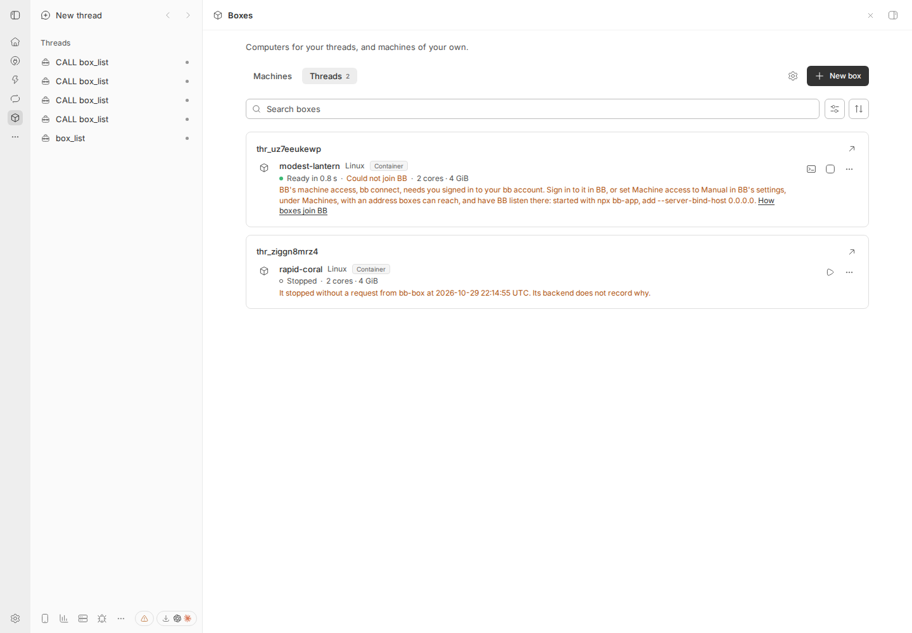

# 069 results

What was built and checked for each unit of
[069](069-boxes-page.md). Each unit keeps to its own section.

## Unit 1a: BoxMenu

Built on 29 October 2026. A box's menu is now one component, `BoxMenu`,
for a thread's box and for a machine of your own. Nothing a person sees or
does changes.

### What changed

- `BoxMenu`, in `src/app/box-menu.tsx`, holds the menu's button, its items,
  when each is offered, and the dialogs its items open: New thread on this
  box…, Resize… and the Release confirmation.
- It takes the box, whose it is, where its views open, and whether its
  Resize dialog is open. A thread's box brings its thread, whether it is
  the thread's own BB machine (held), whether New thread is offered, and the
  row's way to Start, Stop, Release and Check now. A machine of your own
  brings whether Open in browser is offered and the row's Start, Stop and
  Remove.
- The row keeps whether Resize is open, as its resize note hides while the
  dialog is open, as before.
- `BoxRow` (the Box panel and the Boxes page's Threads tab) and `MachineRow`
  (the Boxes page's Machines tab) render `BoxMenu` in place of their own
  menus. Their props are unchanged. `BoxAction` moved to `box-menu.tsx`.
- What differed between the two menus still differs, as `BoxMenu` says by
  whose box it is: a machine's menu offers Open desktop only (never a
  device's Simulator or Emulator), Open in browser only on the Boxes page,
  no Check now, and Remove…, which opens the Machines tab's own dialog with
  its in-use guard.

Files: new `src/app/box-menu.tsx`; changed `src/app/box-row.tsx` and
`src/app/settings-machines.tsx`, which also loses imports nothing used and
`isMoving`, which nothing called. Shared files touched: `src/app/desktop.tsx`
and `src/app/panel.tsx`, one import line each, for `BoxAction`. No server
change. No test changed: the app tests already pin each menu item by item,
in each place:

- the panel lists the thread's boxes as rows, opens a row's details, and
  opens a desktop (a desktop box's whole menu, and Open in browser);
- Resize is offered only where the box's backend changes a part (061);
- releasing a box asks first;
- the panel stops and starts a box that can, and not one that cannot (a
  real box's whole menu);
- a row starts a child thread on its box, and opens it; a box that is not a
  BB machine offers no thread;
- the Boxes page's Threads tab (a thread box's whole menu, with no New
  thread) and its Machines tab (Open in browser, Remove… and its dialog);
- the box this thread runs on, without Release or Stop (its whole menu);
- F-19: each screen in a tab of its own (Simulator before Desktop).

### Checked

On a fresh Linux box, 8 cores, on the commits delivered, rebased onto main
`66682093` (main's next commit, `e58e31a6`, changes only
`067-results.md`):

| Check | Result |
| --- | --- |
| `tsc` | passes |
| Node suite | 2,841 tests: 2,553 pass, 0 fail, 288 skipped (the live suites, skipped as on main), 4 min 4 s |
| vitest | 306 pass, in 4 files |
| `test/docs.test.ts`, `test/site.test.ts` and `scripts/reference.ts --check` | pass; the reference is unchanged |

On the live check's box, once that BB and its desktops ran there, one
server test, "High resolution doubles a Linux desktop's pixels with Xfce at
2x…", failed 3 times in 3 on main `c108795e` and on this branch alike; it
passed there before, and passes on the fresh box.

The live check below ran with the branch rebased onto `c108795e`; main's
next commit, `66682093`, changes none of this unit's files.

### Live check on a separate BB

A Linux box with Docker, 8 cores, 16 GiB, ran a fresh `npx bb-app` 0.48.0
with no account, its own data folder and ports, started with `env -i`,
`HOME` and `PATH` only. bb-box was installed with `bb plugin install` of a
path: first main `c108795e` ("before"), then this branch ("after"), over
the same data, so the same boxes. A Docker backend on the box's own Docker
ran bb-box's Linux and Linux desktop images, built with
`setup/docker/build.sh`. A project and a thread were made with `bb project
create` and `bb thread spawn`; the thread's agent has no login, so it
stopped at once, idle.

Boxes, made through bb-box's CLI as a thread or a person would:

- for the thread: ready-heron (Linux) and bright-sparrow (Linux desktop);
- machines of your own: workbench (Linux) and studio (Linux desktop);
- for each run, two more boxes for the thread and one more machine, to be
  released and removed through the menu.

None joined BB as a machine: a BB with no account cannot (bb connect needs
one), so each row says "Could not join BB".

[`live-check.mjs`](069-boxes-page/unit-1a/live-check.mjs) drives headless
Chromium at 1440 by 1000. In each place it opens each box's menu, records
its items, which are disabled and its separators, takes a screenshot, then
uses every item and checks what it did through the page, the clipboard,
new browser tabs, the RPCs the page sent, and bb-box's own state. Both runs
passed, every item doing the same:

| Place | Box | Item | What it did, before and after alike |
| --- | --- | --- | --- |
| Box panel | ready-heron | Copy address | the clipboard held its address |
| | | Check now | sent `refresh` with the thread and the box |
| | | Resize… | opened "Resize ready-heron", which asked `resize` with the thread |
| | | Stop, then Start | stopped, then ready, as bb-box's state said |
| | | Open terminal | a panel tab "Terminal: ready-heron", connected |
| | bright-sparrow | Open in browser | a new browser tab at `/plugins/bb-box/desktop/<thread>/<box>` |
| | | Open desktop | a panel tab "Desktop", streaming the box's desktop |
| | the first spare | Release… | asked "Release …? Its disk and everything on it will be deleted…", then released it |
| Boxes page, Threads | ready-heron | Copy address, Check now, Resize…, Stop, Start | as in the panel |
| | | Open terminal | the page went to `<thread>/<box>/terminal` |
| | bright-sparrow | Open in browser | a new browser tab at the same address as the panel's |
| | | Open desktop | the page went to `<thread>/<box>` |
| | the second spare | Release… | asked, then released it |
| Boxes page, Machines | workbench | Copy address | the clipboard held its address |
| | | Resize… | opened "Resize workbench", which asked `machines.resize`, with no thread |
| | | Stop, then Start | stopped, then ready |
| | | Open terminal | the page went to `operator/<box>/terminal` |
| | studio | Open in browser | a new browser tab at `/plugins/bb-box/desktop/operator/<box>` |
| | | Open desktop | the page went to `operator/<box>` |
| | the spare machine | Remove… | asked "Remove …? Its machine leaves BB…", then removed it |
| BB Box settings | | | no box menu on the page, before or after |

The 13 menus recorded, items in order, were the same in both runs, with
the same disabled items (none) and the same 2 separators each, once each
run's spare boxes' names were set aside:

| Place | Box and state | Items |
| --- | --- | --- |
| Box panel and Threads | ready-heron, ready | Open terminal, Copy address, Stop, Resize…, Check now, Release… |
| | ready-heron, stopped | Copy address, Start, Resize…, Check now, Release… |
| | bright-sparrow, ready | Open desktop, Open in browser, Open terminal, Copy address, Stop, Resize…, Check now, Release… |
| Machines | workbench, ready | Open terminal, Copy address, Stop, Resize…, Remove… |
| | workbench, stopped | Copy address, Start, Resize…, Remove… |
| | studio, ready | Open desktop, Open in browser, Open terminal, Copy address, Stop, Resize…, Remove… |

The runs' records:
[before](069-boxes-page/unit-1a/before-results.json),
[after](069-boxes-page/unit-1a/after-results.json).

### Screenshots, before and after

[`menus-at-sizes.mjs`](069-boxes-page/unit-1a/menus-at-sizes.mjs) opened
each of the four boxes' menus in each place at 1440, 760 and 390 px, dark
and light: 36 screenshots a run, with no spare boxes listed.
[`compare.mjs`](069-boxes-page/unit-1a/compare.mjs) compared them pixel by
pixel. 25 of 36 are identical. In the other 11, 2 to 23 pixels differ, each
by 1 to 3 levels of 255, all on the anti-aliased rounded corners of the
search field, the sidebar's highlight and the footer's pill: none in a
menu or a row.

In the live run's own screenshots, what differs is what should: the spare
boxes' names, and so where their rows sort; the desktop streams; and
settings' "checked 25 minutes ago".

| Place | Before | After |
| --- | --- | --- |
| Box panel, 1440, dark | [ready-heron](069-boxes-page/unit-1a/before-panel-ready-heron-1440-dark.png) | [ready-heron](069-boxes-page/unit-1a/after-panel-ready-heron-1440-dark.png) |
| Box panel, 760, light | [bright-sparrow](069-boxes-page/unit-1a/before-panel-bright-sparrow-760-light.png) | [bright-sparrow](069-boxes-page/unit-1a/after-panel-bright-sparrow-760-light.png) |
| Threads, 1440, light | [bright-sparrow](069-boxes-page/unit-1a/before-threads-bright-sparrow-1440-light.png) | [bright-sparrow](069-boxes-page/unit-1a/after-threads-bright-sparrow-1440-light.png) |
| Threads, 390, dark | [ready-heron](069-boxes-page/unit-1a/before-threads-ready-heron-390-dark.png) | [ready-heron](069-boxes-page/unit-1a/after-threads-ready-heron-390-dark.png) |
| Machines, 1440, dark | [workbench](069-boxes-page/unit-1a/before-machines-workbench-1440-dark.png) | [workbench](069-boxes-page/unit-1a/after-machines-workbench-1440-dark.png) |
| Machines, 390, light | [studio](069-boxes-page/unit-1a/before-machines-studio-390-light.png) | [studio](069-boxes-page/unit-1a/after-machines-studio-390-light.png) |
| Machines, stopped, from the live run | | [workbench](069-boxes-page/unit-1a/after-machines-workbench-stopped.png) |

### Keyboard

On the after install, on each tab of the Boxes page: Tab from the search
field reached the row's menu button (9 stops on Machines, 15 on Threads);
Enter opened the menu with focus on its first item; ArrowDown moved to the
next; End went to Remove… or Release…; Escape closed it with focus back on
the button.

### Not checked live, and why

- New thread on this box…: offered only for a box that joined BB, which a
  BB with no account cannot do. The item and its dialog moved unchanged;
  "a row starts a child thread on its box, and opens it" covers it.
- Open simulator and Open emulator: they need a device box, on a Mac or a
  Linux host with KVM. They are made by the same code as Open desktop
  (`screensOf`); F-19's test covers them.
- The thread's own BB machine in the panel (held), which needs a box that
  joined BB: its test covers its menu, item by item.

### Deviations from 069

- 069's row for unit 1a names the menu "in settings". Settings has had no
  box menu since 067 unit 1 moved your machines to the Boxes page's
  Machines tab; the live check found none on BB Box's settings page, before
  and after. `MachineRow` keeps its settings form (`from="settings"`:
  views with a way back to settings, no Open in browser), which nothing
  renders now; `BoxMenu` keeps it too.

### Follow-ups

- Unit 1c's page menu (069 section 2) lists Check now for every box and,
  for a machine, a device's views; today a machine's menu has neither.
  `BoxMenu` is where to change that, if unit 1c does.
- `MachineRow`'s settings form could go, or serve unit 1c's
  `from-settings` page.

## Unit 1b: the box log, its files and the reach check

Built on 29 October 2026, on main `9676abb5`.

### What it adds

- **Two files beside bb-box's `data.db`.** `box-log.db` and `box-history.db`
  are attached to the SDK's handle as `boxlog` and `boxhistory` at start,
  each in WAL mode with a 4 MB journal limit, and capped at 8 MB and 64 MB.
  Each keeps its migrations in its own `_migrations` table, by the SDK's
  rules: ordered statements, each with its hash, append-only, run in one
  transaction. Where the handle refuses `ATTACH`, the tables go in
  `data.db` under their own migration tables, its cap rises from 10 MB to
  48 MB, and the box log keeps at most 1,000 events. `box-history.db` has
  no tables yet: unit 3 adds them.
- **The box log**, `boxlog.box_events`: box, thread, name, time, kind, who
  (the person, an agent with its thread, a command, bb-box with why,
  outside bb-box, or unknown), and words of at most 1 KB. A failed stop,
  start, resize or release carries what bb-box then observed of the box,
  when, and from which backend; a resize carries the parts that changed,
  read back from the backend after a failure. "Release asked" is written
  before the backend is called and "released" only once it confirms; a
  release that fails keeps its record. Forget writes "forgotten" and
  deletes nothing. A box keeps its last 7 days and its latest event of each
  kind; a released or forgotten box, 24 hours.
- **When the log cannot be written**, the operation still runs, the box
  is marked with the time of the failed write (kept across restarts), and
  the view claims nothing older than it. The doctor reports the failed
  writes.
- **The reach check.** A box that does not answer a command (the Monitor's
  Live readings through its route included), a Live reading through BB's
  host entry, or a terminal, is checked again by itself after 1
  minute, after 5, then every 15 minutes: through BB's connection state for
  a BB machine, then one command through its route. It never calls a
  backend's API. A command to a box it knows does not answer reads no
  power. Check now (`refresh`) checks at once, and reads the box's power at
  most once a minute while it does not answer.
- **The box's view gains** `log` (its last start: asked, ready or failed,
  by whom, first or not; its last stop: when, by whom, asked or not; its
  last failed operation: which, when, the words, what was observed, the
  parts) and `reach` (answers, with when it last answered; not answering,
  with since, the error, the host, attempts and the next check; or its
  backend not in settings).
- **Who asks**, through every way in: the panel's RPC as the person, the
  tools as the agent with its thread, `bb box` as a command, and bb-box's
  own work with why (spares, an ended thread, a crashed VM started again).
  A claimed spare names whoever asked for the box.
  New commands: `bb box stop`, `bb box start` and `bb box forget`; a new
  RPC, `forget`.
- The doctor has a Box log section: where each file is, its events and
  room, its cap read back from the plugin's own connection, and failed
  writes. Two checks join the catalog: `box-log` and `box-history`.

### Checked

On a Linux box, on this commit rebased onto `d5a64b32`: `tsc` clean; the
node suite 2,861 tests, 2,573 passed, 288 skipped, 0 failed, the docs and
site tests among them; vitest 4 files, 321 tests passed;
`scripts/reference.ts --check` passes. Rebased onto `9676abb5`, whose
change beside this one is in `test/app.test.tsx` alone: `tsc` clean, vitest
323 tests passed, this unit's node tests with the docs and site tests 27
passed, and the reference check passes. The new tests
are in `test/box-log.test.ts` (the files and the store, with a set clock
for 24 hours and 7 days), `test/box-events.test.ts` (the registry's events
and the reach check's schedule), and two in `test/plugin.test.ts` (who,
through the panel, a tool and `bb box`; the reach check with the Monitor
off).

| Gate | Test |
| --- | --- |
| G4 | Both files made and migrated on a fresh start, nothing run again on a second, each `max_page_count` and journal as set; a changed statement refused; `box-history.db` filled past its cap leaves the Monitor's `pressure_logs` and the box log writable; with `ATTACH` refused, the tables in `data.db`, its cap 48 MB, kept by the Monitor's store, and 3,000 events of 1.1 KB words taking under 4 MB of it |
| G5 | 10,000 events of 1.1 KB words keep `box-log.db` within its 8 MB cap, each cut to 1 KB; with the file read-only, 4 failed writes, the doctor's fail, and no last stop or start in the view, also after a restart; a failed release keeps its record and logs no "released" until a later release confirms; a restart after the guest was deleted finishes the release by observing it, with no second release, and removes its BB machine; Forget refused while the backend is built, and once it is not, "forgotten", no "released", no stop |
| G6 | A stop that fails records "running, checked then"; the guest stopping later is "stopped" by the asker from the confirmed time, not a stop bb-box did not ask for, unless the backend says its VM crashed, which is started again; a start whose VM runs but never answers SSH records "running", and with its power unreadable "unknown"; a resize refused after its memory changed names memory and puts the size read back on the record |
| G7 | A box that does not answer, over a set hour: checks at 1, 6, 21, 36 and 51 minutes, at most 6 lines logged, no backend call; each next check shown is when it comes; Check now reads power at most once a minute; with the Monitor off, the same, through the plugin |

### Live check on a separate BB

A fresh `npx bb-app` 0.48.0 with no account, its own data folder and ports,
started with `env -i`, `HOME`, `PATH` and `BB_BOX_LIVE_CHECKS=1` only, in a
Linux box with Docker 29.1.3 (8 cores, 16 GiB). bb-box was installed from
this branch with `bb plugin install path:`, and Docker on the box set up
with `bb box setup docker`, its Linux image built in 4 minutes. A `docker`
shim first on BB's `PATH`, [`docker-shim.sh`](069-boxes-page/unit-1b/docker-shim.sh),
logs every call bb-box makes, and on a flag fails one stop or holds one
removal. The agent is a custom ACP agent registered in BB's
`provider-acp` settings, [`acp-agent.mjs`](069-boxes-page/unit-1b/acp-agent.mjs):
it calls BB's own box tools, through the MCP server BB gives it, as a
prompt names them. The person clicks in headless Chromium at 1440 by 1000.
The script is [`live-check.mjs`](069-boxes-page/unit-1b/live-check.mjs).

**Files.** On the first start BB's log said "Opened box-log.db, attached
to bb-box's database: ran 3 migrations." and "Opened box-history.db,
attached to bb-box's database: no migration to run."; both files were
beside `data.db`. `bb box doctor` read the caps back from the plugin's
connection: "24 KB used of its cap of 8.0 MB", and "box-history.db,
attached to bb-box's database, capped at 64.0 MB". After `bb plugin reload
bb-box`, both said "no migration to run". BB 0.48.0's handle took `ATTACH`,
so the fallback ran in tests only.

**Who stopped it.** One box, made by the agent's `box_acquire`; each row is
what the view (`allBoxes`) and `box-log.db` then said:

| Step | The view | Events logged |
| --- | --- | --- |
| The agent's `box_acquire` | last start by the agent in its thread, the first | made by the agent; ready |
| The person: Stop on the Boxes page | stopped, last stop by the person | stop asked, stopped, by the person |
| The person: Start on the Boxes page | last start by the person, ready 248 ms after it was asked | start asked, started, by the person |
| A command: `bb box stop`, then `bb box start --json` | last stop by a command; last start by a command, ready after 249 ms | stop asked, stopped, start asked, started, by the command |
| The agent: `box_stop`, then `box_start` | last stop and start by the agent in its thread | the same four, by the agent, with its thread |
| Outside bb-box: `docker stop` on the host, then `bb box sweep` | stopped, last stop by outside bb-box, not asked; the row's line "It stopped without a request from bb-box at 22:14:55 UTC." | stopped without being asked, outside |
| `bb plugin reload bb-box` | the same last start and stop | all 17 events kept |

**Outcomes and releases**, on a second fresh BB set up the same way in the
same box, with machines of its own made by `bb box machines add`. These
ran on the change before an independent code review of it; after the
review's fixes, bb-box was installed again on this BB from this branch
(`0acd5011`, the same change before its last rebases), and the stops above
(15 events, each with the same who), the stop that times out and the
interrupted release ran again, with the same results:

| Step | Result |
| --- | --- |
| A stop that times out, then succeeds: the shim failed `docker container stop` with "timed out waiting for the container to stop" and stopped it 8 s later | Logged "stop failed", observed running, checked then by Docker on the box. The container exited; `bb box sweep` then logged "stopped" by the command, at the time it confirmed it, and no "stopped without being asked"; the failure left the view |
| The box log made read-only: BB stopped, `chmod 444 box-log.db`, BB started | bb-box started; its prune and writes failed and said so. The person's Stop on the Boxes page stopped the box (the container exited). The view gave no last stop, although the log held an earlier stop by the person; the doctor failed: "bb-box could not write 2 events to its box log …". With the file writable again and BB restarted, writes worked and the view still claimed nothing from before the failed writes |
| BB killed between the container's removal and the record's: the shim held `docker container rm` for 40 s after removing it, and `kill -9` stopped BB's server then | The container gone, the record `releasing`, "release asked" with no "released". BB's own supervisor started the server again in 2 s, before its BB machine reconnected, so the first sweep could not reach Docker and logged "release did not finish: sunny-canyon is offline in BB", keeping the record. The next sweep, 3 minutes later, found the guest gone and logged "released" by the command that asked, "bb-box found its guest gone after a restart", with no second `docker rm` |
| Forget while the backend is in settings | Refused: "release the box instead" |
| Forget after Docker was removed from the configuration (with BB stopped, from the stored document, as the settings refuse to remove a backend with boxes) | The view said `not-in-settings`. `bb box forget` logged "forgotten" by the command, with the box's name, its backend and its last state, ready; no "released", no stop. The record went; the container still ran |

**A box that does not answer, for an hour.** The script,
[`reach-hour.mjs`](069-boxes-page/unit-1b/reach-hour.mjs), paused the box's
container with `docker pause` (Docker then reads its power as unknown, so
the box stays ready), ran one `bb box run`, and read the view every 20 s
for 62 minutes. The Monitor was on for the first half and off for the
second; box history does not exist until unit 3.

| Time (UTC) | What happened | Docker calls on the box |
| --- | --- | --- |
| 22:16:26 | Paused; `bb box run` failed: "Box modest-lantern is running but does not answer. The box … did not answer through docker exec." The view: not answering, next check 22:17:26.206 | the command's 2 `exec`, and 1 `container inspect`, the failed command's own power reading |
| 22:17:26.223 | Check 1 | 1 `exec` |
| 22:22:26.243 | Check 2, 5 minutes later | 1 `exec` |
| 22:37:26.262 | Check 3, 15 minutes later | 1 `exec` |
| 22:47:27 | The Monitor turned off | |
| 22:52:26.281 | Check 4 | 1 `exec` |
| 23:07:26.298 | Check 5 | 1 `exec` |
| 23:18:29 | Check now | 1 `container inspect`, 1 `exec`; still not answering |
| 23:18:29 | Check now again, at once | 1 `exec`, no power reading |
| 23:18:29 | Unpaused, then Check now | 1 `exec`: answers |

- In the hour, 6 lines for the box in BB's log: the first failure and
  checks 1 to 5, at 1, 6, 21, 36 and 51 minutes.
- Each check came within 20 ms of the next check the view gave before it
  (22:17:26.206, 22:22:26.223, 22:37:26.243, 22:52:26.262, 23:07:26.281).
- From 22:16:27 until Check now, bb-box made no Docker call about the box
  but one `exec` a check. Its backend's listing, one `container ls` every
  3 minutes for all its boxes, went on as before.
- The checks went on the same with the Monitor off.
- This run was on the change before the review's fixes; its words
  for a failed check, "It did not answer a command within 10 s.", are now
  "It did not answer a command.", as the check fails at once.

### Deviations from 069

- `bb box stop`, `bb box start` and `bb box forget`, and an RPC `forget`,
  are new: 069 names a stop by a `bb box` command and Forget, but no such
  command or call existed. Forget is refused while the box's backend is in
  the settings.
- A failed stop whose box is found stopped within 5 minutes of the
  failure, before any other stop or start, is logged as the asker's stop,
  not as one bb-box did not ask for, unless the backend says the VM
  crashed. Before, such a stop was recorded as unrequested (#406).
- A claimed spare logs "made" by whoever asked for the box, with the
  spare's name, so its last start names them, not bb-box's spares.
- The reach check keeps "last answered" in memory only, so after a restart
  of bb-box it is unknown until a command answers. For a BB machine it asks
  BB's connection state first, and when BB says it is connected, runs one
  command too, so a box that BB sees but bb-box cannot reach is still found.
- Check now's limit of one power reading a minute applies only while the
  box does not answer; otherwise Check now reads its power as before.
- The sweep still lists each backend's guests every 3 minutes, one call per
  backend, as before; the reach check adds no call per box.
- After a restart in the middle of a release, a sweep that cannot read the
  guest's power, as while its BB machine reconnects, tries the release and
  logs it as not finished; the next sweep finishes it.

### Open questions

- The Boxes list (`allBoxes`, `machines.list`) still leaves out a box whose
  release did not finish, as it leaves out every releasing box. Its record
  and its view are kept, with the failure in `log.lastFailed`; whether the
  list shows it, with Release again, belongs to unit 1c or 1d.

### Follow-ups

- Unit 1c: the words for `log` and `reach`; `boxPage` can take a released
  or forgotten box from `app.boxLog.ended(boxId)`; Forget… and Release
  again… call the `forget` and `release` RPCs.
- Unit 3: box history's tables, as migrations of `box-history.db`; its
  readings report a box that does not answer to `app.reach.failed`; a
  released or forgotten box's points go with its log, 24 hours after.
- A desktop viewer that cannot open its route does not yet report to the
  reach check; commands, terminals and the Monitor's readings do.

## Unit 1c: the box's page

Built on 30 October 2026, on main `e2d05767`. Every box, and every
machine of your own, has a page of its own on the Boxes page, without
Activity, which unit 2 adds. Rows still unfold: unit 1d makes a row's click
open the page.

### What it adds

- **Paths.** The Boxes page reads its path with `routeOf` in
  `src/app/box-route.ts`:

  | Path under `/plugins/bb-box/desktop/` | Shows |
  | --- | --- |
  | (none), `threads`, `machines` | The list, as before |
  | `box/<boxId>` | The box's page |
  | `box/<boxId>/desktop`, `/device`, `/terminal` | A view of the box |
  | The same, ending in `from-list`, `from-box` or `from-settings`, innermost first, at most two | Where it was opened from |
  | `<threadId>/<boxId>[/device\|/terminal][/from-settings]` | As before |

  A path that is none of these opens the list.
- **Where each entry was opened from.** BB's plugin SDK 0.6.15 gives
  `toPluginPanel(path, { subPath, replace })` and no state, as 069 said,
  so the origin is in the path (G8). The list's quick icons and menu items
  open views with `from-list`; the page's view buttons add `from-box`
  before the page's own origin; the Monitor's views and Page, the Box
  panel's item and a link carry none.
- **The way back.** `useBoxesNav` in `src/app/box-nav.tsx` keeps, in
  memory, the last move the panel made. When the way back leads to the
  entry that move came from, it goes back in history; otherwise it
  replaces the entry with the origin the path names. With no origin, a
  view goes back to the box's page and the page to the list.
  `from-settings` goes back to BB Box settings. A view's back arrow says
  where: "Back to boxes", "Back to happy-beacon" or "Back to BB Box
  settings". The box's name in a view's bar is a link to its page.
- **`boxPage`**, a new RPC: one box by ID, for any owner, with its view,
  its thread and whether it works (`holderOf`, new in `setup.ts`), the
  threads on its BB machine, its Monitor machine or why the Monitor cannot
  read it, a device that did not boot, and, for a box released or
  forgotten in the last 24 hours, `app.boxLog.ended`. The `changed`
  signal for its thread, or `operator`, refreshes it.
- **The page**, `src/app/box-page.tsx`, with its words in
  `src/app/box-words.ts`, in 069's order: the trail; the header, with the
  name focused on opening, the state in words, the ID and Copy link, which
  copy with a click, and the thread with whether it works now, or "One of
  your machines…"; the views as links, so Ctrl-click or Command-click opens
  a new tab; Start or Stop; the menu; the notices; Starting while it starts;
  the eight facts; the other threads on it; and how it started, with the
  last start from the box log. Nothing slides or fades.
- **Every state and notice of section 7 but busy**: ready, starting the
  first time and again, stopping, stopped with when and by whom, stopped
  without being asked, a stop, start or resize that failed with what
  bb-box then observed, a release that did not finish, a backend not in
  settings, a box that does not answer with when bb-box checks again, a
  device that did not boot, a failed join, failed, releasing, gone,
  released, forgotten, and a link to a box that is not here. Words leave
  out a time or an actor the box log does not have.
- **The menu on the page** (`BoxMenu`'s `place="page"`): Copy address, New
  thread on this box…, Resize…, Check now, then Release…, Release again…,
  Remove… or Forget…. A machine of yours gets Check now there.
- **A box whose release did not finish** is listed again, by `allBoxes`
  and `machines.list`, with "Release did not finish" on its row and
  Release again… in its menu, never a spinner. A box being released is
  listed too, dimmed, until its release ends.
- **G20, as the lead decided after the review.** With its backend not in
  settings, or not answering (its listing of boxes fails in the sweep),
  Stop, Start, Resize… and New thread on this box are disabled, with the
  reason in words beside them on the page and in the menus, and a row has
  no quick Stop or Start. A box that does not answer itself keeps Stop,
  Start and Resize, which go through its backend: only its views and New
  thread on this box are disabled, and its notice says it can still be
  stopped, started or released. Its mark clears as soon as its record
  moves out of ready, or it answers.
- **G3.** The panel's `stop` and `release` RPCs ask first when the box's
  own thread is working, as well as when a thread works on its BB machine,
  its own thread first, and when BB cannot say whether the thread works
  ("bb-box could not ask BB whether … is working on calm-otter"). A resize
  that needs a restart asks under the same guard. The question names the
  threads: "Fix the sign-in flow is working on calm-otter." The agent's
  tools and `bb box` are unchanged. A machine of your own keeps today's
  guard.
- **Entries.** "Page" is the first item of the Monitor's Open menu, which
  now shows for a box with no view too; "N more on the Boxes page" opens
  the box's page; the Box panel's menu has "Open on the Boxes page".
- `MachineRow`'s settings mode is gone (the lead's answer: settings names
  no machine since 067, and gets no new entry).
- The guide's Box panel and Boxes page chapter has a section on the page.
  `docs/bb-requests.md` has request 37 (below).

Files: new `src/app/box-route.ts`, `box-nav.tsx`, `box-words.ts` and
`box-page.tsx`; changed `box-menu.tsx`, `box-actions.tsx`, `box-row.tsx`,
`settings-machines.tsx`, `desktop.tsx`, `terminal.tsx`, `panel.tsx`,
`status.ts`, `monitor/box-screens.tsx`, `monitor/status.tsx`, and
`src/plugin/contract.ts`, `rpc.ts`, `setup.ts` and `monitor.ts`.

### Checked

On a Linux box, 8 cores, on the commit delivered: `tsc` clean; the node
suite 2,874 tests, 2,586 passed, 288 skipped, 0 failed, the docs and site
tests among them; vitest 332 tests passed in 4 files;
`scripts/reference.ts --check` passes. New tests:

- `test/box-route.test.ts`: every path of section 1 and the old ones read
  and written back, a wrong path opens the list, the way back for each
  origin, and the words of section 7 and 11 with a set clock.
- `test/plugin.test.ts`: G3 through the panel's RPCs, with the box's own
  thread working, then also a thread on its BB machine, then forced, then
  idle; `boxPage` for a box, a box whose release failed (listed by
  `allBoxes`), a released box, an unknown ID and a machine.
- `test/app.test.tsx`: the page's header, links, menu, facts, threads and
  how it started; the way back going back in history only after the
  panel's own move; G3 from the page; G20 on the page and a row's menu,
  with Forget…; a release that did not finish on the page and its row; a
  link to a box that is not here; a machine's page; the Starting card; a
  device that did not boot, a failed join, a gone box and a failed one.
  `test/monitor-app.test.tsx`: Page first, the views' new paths, and "N
  more" opening the box's page.

### Live check on a separate BB

A Linux box with Docker 29.1.3, 8 cores, 16 GiB, ran a fresh `npx bb-app`
0.48.0 with no account, its own data folder and ports, started with
`env -i`, `HOME` and `PATH` only, set up by
[`live-setup.sh`](069-boxes-page/unit-1c/live-setup.sh). bb-box was
installed from this branch with `bb plugin install path:`, and Docker on
the box set up with `bb box setup docker`. So that boxes join BB without an
account, BB listened on all addresses, closed to the network outside the
box by its firewall, with Machine access set to Manual at the box's own
address: every box joined BB. A shim first on BB's `PATH`,
[`docker-shim.sh`](069-boxes-page/unit-1c/docker-shim.sh), logs every
Docker call; on a flag it fails one start, one stop or one removal, makes
`docker exec` into one container hang, as a hung box does, or makes
`docker container ls` fail, as a Docker daemon that does not answer does.
The agent is unit 1b's custom ACP agent, which calls BB's box tools as a
prompt names them, driven by
[`agent-call.sh`](069-boxes-page/unit-1c/agent-call.sh). The boxes, made
through bb-box:

- for the thread, by the agent's `box_acquire`: clear-finch (the page's
  box), polite-dune (the one that hangs), and in each run two more, one
  released from its page and one whose start fails and which is then
  forgotten;
- a machine of your own, by `bb box machines add`: workbench.

[`live-check.mjs`](069-boxes-page/unit-1c/live-check.mjs), with
[`live-lib.mjs`](069-boxes-page/unit-1c/live-lib.mjs) and
[`runs.sh`](069-boxes-page/unit-1c/runs.sh), drives headless Chromium at
1440 by 1000 and checks each result through the page and bb-box's own
state. Three runs in a row on the commit delivered each passed 33 of 33
checks: [run 1](069-boxes-page/unit-1c/run-1.md),
[run 2](069-boxes-page/unit-1c/run-2.md),
[run 3](069-boxes-page/unit-1c/run-3.md). (The first delivery's three runs
passed its 31 checks each, on a first fresh BB.)

| Check | Result, each run |
| --- | --- |
| A link | the page, with focus on its name |
| The Box panel's Open on the Boxes page | the page; its menu: Open terminal, Open on the Boxes page, Copy address, New thread on this box…, Stop, Resize…, Check now, Release… |
| The Monitor's Open menu | Page, Open terminal, then the thread; Page opens the page |
| The box's name in a view's bar | the page, keeping the view's origin: `box/<id>/from-list` |
| An old path, `<thread>/<box>/terminal` | its back arrow, "Back to clear-finch", replaces it with the page |
| An old path with `from-settings` | its back arrow is a link to BB Box settings |
| Reload | the page again, its name focused |
| Page, Terminal, browser Back, Forward, then the view's back arrow | Back, Forward and the arrow agree, and nothing is pushed twice: the history's length stays |
| A reload on the view, then its back arrow | replaced with the page; Back then goes to the entry before the view |
| Ctrl-click on Terminal | a new tab at `box/<id>/terminal/from-box`, whose back arrow replaces it with the page |
| Keyboard only | Tab from the name: Box ID, Copy link, the thread, Terminal, Stop, the menu, then the facts; Shift-Tab reaches the trail; Enter on Terminal opens it; in the terminal, 12 presses of Shift-Tab stay in the shell (an open question below); the browser's Back returns to the page with focus on its name |
| Working now | with the page open on clear-finch, "idle" turned to "working now" within 15 s of the agent starting a `box_run` there, with no reload |
| Stop, Start and Release from the page | stopped "just now, today at 2:21 AM, by you", started, "Last started … by you: ready in 0.3 s"; released, "Released just now, … by you", also after a reload and after `bb plugin reload bb-box` |
| A failed stop, then the box stopped outside bb-box | "Stop failed just now"; after `docker stop` and `bb box sweep`, "Stopped" and no failure beside it |
| A start that fails | "Start failed just now", Docker's words, "It is still stopped (checked 2:22 AM)."; Start again starts it |
| A failure, said | the page's one announcer said "Stop failed. …" once, and nothing on opening; no notice has a live part |
| A release that does not finish | "Release did not finish", Docker's words, on the page and the row, with Release again…, which then released it |
| A backend removed from settings, with bb-box off, from its stored configuration | "Not checked · last seen ready", the notice with Open BB Box settings and Forget…; Forget…: "… was forgotten: bb-box removed its record. Its box was not deleted and may still run on crisp-petrel", its container still running; the same after a reload and after `bb plugin reload bb-box`; the container then removed and the configuration put back |

| Gate | Result | What each run did |
| --- | --- | --- |
| G3 | 3 of 3 | With the agent in `box_run` on clear-finch, Stop from its row, its row's menu, its page and a failed stop's Stop again each asked "Stop clear-finch anyway?", "CALL box_list is working on clear-finch.", with the thread's chip; Cancel left it ready; Stop anyway stopped it. With the thread idle, Stop stopped it at once. workbench, with no thread on it, stopped at once |
| G6, words | 3 of 3 | A stop Docker refused: "Stop failed just now", Docker's words, "It is still running (checked 2:21 AM)."; a start Docker refused: "It is still stopped (checked …)."; "still stopped" only with an observation |
| G8 | 3 of 3 | A row's quick Terminal and back: the list, by going back in history; after visiting another box's page, a quick icon and back: the list; settings, workbench's page with `from-settings`, Terminal and back: the page, then settings, also after a reload on the view; a page opened by URL, then Boxes, then browser Back: not the page; a row's quick Terminal, a reload, then back: the list |
| G20, as the lead decided | 3 of 3 | polite-dune, whose `docker exec` hangs: "Not answering", its notice saying it can still be stopped, started or released, Stop enabled on its page and row, "Terminal is off: polite-dune does not answer." beside the actions, New thread on this box… disabled with that reason; Stop from its page stopped it, and its mark cleared. With `docker container ls` failing and a sweep: "Not checked", "Docker on crisp-petrel does not answer", Stop disabled, "Terminal and Stop are off: Docker on crisp-petrel does not answer.", New thread on this box… and Resize… disabled with it in the page's menu, Stop and Resize… in the row's, no quick Stop; all back after the next sweep listed again. A box whose backend was removed: the same with "its backend is not in settings", Runs on saying "Backend not in settings", and Forget… last |

### Screenshots

At 1440, 760 and 390 px, light and dark, from the live BB: the
[ready page](069-boxes-page/unit-1c/ready-1440-light.png)
([dark](069-boxes-page/unit-1c/ready-1440-dark.png),
[760](069-boxes-page/unit-1c/ready-760-light.png),
[760 dark](069-boxes-page/unit-1c/ready-760-dark.png),
[390](069-boxes-page/unit-1c/ready-390-light.png),
[390 dark](069-boxes-page/unit-1c/ready-390-dark.png)),
[stopped](069-boxes-page/unit-1c/stopped-1440-light.png)
([390 dark](069-boxes-page/unit-1c/stopped-390-dark.png)), [a stop that
failed](069-boxes-page/unit-1c/stop-failed-1440-dark.png), [the G3
question](069-boxes-page/unit-1c/in-use-1440-light.png), [a start that
failed](069-boxes-page/unit-1c/start-failed-760-light.png), [a release that
did not finish](069-boxes-page/unit-1c/release-unfinished-760-dark.png),
[released](069-boxes-page/unit-1c/released-1440-light.png) ([390
dark](069-boxes-page/unit-1c/released-390-dark.png)), [a box that
does not answer](069-boxes-page/unit-1c/not-answering-1440-light.png) ([390
dark](069-boxes-page/unit-1c/not-answering-390-dark.png)), [a backend that
does not answer](069-boxes-page/unit-1c/backend-silent-1440-dark.png) ([390
dark](069-boxes-page/unit-1c/backend-silent-390-dark.png)), [a backend
not in settings](069-boxes-page/unit-1c/not-in-settings-1440-light.png)
([390 dark](069-boxes-page/unit-1c/not-in-settings-390-dark.png)),
[forgotten](069-boxes-page/unit-1c/forgotten-760-light.png), [a machine
from settings](069-boxes-page/unit-1c/machine-1440-dark.png), and [a view's
bar](069-boxes-page/unit-1c/view-bar-1440-light.png) ([390
dark](069-boxes-page/unit-1c/view-bar-390-dark.png)). A fourth run on
this delivery took them, with its screenshots on (its two G3 checks failed
there, as resizing the window for a screenshot closes the open dialog);
[`shots-stopped.mjs`](069-boxes-page/unit-1c/shots-stopped.mjs) took the
stopped page's.

### Not checked live, and why

- A device box's page and views, and a device that did not boot: they need
  a Mac or a Linux host with KVM. The page's tests cover them, and its
  Simulator link.
- The Starting card: a Docker box starts in under a second. Its test
  covers the first start and a start again.
- A failed join, and a gone box: here every box joined, and none was
  deleted outside bb-box. Their tests cover them.
- Focus back on the row after a view's way back, which is unit 1d's G9:
  here it goes back to the list, where 1d keeps the row.

### Deviations from 069

- No settings entry: settings names no machine since 067, and the lead
  chose to add none. `from-settings` works on every path, new and old,
  and G8's settings case ran from such a link opened from the settings
  page. `MachineRow`'s settings mode went.
- The way back to settings is a link, so it pushes BB Box settings rather
  than replacing the entry: BB offers no replace for its own app paths.
- "Its host does not answer" names the box, as "calm-cedar does not
  answer", with its host in the words, as the reach check tests the box
  itself and cannot tell a host that does not answer from a box that does
  not. A backend that does not answer is told by its listing failing in
  the sweep, every 3 minutes, so it can take up to 3 minutes to show, and
  to clear.
- Every box being released is listed, dimmed, not only one whose release
  failed.
- A view by box ID waits for `boxPage` to learn the box's thread.
- The Terminal button shows, disabled, whenever a box is not ready, as a
  stopped box's view does not say whether it has a terminal.
- A shared slot's Size is "A share of mac-1", without the Mac's cores and
  memory, which the box's view does not have. The Address's tailnet name
  waits for unit 2's readings.
- Open in browser still opens the old path, which keeps working.
- The page's links stop a click with Ctrl, Command, Shift or Alt held, or
  another button, going further: BB 0.48.0 routes every link to an app
  path in its panel in the same tab, so the browser could not open the
  new tab (request 37 in `docs/bb-requests.md`).

### Open questions

- From a terminal view, Tab and Shift-Tab go to the shell, as xterm keeps
  them, so the back arrow cannot be reached from the keyboard there; the
  browser's Back works. This predates the page (035). Should a terminal
  give a key to leave it, for keyboard-only use?

### Follow-ups

- Unit 1d: a row's click, name and chevron open the page, with
  `from-list`, and focus returns to the row.
- Unit 2: Activity can read `boxPage`'s `monitor`; an offline BB machine
  gets the words "is not a BB machine" there now.
- A view whose box's backend is not in settings, or which does not answer,
  still tries to connect; it could say why first, as the page does.
- A forgotten box whose guest still runs comes back when its backend is put
  back in settings: the sweep restores its record from the guest (019),
  and lists it again. Forget is meant for a backend gone for good; 069 and
  the guide could say so.
- A resize that needs a restart is not checked live here: Docker resizes
  cores and memory live. Its test covers the guard.

### After the independent review

The review of the first delivery (PR 1291) said to merge after fixes. Each
fix has a test; the lead decided points 1 to 3.

| # | Finding | Fix | Test |
| --- | --- | --- | --- |
| 1 | G20 turned off Stop, Start and Resize for a box that does not answer, though they go through its backend | Only a backend not in settings or not answering turns them off. bb-box now records a backend whose listing fails in the sweep (`Boxes.backendSilence`), and the box's view says `backend-silent`. A box that does not answer keeps them, and its mark clears when its record moves out of ready (`ReachCheck.settled`). Its notice: "bb-box cannot reach it …, so it cannot read it or run commands in it. You can still stop, start or release it: those go through Docker on devpc." Section 7 and G20 of 069 say so, as the lead's decision | `plugin.test.ts`: a box that does not answer stops through its backend and its mark clears; a backend whose listing fails, then lists again. `box-route.test.ts` and `app.test.tsx`: the words, the menus and the page |
| 2 | The G3 guard let Stop and Release through when BB's thread lookup failed | `holderOf` throws on any error but a missing thread; the guard then asks, saying bb-box could not ask BB. `boxPage` still shows no thread then | `plugin.test.ts`: with BB's lookup failing, Stop and Release ask; with the thread gone, Stop goes on. `app.test.tsx`: the question's words |
| 3 | A resize with a restart did not ask while the box's own thread worked | Its `beforeRestart` uses the same guard as Stop and Release | `plugin.test.ts`: it asks, then restarts when forced. The resize dialog's words name the thread |
| 4 | "Starting again" showed the last start's steps, and Total, as done | A start clears the last start's `start.*` timings when it is asked; the card shows only what it waits on; `startSteps` leaves out Total | `plugin.test.ts`: no step of the last start while one is under way. `app.test.tsx`: the card |
| 5 | Notices were live regions whose words changed with the clock | Notices are sections with a heading. One polite announcer, always in the page, says a notice once when it appears or changes in substance, never on opening and never as the time moves; the countdown is plain text apart from the words | `app.test.tsx`: no live part in a notice; a new failure said once; 61 s later the announcer says nothing new |
| 6 | A failed stop or start stayed beside a state that contradicted it | A failure shows only while the box is still as bb-box observed it then, and until a later stop or start | `box-route.test.ts`; live: a failed stop, then `docker stop` outside bb-box, and the notice goes |
| 7 | A release whose failure the log lost showed "Releasing…" for ever | A releasing box with an error is a release that did not finish: its words, and Release again… | `box-route.test.ts`, `app.test.tsx` |
| 8 | Disabled reasons were only a hover title | The reasons are words beside the actions ("Terminal and Stop are off: its backend is not in settings."), linked to the buttons with `aria-describedby`; a notice's disabled button has its reason beside it | `app.test.tsx`; live |
| 9 | Working now and the threads went out of date | An open page asks `boxPage` again every 15 s while it is shown | `app.test.tsx`; live: "working now" appeared within 15 s of the agent starting, with no reload |
| 10 | The working spinner ignored reduced motion | `WorkingMark` stops under reduced motion | `app.test.tsx` |
| 11 | A view opened by box ID had no way back while loading or on error | It shows the trail and its way back meanwhile | `app.test.tsx` |

Rebased onto main `50b110a7`. On a Linux box, on the commits delivered:
`tsc` clean; the node suite 2,882 tests, 2,594 passed, 288 skipped, 0
failed, the docs and site tests among them; vitest 338 tests passed in 4
files; `scripts/reference.ts --check` passes. The live check below ran on
the same code before that rebase, whose only change beside it is in the
boat backend.

The live check ran again on a second fresh BB 0.48.0 set up the same way,
now by [`live-setup.sh`](069-boxes-page/unit-1c/live-setup.sh) with
[`agent-call.sh`](069-boxes-page/unit-1c/agent-call.sh). The shim gained
two flags: one makes `docker exec` into one container hang, as a hung box
does, and one makes `docker container ls` fail, as a Docker daemon that
does not answer does. A paused container cannot be stopped by Docker at
all, so the hung box is made this way.

## Unit 1d: the list opens the page

Built on 30 October 2026, on main `635707e5`. On the Boxes page, a row
opens the box's page. Its details no longer unfold there. The list keeps
its place for the way back.

### What it adds

- **A row opens the box's page.** On both tabs, a click anywhere on a row
  that is not one of its controls, its name and the chevron at its end
  each open `box/<boxId>/from-list`. The name is a link: Tab reaches it,
  Enter opens the page, and Ctrl-click, Command-click or a middle click is
  left to the browser. The chevron comes last, after the menu, and is the
  same link, out of the tab order and hidden from screen readers. A row
  whose text is being selected does not open the page, and a click inside
  a row's menu or dialog, which React passes up to the row, is not a click
  on the row.
- **The inline details are gone from the Boxes page.** The box's page has
  them and more.
- **Hover** shades the row lightly, edge to edge in its card, and
  brightens the chevron; nothing moves. The row stays shaded while its
  menu is open.
- **The list keeps its place.** `src/app/list-place.ts` keeps the search,
  filters, sort, scroll and the row last left in module memory, as 067
  keeps drafts, and in session storage, so a reload keeps them too. The
  tab is kept in local storage, as before. What it reads back from storage
  is checked, and anything that is not a place is dropped.
- **Every way out of a row records it first**: its click, name and
  chevron, its quick icons, its menu's views, and on the Machines tab its
  thread chips. Each records the box, its position in the list and the
  list's scroll.
- **The way back.** When the list opens again on the tab it was left
  from, it puts back the scroll and focuses that row's name. If the box
  has gone, it focuses the row now in its place. The list first shows the
  rows it remembers, then asks for fresh ones; if a fresh list drops the
  row that had focus, as after a release from the page, focus moves to
  the row now in its place. With a search set, the list waits for the
  threads' titles before it puts its place back, as a search can match a
  title; titles are now remembered across visits.
- **The search row and tabs stay above the scrolling rows**, as before,
  at 1440, 760 and 390 px.
- The guide's Box panel and Boxes page chapter says how a row opens the
  page, and what the list keeps.

Files: new `src/app/list-place.ts`; changed `src/app/box-row.tsx`,
`settings-machines.tsx`, `desktop.tsx`, `box-nav.tsx`, `thread-chips.tsx`
and `panel.tsx`, `docs/guide/boxes.md`, and `test/app.test.tsx`. No server
change.

### Scope

The thread's Box panel keeps unfolding a row's details in place, and
"Open on the Boxes page" stays in its menu (the lead's answer on 30
October 2026). Only the Boxes page's rows open the page. `BoxRow` takes
either way of opening.

### Checked

On a Linux box, 8 cores, from a clone of the delivered bundle: `tsc`
clean; the node suite 2,882 tests, 2,594 passed, 288
skipped, 0 failed, the docs and site tests among them; vitest 351
tests passed in 4 files; `scripts/reference.ts --check` passes. New tests
in `test/app.test.tsx`:

- a row's click, name and chevron open the page with `from-list`; a
  modified click is left to the browser; Stop and the menu's Check now do
  not open it; no row unfolds on the Boxes page; the chevron is last, out
  of the tab order and hidden from screen readers;
- with a search, a filter and a sort set, opening a box by its name, its
  chevron, a quick icon and its menu, then coming back: all three kept,
  the same rows in the same order, and focus on that row's name, each way;
- a box released while away: focus on the row now in its place, also when
  the list first shows the remembered rows and the fresh list drops it;
- a machine's row opens its page, and a thread chip records the row;
- the place survives a reload through session storage, its scroll only for
  the tab it was on, and junk in storage is dropped.

The tests that read the Boxes page's rows by their old details buttons now
read the name links. The Box panel's tests are unchanged.

The live check below ran on the same code before the rebases onto
`1e8de9d9` and `635707e5`, which change the docs site, guides, demo and
the Monitor's machine threads, none of this unit's files.

### Live check on a separate BB

A Linux box with Docker, 8 cores, 28 GiB, ran a fresh `npx bb-app` 0.48.0
with no account, its own data folder and ports, started with `env -i`,
`HOME` and `PATH` only, set up by
[`live-setup.sh`](069-boxes-page/unit-1d/live-setup.sh), as unit 1c's
was. bb-box was installed from this branch with `bb plugin install path:`.
Unit 1b's custom ACP agent, driven by unit 1c's `agent-call.sh`, made the
boxes through BB's box tools: three threads with three Docker boxes each,
and `bb box machines add` made workbench. (The box first had 16 GiB, which
held 7 of these boxes; it was grown to 28 GiB and the last two made by
hand with the same commands.)

[`live-check.mjs`](069-boxes-page/unit-1d/live-check.mjs), with unit 1c's
`live-lib.mjs` and [`runs.sh`](069-boxes-page/unit-1d/runs.sh), drives
headless Chromium. Each run stops one box if none is stopped, then on the
Threads tab sets the search to "docker", ticks Ready under Filters, sorts
by Created, descending, and scrolls the list half way (108 of 216 px at
1440 by 640). It then opens a box each way and returns each way, and after
each return checks, through the page itself: the list's path, the search
text, the filter, the sort, the tab, the same rows in the same order, the
scroll within 2 px, the search row in the same place and outside the
scrolling rows, and focus on that row's name link. The box it opens
rotates among the rows fully in view. Three runs in a row on the commit
delivered each passed 18 of 18 checks:
[run 1](069-boxes-page/unit-1d/run-1.md),
[run 2](069-boxes-page/unit-1d/run-2.md),
[run 3](069-boxes-page/unit-1d/run-3.md).

| Gate | Result | What each run did |
| --- | --- | --- |
| G9 | 3 of 3 | At 1440 by 640: a box opened by its name, its chevron, a quick icon (Open terminal) and its menu (Open terminal), and each returned by the trail, the browser's Back and a view's back, 12 ways: all four kept and focus on that row's name, every time. From the page, "the trail" is its Boxes link and "a view's back" is Terminal, its back arrow to the page, then the trail; from a view, "the trail" is the box's name in the view's bar, then the page's Boxes link |
| G9, release | 3 of 3 | A box released from its page, then the page's Boxes link: the box gone from the list, focus on the row now in its place, search, filter and sort kept. Each run then made a new box for the thread, so every run starts alike |
| G9, 390 px | 3 of 3 | At 390 by 700, scrolled half way: name and the trail, chevron and Back, quick icon and the view's back, menu and Back: all four kept, focus on the name |

A Back pressed in the same instant as a click on a quick icon, before the
list has gone from the page, leaves focus on the button clicked, as the
list never left. The check waits for the view to show before going back,
as a person does.

### Keyboard

Each run, at 1440 px, from the search field: Tab reaches Clear search,
Filters, Sort, the first thread's title, Open thread, then the first row's
name; Enter opens its page with focus on the box's name; Shift-Tab reaches
the trail's Boxes link; Enter returns to the list with focus on that name;
Tab then reaches the row's Open terminal; Enter opens the terminal; the
browser's Back returns to the list with focus on the name again. The
chevron is never reached by Tab.

### Screenshots

From the live BB, the list kept and scrolled after a return, at 1440 by
640: [light](069-boxes-page/unit-1d/list-1440-light.png),
[dark](069-boxes-page/unit-1d/list-1440-dark.png); 760:
[light](069-boxes-page/unit-1d/list-760-light.png),
[dark](069-boxes-page/unit-1d/list-760-dark.png); 390:
[light](069-boxes-page/unit-1d/list-390-light.png),
[dark](069-boxes-page/unit-1d/list-390-dark.png). Returned by the
keyboard, with focus on the row's name:
[light](069-boxes-page/unit-1d/returned-1440-light.png),
[dark](069-boxes-page/unit-1d/returned-1440-dark.png); hover:
[light](069-boxes-page/unit-1d/hover-1440-light.png),
[dark](069-boxes-page/unit-1d/hover-1440-dark.png); the page opened from
the list: [light](069-boxes-page/unit-1d/page-from-list-1440-light.png).

### Not checked live, and why

- The Machines tab's ways back: the live BB had one machine, so its list
  cannot scroll. Its row's click, name, chevron and thread chips are
  covered by tests, and the same code keeps the place for both tabs.
- A device box's row: it needs a Mac or a Linux host with KVM. Its quick
  icon and menu open views through the same recorded ways as a terminal's.
- A look in production in the owner's browser waits for the lead's deploy.

### Deviations from 069

- The search, filters and sort are shared by the two tabs, as before;
  the scroll is kept for the tab it was on. The tab itself stays in local
  storage, as before, so it lasts beyond the browser tab's session.
- The chevron is a second link to the page, so it is out of the tab order
  and hidden from screen readers; the name is the one link they reach.
- The name link's accessible name is the box's name alone, as the old
  details button's was; the system and badges are read in the page's
  text.
- The lines between rows now run the card's full width, as in the
  prototype, since the hover shade runs edge to edge.
- Focus returns once: the first time the list opens again on the tab a
  row was left from, by any way, BB's sidebar included. After that,
  opening the list moves no focus.

### Open questions

- A thread with no title of its own heads its card with its ID, as BB's
  thread title is empty until it has one; BB's sidebar shows the first
  prompt instead. This predates 1d. Should the card fall back to the same
  words as the sidebar?

### Follow-ups

- Unit 4 can sort by Last active through the same kept sort: a stored
  sort whose key a later build drops falls back to Name.
- The terminal keeps Tab, so its back arrow cannot be reached from the
  keyboard (unit 1c's open question); the browser's Back works and now
  lands on the row's name.

## Unit 2: Activity on the box's page

Built on 30 October 2026, on main `7647080c`. A box's page now shows how
the box is doing now: Activity, read through the Monitor, and its top
processes. The lead chose Live only until unit 3 brings box history (see
[Decided during unit 2](069-boxes-page.md#decided-during-unit-2)).

### What it adds

- **Activity** (`src/app/activity.tsx`, words in `activity-words.ts`). It
  reads `boxPage`'s `monitor`, which now says what it is (`read`, `off`,
  `not-running` or `unreadable`), and reads the box through the Monitor's
  own `useMonitorSnapshot`, so the page and the Monitor share one reading.
  The card's heading has "Read at 5:18:24 AM".
  - Four tiles: CPU with the load, or the pressure in a container; memory
    with Normal, High or Critical; free disk with its size; network down
    and up. A fifth for a GPU where the reading has one.
  - The chart (`src/app/history-chart.tsx`): CPU and memory as % used over
    the last 72 readings, placed by time, a gap where a reading failed or
    came late, ticks every 2 minutes, legend chips that hide a line, and
    the Monitor's colours in a darker tone on the light theme (CPU
    `#15803d`, memory `#a16207`, download `#1d4ed8`, upload `#6d28d9`,
    the Mac `#525252`). Memory and upload are dashed, the Mac
    long-dashed. Network below, on its own scale, with the same width.
  - Reading a point: hover, or with focus Left and Right, Page Up and
    Page Down by 10, Home and End, Escape to clear; none scrolls the
    page. A polite live region, always in the page, says each point.
  - Each chart is described by its numbers: "Over the last 6 min, every 5
    s: CPU averaged 31%, highest 78% at 4:10:05 PM; memory last 58%",
    and the network's averages and highest points, with the gaps (G17).
  - The charts hold the reading they had while focus is on them, and say
    "Held at 5:18:24 AM while you read it".
  - Not read: the Monitor off, with "Turn it on in Monitor settings"
    (linking to `#option/monitor`); a stopped box, "amber-coral is
    stopped, so bb-box is not reading it. It stopped 3 min ago, today at
    5:18 AM."; a box it cannot read, with the Monitor's words. A reading
    that fails after one worked keeps the numbers under "Can't reach
    amber-coral. Showing data from 5:18 AM."
  - G16: a stopping box stays readable (`readableState` in
    `src/plugin/monitor.ts`), so Live goes on until the stop is confirmed.
- **Top processes**: name, PID, CPU and memory; 100% or more in amber;
  the PID column goes below 640 px; long names cut in the middle; the
  note that CPU is per core and that bb-box reads names and PIDs only.
- **A shared slot** (G1, G2). Its reading adds `own` (its user's CPU in
  cores and memory) to the snapshot and to each history point, and
  `slot.share`: the Mac's cores and memory divided by the slots it can
  hold (the placement's `most`). Its health is judged on its own numbers
  against its share, never the Mac's; without its own reading, its CPU
  and memory are not read and only the shared disk can warn. The page shows "This slot's CPU",
  "This slot's memory", "mac-1, all slots" (busy at 85% CPU or a load of
  its cores), "mac-1's encoder" and "mac-1's disk", the line that says
  how it is judged, the slot's chart with the Mac's CPU as a third line,
  hidden at first, and "This slot's processes".
- **How a slot is read** (`src/monitor/own-usage.ts`). On a Mac, a few
  lines of Python run by `/usr/bin/python3` read, for each of the slot
  user's processes, `proc_pid_rusage`'s own CPU time, children's CPU time,
  memory footprint and start, into the whole 160-byte `rusage_info_v2`
  with a canary after it, and `proc_pidinfo`'s parent. It runs only where
  `xcode-select -p` finds Xcode or the command line tools, as without them
  `/usr/bin/python3` asks on the Mac's screen to install them; otherwise,
  and where Python fails, `ps` is read, without exited children. The host
  entry and the command route both use it. Between two readings, CPU is
  each process's growth, a process known by its PID and start; a process
  that ended is owed by its nearest running ancestor and settled against
  that ancestor's children's growth for at most two readings; a change of
  reader starts a new baseline (see the decision's section).
- **The follow-ups from unit 1c's look in production**:
  - Activity reads the Monitor data the page already has; an enrolled box
    whose BB machine is offline and has no shell route now says "its BB
    machine is not answering BB", not "it is not a BB machine".
  - The two "up" times: the Monitor's label for a box now says whose clock
    it counts, "system up" or, for a container or shared slot, "host up";
    the page's "up" stays from the last start. The guide says so.
  - How it started for a claimed spare: a spare that keeps its name is
    named after it is ready, so that step leaves the bar and the longest
    steps, and a line says "Once it was ready, bb-box named it for its
    thread in 0.3 s." (`namedAfterReady`).
  - A thread with no title: the SDK 0.6.15 gives a thread's
    `titleFallback`, which BB's sidebar shows (its first prompt), so the
    Threads tab's card is headed by it, then by the ID only when it has
    neither.
- The page's headings, the box's name and notices' titles are set at
  weight 400, as the owner's style guide asks; the chart's tooltip has a
  border and no shadow.
- The guide's chapter on the Boxes page has a section on Activity; the
  Monitor's chapter says what its "up" counts and how a slot's health is
  judged. 069 has a section, [Decided during unit 2](069-boxes-page.md#decided-during-unit-2).

Files: new `src/app/activity.tsx`, `activity-words.ts`,
`history-chart.tsx` and `src/monitor/own-usage.ts`; changed
`src/app/box-page.tsx`, `box-words.ts`, `desktop.tsx`,
`monitor/status.tsx`, `src/monitor/collector.ts`, `route.ts`,
`snapshot.ts`, and `src/plugin/contract.ts`, `monitor.ts`, `rpc.ts` and
`setup.ts`.

### Checked

On a Linux box, 8 cores, in a clone of the commit delivered: `tsc` clean;
vitest 373 tests passed in 5 files; the node suite 2,916 tests, 2,628
passed, 288 skipped, 0 failed, the docs and site tests among them;
`scripts/reference.ts --check` passes. (Before main's fix to the reach
check's timing, #1301, its G7 test failed here once in 9 runs.) New tests:

- `test/own-usage.test.ts`: ps's CPU times in both forms; the Mac reader's
  shape, its guard and its `ps` fallback; that the host entry never runs
  `/usr/bin/python3` where `xcode-select -p` fails, and looks again after
  10 minutes; CPU between readings; children that exit
  into a live parent; a build service its tool did not wait for; a new
  process, a reused PID and a tree that ends whole; G1's share (2 of 4
  cores is 50%) through the command route; a busy Mac leaving a calm slot
  healthy.
- `test/activity-words.test.ts`: Live's window and ticks; gaps; the chart's
  and the network's summaries (G17); the read-out's words; a slot's words;
  sizes and rates; a spare named after it was ready.
- `test/activity.test.tsx`, the page in the SDK's harness: the tiles; the
  charts' names and summaries; the read-out's keys and live region; a
  hidden line; the processes; a slot's tiles (G1); the Monitor off; G16
  through a stop; a box it cannot read; a failed reading; the charts held
  while focused; the Monitor's up labels; the untitled thread's words.
- `test/monitor.test.ts` and `test/plugin.test.ts`: a slot's share in the
  reading; `boxPage`'s `monitor.is` and the offline machine's words.

### Live check on a separate BB

A Linux box, 8 cores, 16 GiB, ran a fresh `npx bb-app` 0.48.1 with no
account, set up by [`live-setup.sh`](069-boxes-page/unit-2/live-setup.sh)
as unit 1c's was, with bb-box installed from a clone of this branch and
Docker on the box as its backend. The agent's `box_acquire` made
amber-coral, a Docker box of 4 cores and 2 GiB, and a BB machine.
[`live-check.mjs`](069-boxes-page/unit-2/live-check.mjs) drives headless
Chromium. [Run 1](069-boxes-page/unit-2/run-1.md), on a first build
before the slot reader's and the chart's fixes, passed its 9 checks;
[run 2](069-boxes-page/unit-2/run-2.md) and
[run 3](069-boxes-page/unit-2/run-3.md), on the code delivered, passed 10
of 10 each, the tenth being the untitled thread's card.

| Check | Run 2 | Run 3 |
| --- | --- | --- |
| CPU: `stress-ng --cpu 2`, typed into the page's own Terminal view with `top -d 5` beside it, against `top -b -d 5` in the box over 40 s. `top`'s figure is every process's %CPU over the box's 4 cores; its `%Cpu(s)` line is the host's, not the container's | page 48.2% (9 readings), `top` 47.7% (8 frames): 0.5 points | page 49.2%, `top` 49.9%: 0.7 points |
| Processes | stress-ng twice, at 97.5% and 92.0% | the same |
| The Monitor off, then on (`bb box option set monitor.enabled=…`) | the off words and the settings link within seconds, the processes gone; Live back on | the same |
| G16: Stop with Docker's stop slowed by 20 s | "Read at 5:18:37 AM", then "Read at 5:18:47 AM" while Stopping; then "amber-coral is stopped, so bb-box is not reading it. It stopped just now, today at 5:18 AM." | the same |
| Started again | Live back on its own | the same |
| A failed reading (`docker pause`) | "Can't reach amber-coral. Showing data from 5:18 AM.", the last numbers kept | the same |
| The keyboard | role `application`, "chart"; held while focused; End "5:18:24 AM: CPU 45%, Memory 19%", Left the reading before; Page Down did not scroll | the same |
| The untitled thread's card | headed "CALL box_list", its first prompt, not its ID | the same |

Run 1, on the first build, had the same results (CPU gap 0.3 points).

### Gates

| Gate | Result | How |
| --- | --- | --- |
| G1 | Passed, on a 12-core host holding up to 9 slots, not a 12-core Mac with 3 | No free 3-slot Mac: the pool's Mac was lent whole to another box, and the Namespace Mac gave no second slot twice (see Follow-ups). Three slots on one Tart shared iOS host, 12 cores and 22 GiB, which holds up to 9, so a share is 1.33 cores. This branch's collector ran in each slot, as the host entry does, every 5 s. With the host at 88 to 100% CPU from the other two slots (their new simulators kept it near a load of 20), the quiet slot read 2 to 13% of its share throughout. The loaded slot read 10.5 cores, 787% of its share and 87% of the host, under 10 busy processes. A slot over its share is judged on its own numbers (tested), and the 2-of-4-cores case is tested through the command route; it could not be reproduced on a 9-slot host |
| G2 | Passed against the Mac's own counters; `time xcodebuild` cannot be the yardstick | In a Namespace slot, an `xcodebuild` of a Swift package of 360 files for the iOS Simulator, run from a shell that stays open, as a terminal is. Over the build the slot read 36.1 CPU-seconds above its idle level; the Mac, with no other slot busy, 36.5: 1% apart. `time xcodebuild` reported 1.1 s, as Xcode's build service, which runs the compilers, is not a child `xcodebuild` waits for. With `ps -S`, as 069 first said, the slot read almost nothing of the build: macOS 26's `ps -S` adds no exited child's time. Unit 3's history part waits for unit 3 |
| G16 | Passed | Above, three runs |
| G17 | Passed in tests and with NVDA | NVDA read "Download and upload, the last 6 min, every 5 s", then "download averaged 957 B/s, highest 5 KB/s at 4:56:28 AM; upload averaged 1.1 KB/s, highest 5.3 KB/s at 4:56:28 AM" |

The guard, on a Tart shared iOS slot with Xcode 27, the command route's
whole script for a slot run by `sh` and by `zsh`: with Xcode there, the
Python reader answered for 151 processes; with an `xcode-select` that
fails first on the `PATH`, `ps` answered, and Python was not run.

### Screen readers

NVDA 2026.2, portable, in Edge on a Windows desktop box, with its speech
logged ([what it said](069-boxes-page/unit-2/nvda-speech.md)). The first
look found two faults, both fixed: as an image, the chart kept NVDA in
browse mode, so the arrow keys moved NVDA's own cursor and never reached
the read-out; and NVDA said the chart's summary again at every reading,
as it changed while focused. After the fix, Tab from the box's name
reached the ID, Copy link, the thread, Terminal, Stop, the menu, the
legend's CPU and Memory ("toggle button, pressed") and the chart: "CPU
and memory, the last 6 min, every 5 s, chart", then its summary; End said
"4:59:15 AM: CPU 0%, Memory 30%", Left the reading before, Home the first,
and nothing more was said while it waited. Page Up and Page Down did not
reach the page through the desktop tool's key names; they are checked in
Chromium.

VoiceOver was not checked: a Mac desktop box on Tart cannot reach the
separate BB's network, the Namespace and pool Macs were not free as
desktops, and a fresh BB on a Mac box has no backend to make a box with.
NVDA stands in, with the attributes VoiceOver reads (`application`,
`aria-roledescription` "chart", the summary by `aria-describedby`, a
polite live region) under test.

### Screenshots

From run 2, at 1440, 760 and 390 px, light and dark: under load
([1440](069-boxes-page/unit-2/ready-load-1440-light.png),
[dark](069-boxes-page/unit-2/ready-load-1440-dark.png),
[760](069-boxes-page/unit-2/ready-load-760-light.png),
[760 dark](069-boxes-page/unit-2/ready-load-760-dark.png),
[390](069-boxes-page/unit-2/ready-load-390-light.png),
[390 dark](069-boxes-page/unit-2/ready-load-390-dark.png)); the Monitor off
([1440](069-boxes-page/unit-2/monitor-off-1440-light.png),
[dark](069-boxes-page/unit-2/monitor-off-1440-dark.png),
[390 dark](069-boxes-page/unit-2/monitor-off-390-dark.png)); stopped
([1440](069-boxes-page/unit-2/stopped-1440-light.png),
[760](069-boxes-page/unit-2/stopped-760-light.png),
[390 dark](069-boxes-page/unit-2/stopped-390-dark.png)); stopping
([1440](069-boxes-page/unit-2/stopping-1440-light.png)); a failed reading
([1440](069-boxes-page/unit-2/stale-1440-light.png)); the box's terminal
with `top` ([1440](069-boxes-page/unit-2/terminal-top-1440.png)); and the
Threads tab ([1440](069-boxes-page/unit-2/threads-1440-light.png)). The
others of each set are in the same folder. No shared slot is shown: none
was read by the separate BB.

### Not checked live, and why

- A shared slot's page in a browser: the separate BB has no Mac. Its
  numbers were measured in real slots with this branch's collector; its
  tiles and words are covered by tests.
- VoiceOver: above.
- A GPU tile, and a box read through its command route rather than as a
  BB machine: the box here was a BB machine with no GPU. Their tests
  cover them.
- The spare named after ready, and the Monitor's "system up" and "host
  up": no spares were kept on the separate BB, and the Monitor's machine
  status was not opened there. Both have tests, and both show in
  production: a claimed Windows spare this thread used said "naming it
  for its owner 0.3 s" after its total.
- A look in production in the owner's browser waits for the lead's deploy.

### Deviations from 069

- No range group until unit 3, by the lead's decision; G16 reads as above.
- A slot's own CPU is read with `proc_pid_rusage`, not `ps -S`, and its
  memory as footprints, not resident sizes (see the decision's section).
  It runs only where `xcode-select -p` finds Xcode or the command line
  tools; without them, exited children are not counted.
- G2's yardstick is the Mac's own CPU, not `time xcodebuild`.
- The chart is `role="application"` with the role description "chart",
  not an image, and holds still while focused.
- A slot's share is the Mac's cores and memory over the slots it can hold;
  064's per-slot cores and memory are not used, as a pool Mac's slots set
  none. "mac-1's disk" gives the Mac's free disk without the slot's own
  files beside it: measuring a home folder at each reading costs too much.
- Live has no disk line: the Monitor's 72 readings keep CPU, memory and
  network only. Unit 3's history has disk.
- The line under a slot's tiles says "one of up to 3 slots there", the
  slots the Mac can hold, not how many other slots are held now, which
  bb-box knows only for its own install.

### Open questions

- For VoiceOver in a later unit: should a separate BB for a Mac check run
  on a Mac box with a backend it can reach, or should the live BB's box
  get a route a Tart VM can reach?

### After the independent review

The review of `3dfaf0b3` said to merge after five fixes. Each has its
tests; 1 to 3 were checked again on a Tart shared iOS slot, macOS 27 with
Xcode 27, with this branch's collector, as the host entry runs it.

| # | Finding | Fix | Tests | On the Mac |
| --- | --- | --- | --- | --- |
| 1 | The reader's ctypes structure was 112 bytes, but `proc_pid_rusage` flavour 2 writes the 160-byte `rusage_info_v2` | The whole structure, 18 counters after the UUID, with a 64-byte canary after it: a structure of another size, or a canary not as it was, ends the reader with an error before it prints, and `ps` is read | `own-usage.test.ts`: the reader's fields add to 160 bytes, its size and offset check, the canary's fill and check, and that it prints once at the end | A probe: a 112-byte buffer had 48 bytes written past it, a 160-byte one none. The reader ran with its canary untouched |
| 2 | A zombie answers `proc_pid_rusage` but not `proc_pidinfo`, so it was dropped and its time counted again at the wait; a reused PID broke the counters | A process is known by its PID and start. A zombie is kept, with the parent it had. A process that ended is owed by its nearest running ancestor and settled against that ancestor's children's growth in that reading or the next, then lapses | `own-usage.test.ts`: a zombie waited for late, one never seen alive, a reused PID with a lower and a higher counter, compilers that exit, a build service not waited for, a debt that lapses | The reader listed the zombie with no parent (`4747 -1 3.000`). A child using 8 s of CPU, then a zombie for 6 s, then waited for: 1.25 and 0.74 cores while it ran, and nothing at the wait beyond the slot's idle 0.04 to 0.6 |
| 3 | `ps` has no children's counters, so an exited child's credit took a parent's new time, and a change of reader could make a spike | A reading says which counters it has; with `ps`'s alone nothing is owed; a change of reader starts a new baseline | `own-usage.test.ts`: an exited child under `ps`, and changes from the Python reader to `ps` and back | With `xcode-select` failing, the same child: 0.9 cores while it ran, nothing at its exit or wait, no spike; `ps` loses its last seconds, as a zombie reads 0:00.00 there |
| 4 | A slot's percentages were capped at 100 before the summary, the tooltip and the read-out | Raw values everywhere but the drawn line, which the chart already stops at the top | `activity.test.tsx`: a slot at 787% of its share and 125% of its memory says so in its tile, summary and read-out, and its line is drawn at the top | |
| 5 | When a slot's own reading failed, its health fell back to the whole Mac's | Its CPU and memory are then not read, and only the shared disk can warn; the page says "not read" | `own-usage.test.ts` and `monitor.test.ts`: a busy Mac with no own reading leaves the slot healthy, a full disk warns; `activity.test.tsx`: the tiles say "not read" | |

On a Linux box, in a clone of the commit delivered: `tsc` clean; vitest
373 tests passed in 5 files; the node suite 2,916 tests, 2,628 passed,
288 skipped, 0 failed; `scripts/reference.ts --check` passes. The change
between readers was not seen live: the host entry looks for the tools
again only every 10 minutes; its tests cover it.

### Follow-ups

- The Namespace Mac made for the first ios box gave no slot to a second
  or third, twice ("gave box … no slot within 5 minutes"), though it said
  slot 1 of 4. Not part of unit 2.
- Unit 3: read a slot's history with `own-usage.ts`, and add the range
  group, history's disk line, and the busiest minute.
- Unit 4: busy from a slot's own share, as its health is now.

## Unit 5: the view's bar

Built on 30 October 2026, on main `c8be38e9`. A desktop, device or
terminal on the Boxes page now has the box's other views in its bar, and
the box's CPU and memory now.

### What it adds

- **The other views** (`src/app/view-bar.tsx`). The bar of a view on the
  Boxes page has a button for each other view the box can open now:
  Desktop, Simulator or Emulator, and Terminal, in that order, as outline
  buttons with their glyphs, after the state. A view that cannot open now
  is left out; the view itself says why. A switch replaces the view
  (`nav.go(…, { replace: true })`) and keeps its origins, so the way back
  and the browser's Back go where the view was first opened from. The
  page's view buttons and the bar share one list, `boxViews`.
- **A switch from an old path names its view.** `otherView` now gives
  `box/<boxId>/<view>` and the origins. The old `<threadId>/<boxId>` shows
  whichever screen was last shown, so a switch back to it could show the
  wrong one.
- **The live numbers.** Above 640 px, `BarNumbers` sits before Take
  control: a link to the box's page, "CPU 31% Memory 58%", with the
  Monitor's colour dots. It reads through `useMonitorSnapshot`, the same
  source as the page's Activity, so a view opened from the page shows the
  page's reading at once. Its name says whose and when: "amber-fox: CPU
  31%, memory 58%. Open amber-fox's page"; a slot's is "this slot's CPU
  50% of its share". The tiles and the bar take their percentages from one
  function, `nowPercents`. It shows only where the page would read the box
  (`monitor.is` is `read`); below 640 px it is `display: none`, so nothing
  is read. A reading that fails after one worked keeps the numbers and adds
  "at 5:18 AM" in amber; one that fails first says "Not answering".
- **Ctrl+Shift+Up leaves the terminal** (the lead's decision, see
  [Decided during unit 5](069-boxes-page.md#decided-during-unit-5)). The
  terminal takes Tab and Shift+Tab for the shell, so a keyboard user could
  not reach the bar from it. Ctrl+Shift+Up now moves focus to the bar's
  first other view, or its first control, and xterm sends the shell
  nothing (`attachCustomKeyEventHandler`). The terminal's input is
  described by "Tab goes to the shell. Ctrl+Shift+Up moves focus to the
  bar above.", and the bar's view buttons in a terminal have "In the
  terminal, Ctrl+Shift+Up comes here." as their tooltip.
- **A slot's host is named by its Mac** (the lead's addition). Activity's
  tiles, its network label and the Monitor's "on" pill named a Tart
  slot's host by the host VM's own name, `bb-box-host-` and an ID, which
  cut off in the tiles and wrapped the network label to four lines. The
  box's record names the Mac it is on (`guest.host`), so the Monitor's
  slot reading and a new `slotHost` in the box's view now use it
  (`slotHostName`), and the page's facts use it before the backend's
  label. A Namespace Mac has no name of its own, so its slots say "its
  Namespace Mac" there, "Its Namespace Mac, all slots" at the start of a
  label, never the host's tag (the lead's answer). The network's label is
  now "Network", with "mac-1, all slots" after its legend.
- The box's name in the bar is at weight 400, as the owner's style guide
  asks.
- The guide: "A view's bar" in the Boxes page's chapter; the terminal's
  chapter says how to leave it by keyboard.

Files: new `src/app/view-bar.tsx`; changed `src/app/activity.tsx`,
`activity-words.ts`, `box-nav.tsx`, `box-page.tsx`, `box-route.ts`,
`desktop.tsx`, `terminal.tsx`, `src/core/device-host.ts`,
`src/plugin/setup.ts` and `views.ts`.

### Checked

On a Linux box, 8 cores, in a clean copy of the commit delivered, with a
fresh `npm ci`: `tsc` clean; vitest 380 tests passed in 5 files;
`scripts/reference.ts --check` passes; the node suite 2,917 tests, 2,629
passed, 288 skipped, 0 failed, the docs and site tests among them. A run
on the first delivery, while the live check ran on the same box, failed
these, none of them from this change:

- The docs and site tests failed on a link in this section, since fixed.
- `device-ios.test.ts`' "starts idb_companion again when it is killed"
  failed once, while the live check loaded the same box, and passed when
  run again.
- `plugin.test.ts`' "High resolution doubles a Linux desktop's pixels"
  failed while the live check's Docker desktop box ran on the same box:
  its `xfce4-panel` shows in the test's process list, so the test expects
  a restart of the panel. It failed the same way on an earlier commit
  there, and passed once that box was released.

New tests:

- `test/box-route.test.ts`: a switch from an old path names its view and
  keeps `from-settings`; for each of none, `from-list`, `from-settings`,
  `from-box`, `from-box/from-list` and `from-box/from-settings`, a switch
  reads back, keeps the way back, and switching back gives the same path.
- `test/device-host.test.ts`: a Tart or pool slot is named by its Mac, a
  Namespace slot "its Namespace Mac"; a VM of its own has no host name.
- `test/activity-words.test.ts`: "its Namespace Mac" starts a sentence as
  "Its Namespace Mac", and a Mac's own name keeps its case.
- `test/app.test.tsx`: the bar's other views on a desktop, a terminal and
  an Android terminal, for every origin, and from an old path with
  `from-settings`; back after a switch goes back in history; the numbers
  in the desktop and terminal bars, their link and `max-sm:hidden`, equal
  to the page's tiles; a slot's numbers against its share, and the
  network's label; a reading that fails after one worked keeps the
  numbers with "at" and its time in amber, and says "from" that time in
  its name, and one that fails first says "Not answering", named by the
  Monitor's words; a Namespace slot's tiles, chart, network, slot line and
  facts say its Namespace Mac and never its tag; Ctrl+Shift+Up moves focus to Desktop, is not sent, and
  every other key (Tab, Shift+Tab, Up with Ctrl, Shift or Ctrl+Shift+Alt,
  Escape, Ctrl+B) stays in the terminal; the input's description and the
  tooltip.

### Live check on a separate BB

A Linux box of 8 cores and 16 GiB on Proxmox LXC ran a
fresh `npx bb-app` 0.48.1 with no account, set up by
[`live-setup.sh`](069-boxes-page/unit-5/live-setup.sh), with bb-box
installed from a clone of this branch. Its backends: Docker on the box,
with the desktop image built, and Proxmox QEMU with only the Android
template, set up by the lead (2 VMIDs and 2 addresses, KVM on). The
agent's `box_acquire` made polite-prairie, a Linux desktop (CPU) on
Docker, 4 cores and 4 GiB, and zesty-acorn, an Android emulator (Pixel 8)
VM, 8 cores and 16 GiB, ready in 45 s. Both joined BB.
[`live-check.mjs`](069-boxes-page/unit-5/live-check.mjs) drives headless
Chromium; [`runs.sh`](069-boxes-page/unit-5/runs.sh) ran it twice.
[Run 1](069-boxes-page/unit-5/run-1.md) and
[run 2](069-boxes-page/unit-5/run-2.md) each passed 30 of 30.

| Check | Run 1 | Run 2 |
| --- | --- | --- |
| G8, 8 paths for each box: a row's quick view, Terminal, the view again, then back (history back to the list); the same then the browser's Back (the list); with a reload (the list, replacing); the page's view, Terminal, the view, back (history back to the page); settings, the page, the view, Terminal, the view, back, then the trail (the page, then settings), and the same with a reload; a view by its `from-settings` link (its back is the settings link); a view by URL with no origin (back replaces with the page). No switch pushed an entry | 16 of 16 | 16 of 16 |
| Each view works after a switch: the desktop or emulator "The agent has control.", Terminal "Connected" and a typed `touch` made its file in the box, then the desktop or emulator again | Terminal 436 and 432 ms after the click; the screen's control words 419 and 421 ms after the click back | 2 of 2 |
| The numbers, under two `yes` in each box: in each view, the bar's numbers, then its link to the page, read at once; compared only when the page's "Read at" is the bar's reading's time | 12 of 12 readings equal, such as "7:05:15 AM: bar CPU 57%, memory 20%; page CPU 57%, memory 20%" | 12 of 12 |
| 640 px | shown at 641 px, hidden at 639 px, for each box | the same |
| Keyboard only (below) | 2 of 2 | 2 of 2 |
| The terminal's keys: in raw mode, `cat` read Tab, Shift+Tab, Up, Ctrl+Up, Shift+Up, Escape and `x`; Ctrl+Shift+Up moved focus to the bar's view button; then `y` | the shell read `\t 033 [ Z 033 [ A 033 [ 1 ; 5 A 033 [ 1 ; 2 A 033 x y`: no `033 [ 1 ; 6 A` between `x` and `y`, on both boxes | the same |
| vim, less and tmux: vim wrote "hello from vim" after Escape, Ctrl+Up and Shift+Up; `seq 1000 \| less` took G, Tab and `s` and saved 1,000 lines; tmux took Ctrl+B c and had 2 windows | both boxes | both boxes |

The CPU of polite-prairie read 100% for a few minutes in an earlier try,
with two `yes` on its 4 cores: its desktop's video was being encoded in
software while the check watched it. With no viewer, the Monitor read
49.6% and `top` showed the two `yes` at 100% each, 50% of 4 cores.

### Keyboard

From the Threads tab, Enter on a row's quick Desktop or Emulator opened
the view; 3 Tabs reached its Terminal button. The bar in Tab order: Back
to boxes, the box's name, the device picker on an emulator ("Device: Pixel
8. Choose another"), Terminal, the numbers ("polite-prairie: CPU 61%,
memory 21%. Open polite-prairie's page"), Take control, the view's menu.
Enter on Terminal put focus in the terminal, where Tab and Shift+Tab stayed
("Terminal input", the shell's). Ctrl+Shift+Up moved focus to Desktop or
Emulator, and its tooltip showed; Enter switched back, with focus on the
screen. Enter on Back to boxes reached the list. Nothing moves or fades on
a switch.

### Screenshots

From the run, at 1440, 760 and 390 px, light and dark, under load: the
desktop ([1440](069-boxes-page/unit-5/desktop-desktop-1440-light.png),
[dark](069-boxes-page/unit-5/desktop-desktop-1440-dark.png),
[760 dark](069-boxes-page/unit-5/desktop-desktop-760-dark.png),
[390](069-boxes-page/unit-5/desktop-desktop-390-light.png)); its terminal
([1440](069-boxes-page/unit-5/desktop-terminal-1440-light.png),
[390](069-boxes-page/unit-5/desktop-terminal-390-light.png)); the
emulator ([1440 dark](069-boxes-page/unit-5/android-device-1440-dark.png),
[760](069-boxes-page/unit-5/android-device-760-light.png),
[390](069-boxes-page/unit-5/android-device-390-light.png)); and its
terminal ([1440](069-boxes-page/unit-5/android-terminal-1440-light.png),
[760 dark](069-boxes-page/unit-5/android-terminal-760-dark.png),
[390 dark](069-boxes-page/unit-5/android-terminal-390-dark.png)). The
others of each set are in the same folder. At 390 px the numbers are gone
and the bar wraps: the name and device, then the state and the other view,
then Take control and the menu.

### Not checked live, and why

- A shared slot's bar and its Mac's name: the separate BB has no Mac.
  Tests cover the numbers against a share, the label and the name.
- A failed reading in the bar ("at 5:18 AM" and "Not answering"): the
  check did not make a box stop answering. Its words come from unit 2's
  stale path, which unit 2 checked live, and are under test.
- VoiceOver and NVDA reading the terminal's description: checked in the
  page's DOM and in tests only.
- Ctrl+Shift+Up on a Mac: macOS takes Ctrl+Up for Mission Control. Whether
  it also takes Ctrl+Shift+Up before the browser sees it needs a look on a
  Mac's own keyboard.
- A look in production in the owner's browser waits for the lead's deploy.

### Deviations from 069

- The bar's view buttons leave out a view that cannot open now, rather
  than show it disabled with the reason, as the prototype did; the view
  itself says why.
- A switch from an old path goes to the new form (above).
- The terminal gains Ctrl+Shift+Up, and the slot's host is named by its
  Mac, both by the lead's decision during this unit.

### Open questions

- Ctrl+Shift+Up on macOS, above: the lead asks the owner to press it in a
  terminal on his Mac after the deploy.

### Follow-ups

- The thread's own Terminal tab has no other view in its bar, so there
  Ctrl+Shift+Up moves focus to the first control in the bar, if any, or
  leaves the terminal.
