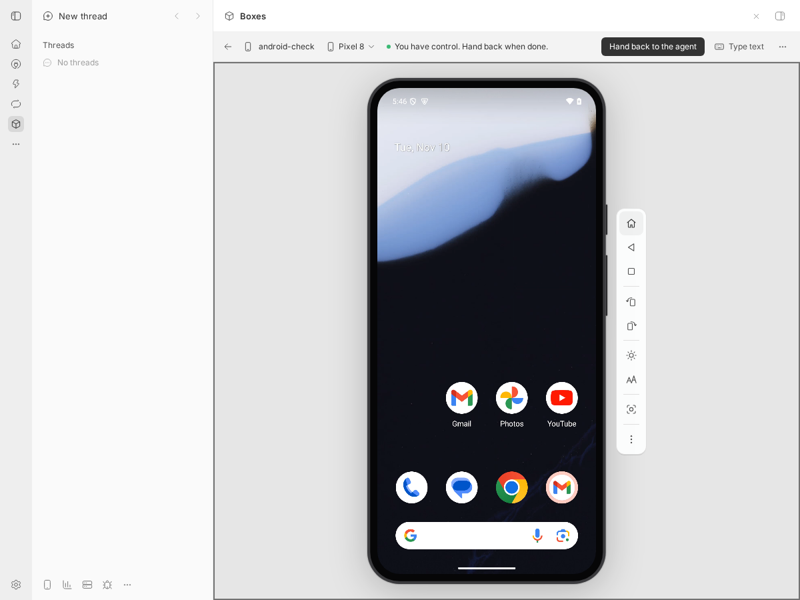
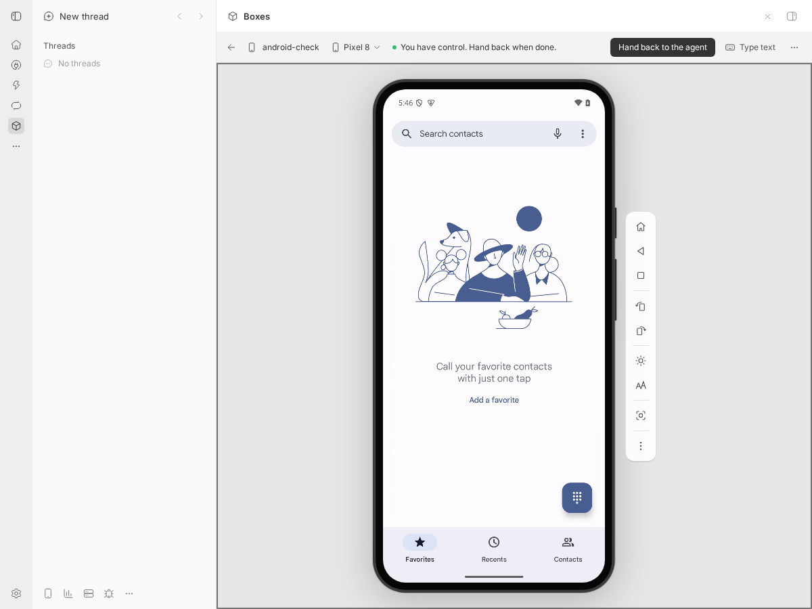
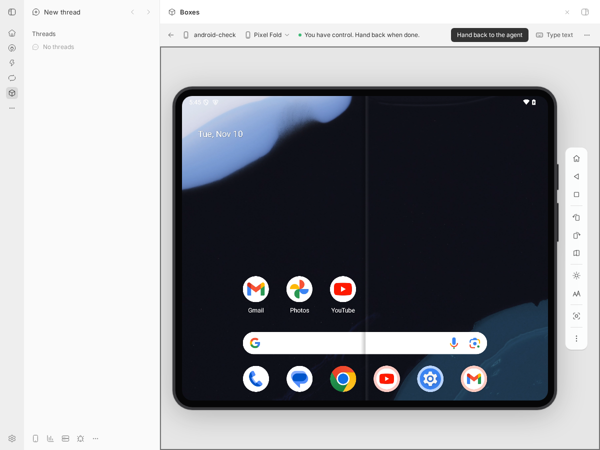

# Android cold boot checks

10 November 2026. Separate BB 0.49.0 in a Proxmox LXC Linux box, no account.
BB Box was built and installed from the branch. The Android VM used
LVM-thin storage and nested KVM, with 8 cores, 16 GiB memory and 48 GiB disk.
Only one Android box ran at a time.

The test box was a personal machine (`bb box machines add android`) because
a placeholder thread is swept when it does not exist in the separate BB.
Account enrolment was unavailable, but BB Box commands and the panel worked.

## Restore and undo

Commands used the separate BB's CLI wrapper. BOX and UNDO stand for the
box name and the undo ID returned by BB Box.

```sh
bb box machines add android --name android-check
bb box run BOX 'timeout 90 adb wait-for-device; adb shell "echo A > /data/local/tmp/marker; sync; cat /data/local/tmp/marker"; echo A > /home/box/host-marker' --machine
bb box snapshot take BOX --name marker-a --machine
bb box run BOX 'timeout 90 adb wait-for-device; adb shell "echo B > /data/local/tmp/marker; sync; cat /data/local/tmp/marker"; echo B > /home/box/host-marker; cat /home/box/host-marker' --machine
bb box snapshot restore BOX marker-a --replace --machine
bb box run BOX 'timeout 90 adb wait-for-device; adb shell cat /data/local/tmp/marker; cat /home/box/host-marker' --machine
bb box snapshot restore BOX UNDO --replace --machine
bb box run BOX 'timeout 90 adb wait-for-device; adb shell cat /data/local/tmp/marker; cat /home/box/host-marker' --machine
```

Outputs were B/B before restore, A/A after restore and B/B after undo.
The device started through BB each time. No manual service start or boot
flag was used. Its server log reported a cold boot after undo.

Memory snapshots, fork and Keep each refused with the disk-only or missing
identity reset reason. The Linux and Windows backend paths were unchanged.

## Panel

Playwright with headless Chromium opened the separate BB's Box panel at
1200 by 900 pixels. After undo, its device menu switched Pixel 8 to Pixel
Fold and back. The Fold's server log reported a cold boot. Both markers
still read B after switching back.

The panel's Home control returned to the launcher. A pointer click on the
Phone icon opened Phone through the panel's device input.








## Automated checks

Typecheck passed. The Proxmox, snapshot, conformance and Android tests
passed: 772 passed, 242 skipped, none failed. The new host-boot regression
failed against the original emulator implementation: all four starts had
no cold-boot flag. With the change, the first three starts received the
flag and the fourth, within the same host boot after a saved stop, did not.
All 38 Android tests passed. Reference generation produced no diff.
The documentation site built and its link check passed.

The original head also passed two normal marker restore and undo runs.
The earlier builder's missing startup was not reproduced. The change
makes the cold-boot choice independent of a saved model's unsaved marker;
it does not add another device startup path.
