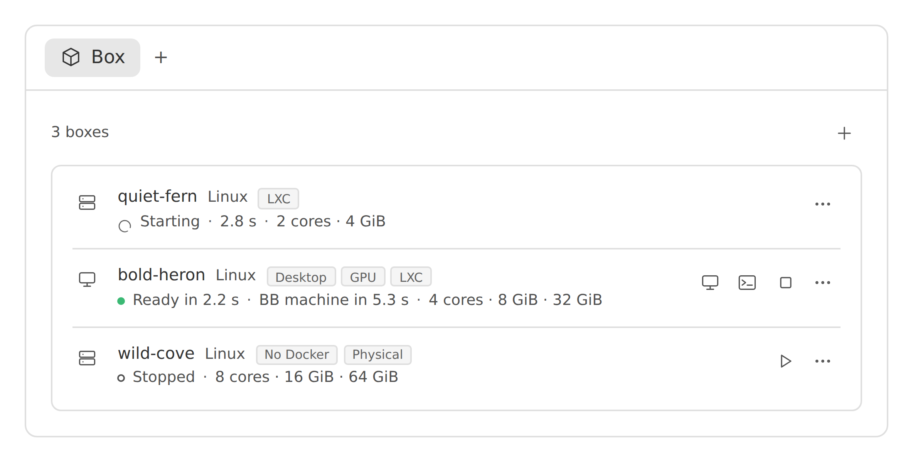
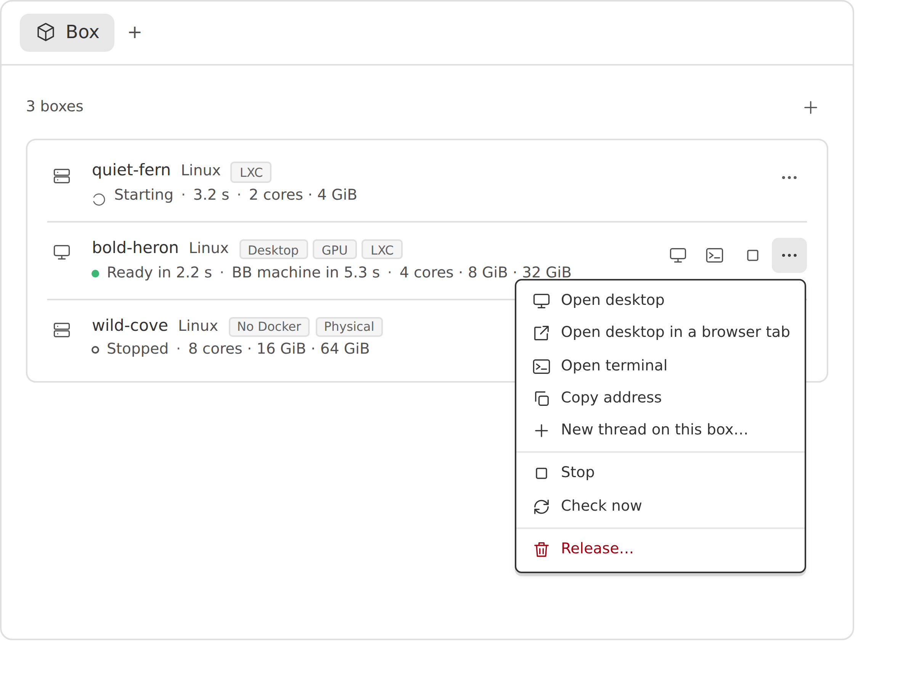
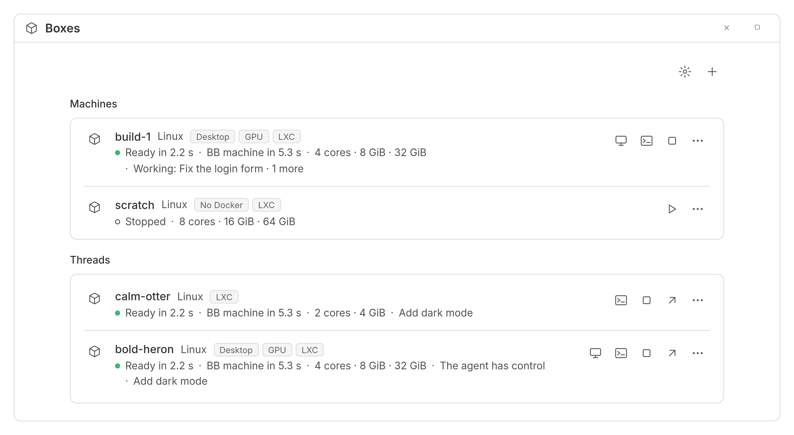
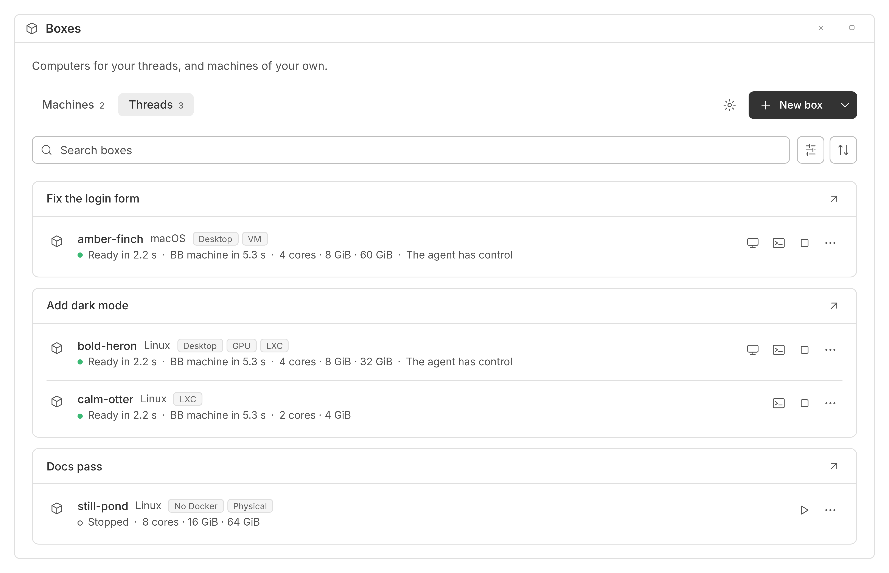

# The Box panel and the Boxes page

The Box panel shows one thread's boxes. The Boxes page shows every box you have: your machines, and each thread's boxes. Both let you open a box's desktop or terminal, and stop, start or release it.

## The Box panel

Open a thread and select the **Box** tab in its right panel. Each box is a row. The plus at the top right makes a new box for the thread: see [making a box](making-a-box.md).

When the thread has no boxes, the panel says 'No boxes yet'.

When no backend is set up, the panel looks for Docker on your BB machines, the one that runs BB first. Where it finds Docker, select **Use Docker on this machine**: BB Box turns it on and builds the Linux image, which usually takes 5 to 12 minutes, depending on the machine, and the panel shows how far it is, then says when the image is ready. Desktop images are left off until you first ask for a desktop: then New box's Desktop says 'Builds first, usually 4 to 10 min', and **Build and create** builds the desktop image, shows how far it is, and makes the box once it is built. If the image does not build, or the box cannot be made once it has, the panel says why, and choosing Desktop again tries again. Once a machine has built an image, the panel gives that machine's last time as its estimate. Where Docker is there but BB's user cannot use it, the panel gives the line to fix it, and the line that restarts BB there. A restart ends the turns of threads running there; where the line restarts all of the user's services, it also restarts a desktop's audio and notifications, so logging out and in again, or rebooting, is gentler. Then select **Check again**. Where no machine has Docker, the panel says 'BB Box is not set up yet' and links to BB Box's settings.

### What a row tells you

A row starts with the box's name and its system, such as Linux. Badges then say what the box is:

- Desktop: it has a screen you can see and use
- GPU: its desktop is drawn by a graphics card
- No Docker: it is a Linux box without Docker
- arm64: it runs on an ARM processor, which some programs do not support
- Container, LXC, VM or Physical: what kind of computer it is
- BB machine: it is the machine this thread runs on

The line under the name says how the box is doing:

| What it says | What it means |
| --- | --- |
| Starting, with a time | the box is being made or started |
| Ready in 2.2 s | the box is ready, and took that long to start |
| Joining BB… | the box is becoming a BB machine, which takes a few seconds, or a minute or two for a Windows box |
| BB machine in 5.3 s | the box is a BB machine, so the thread's commands and terminals can use it |
| This thread's machine | the box was made for the thread to run on, from BB's new-thread screen |
| Could not join BB | the box works, but it is not a BB machine, and a line under it says why: see [when a box does not join BB](#when-a-box-does-not-join-bb) |
| Stopped | the box is off and keeps its disk |
| Stopping… or Releasing… | the box is stopping, or going for good |
| Failed | the box could not start, and a red line under it says why |
| Gone | someone deleted the box outside BB Box |

After the state, the line says what needs your attention. For a desktop, it says when someone has control: 'You have control' or 'Another viewer has control'. 'Display on the CPU' means a GPU desktop is drawn without its graphics card. The line then gives the box's cores, memory and disk.

The name and the line under it each keep to one line. In a narrow panel, the line leaves out what does not fit, from its end. Point at the line to see all of it. A long name is shortened in the same way.

Select a row to see its details. They give the box's address, size, backend and system, and whether it is a BB machine. They also say how long each step took to start it, and when it was made.

### What you can do with a box

The buttons on a row open the box's desktop or terminal, and stop or start the box where its backend can. The menu at the end of the row has these and more:

- Open in browser: shows the desktop on a page of its own
- Copy address: copies the box's network address
- New thread on this box…: starts a child thread that works on this box in its own copy of the project, and is archived with this thread
- Check now: asks the backend for the box's state again
- Resize…: changes its cores, memory or disk: see [resizing a box](resizing.md)
- Release…: deletes the box

### Releasing a box

Releasing a box deletes it and everything on its disk, so copy out anything you want to keep first. On a physical machine, releasing resets the machine and returns it to its pool. Everything in the box user's home is deleted.

Release asks you first. If another thread is working on the box, it asks again, for example 'Release calm-otter anyway?', and names the threads that would lose their machine. Stop asks the same way.

### The machine a thread runs on

A thread can run on a box rather than on your computer. That box is the first row, with a BB machine badge. Its row has no Release, Stop or Start. Instead, a line says where those are: in BB Box's settings for one of your machines, or in the thread that holds the box.

### When a box does not join BB

A box joins BB through BB's machine access, in BB's settings under Machines. BB's desktop app starts with bb connect, which needs you signed in to your bb account. Until you are, no box joins BB: the row says 'Could not join BB' and why, and the first-run offer says so before you make a box. Sign in to your bb account in BB, or set Machine access to **Manual** with an address boxes can reach, such as the machine's address on your network. A box made before then stays as it is, so release it and make a new one.

Boxes still work without joining BB, but the thread's commands and terminals cannot use them, and they do not get the thread's Git credentials and variables.

### When something goes wrong

If BB Box cannot do what you asked, it says why in a red line under the plus. For example, it cannot stop a box whose host does not answer. The line stays until you select **Dismiss** or do something else.

## The Boxes page

Select **Boxes** in BB's sidebar. The page has 2 tabs, each with a count:

- **Machines** lists your machines.
- **Threads** lists every thread's boxes, in a card for each thread. The card's title is the thread's title. Select it, or the arrow beside it, to open the thread.

The page opens on the tab you chose last. The first time, it opens on Machines if you have any.

Under the tabs, a search field finds boxes by name, kind, provider or thread title. Beside it:

- **Filters** keeps the kinds, providers and states you tick. Each filter offers only what the tab lists.
- **Sort** orders the boxes by name or by when they were made. Select the same choice again to reverse the order.

On Threads, each thread's card comes where its first box falls in that order.

A thread's box has the same row and menu as in the Box panel. It asks the same questions before it releases or stops a box. 'New thread on this box…' is only in the Box panel.

A desktop or terminal you open from the page shows on the page, with a back arrow to the list.

The gear at the top right opens BB Box's settings. **New box** beside it adds one of your machines, since a box made on this page has no thread. To start a thread on a box of its own, use BB's new-thread screen: see [starting a thread on a new box](making-a-box.md#starting-a-thread-on-a-new-box).

## Your machines

A machine is a box of your own, kept as a BB machine. It belongs to no thread. It shows in BB's machine list and in the new-thread picker, so you can start threads on it, and it stays until you remove it.

You can add a machine from **New box** on the Boxes page, or from **Add machine** in Settings, BB Box, Machines. The form is the same as for a new box, with a name at the end. The name is optional: leave it empty and BB Box picks one. A name uses lowercase letters, digits and hyphens, starts with a letter, does not end with a hyphen, and is at most 32 characters.

A machine's row lists the threads working on it. You can stop, start, [resize](resizing.md) and remove it from the Boxes page or from settings. Removing a machine deletes it, as releasing a box does. If a thread is working on the machine, Remove and Stop ask again before they go on.

Remove a Windows machine here, not from BB's own machine list. Removing it there takes it out of BB, but leaves the Windows box running.
