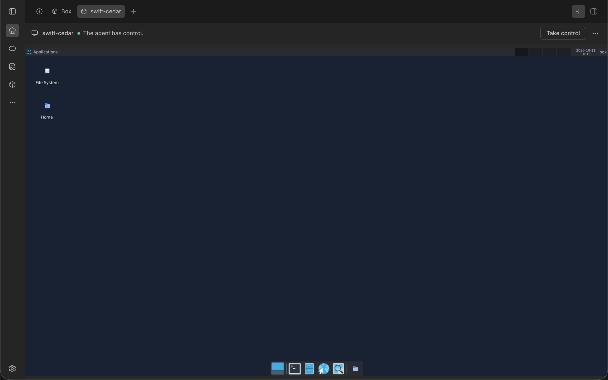
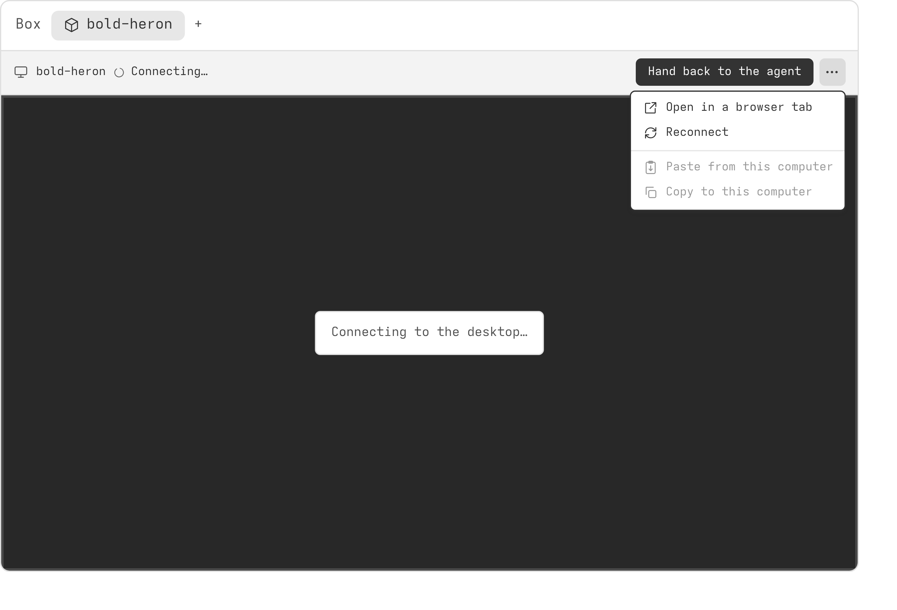

# Desktops

A desktop box has a screen you can watch while an agent works, and use yourself when you take control. Only one of you, you or the agent, sends input to it at a time.

## Opening a desktop

You can open a box's desktop from:

- the Box panel: select **Open desktop** on the box's row, which opens a tab named after the box in the thread's right panel
- the thread's Desktop tab: it opens the thread's desktop straight away, lists them when there are several, or offers the Box panel when there is none
- a browser tab of its own: select **Open in browser** in the box's menu
- the Boxes page: the desktop shows on the page, with a back arrow to the list

The thread's Desktop tab counts the machine the thread runs on, if it is a desktop.

When you switch to another tab and back, the desktop is still there, with no wait. A desktop you have not looked at for 10 minutes disconnects, and connects again when you come back.

## Taking and handing back control

At first the agent has control. You see the screen, but your keyboard and mouse do nothing there. The toolbar says 'The agent has control.'

To use the desktop yourself, select **Take control**. The toolbar says 'You have control.', and a coloured ring around the screen shows which tab sends input. Anyone else watching sees 'Another viewer has control.' While you have control, agents leave the desktop alone.

To give it back, select **Hand back to the agent**. The agent also gets control back when your tab has been closed or hidden for a minute. It does the same when your tab loses its connection and does not connect again soon.

If you ask an agent to carry on while you have control, it can take control back. The toolbar then says 'The agent took control.', and **Take control again** gives it back to you.

### The desktop's size

Taking control does not change what you see: the desktop keeps its size. While you have control, resizing your tab or window resizes most desktops to fit it. On video, the last picture stretches to fill the new space until the desktop has its new size, so you see one change. A macOS desktop on a Mac keeps its own size. When you hand back after resizing, the desktop goes back to the size the agent had.

## Your keyboard

On a Mac, Cmd works as Ctrl in a Linux or Windows box. So Cmd+C copies, Cmd+V pastes, and Cmd+A, Cmd+Z, Cmd+F and Cmd+S do what Ctrl would. In a macOS box, Cmd stays Cmd. The left Option types symbols as on your Mac, and with an arrow, Tab or a function key it works as Alt; the right Option is always Alt, for an app's Alt+letter menu keys.

Accented letters and other characters reach the box as your keyboard types them, such as é, ß or ж, whatever your keyboard's layout. Capitals arrive as capitals on every desktop, however your browser sends them, from a phone's or tablet's on-screen keyboard too. Shortcuts go by the key you press, as on the box's own keyboard.

An accent typed with a dead key, such as Option+E then E on a Mac, or ' then E on a US International keyboard, makes é on the desktop only from a browser on Windows. From a browser on a Mac (Chrome or Safari) or on Linux (Chrome or Firefox), the dead key is dropped and the plain letter arrives. To type these accents there, use **Type text**, below, or a keyboard layout with the accented letter on its own key.

To write in another language with an input method, such as Japanese or Chinese, or to add emoji, select **Type text** in the toolbar, or press Ctrl+Cmd+Space on a Mac, Ctrl+Alt+Space elsewhere. A field opens over the desktop. Type there with your input method, press Ctrl+Cmd+Space again on a Mac for the emoji picker, or paste. Enter sends the text to the box where the cursor is, and the field stays open for more. Shift+Enter starts a new line, and Esc closes the field. Long text goes as a paste. Typing straight onto the desktop works as before.

## Copying and pasting

Copying and pasting between your computer and the box works while you have control. After you paste, or select Copy to this computer, a BB notification says 'Pasted' or 'Copied' for a few seconds. Notes like these come as notifications, not in the toolbar, and you can close one early.

To paste text from your computer into the box, click where it should go and press Cmd+V on a Mac, or Ctrl+V elsewhere, into a macOS box too. In a Linux or Windows box, Ctrl+Shift+V (Cmd+Shift+V on a Mac) pastes your text too, as a terminal expects. In a macOS box, Cmd+Shift+V goes to the box as you typed it, to paste and match style. You can also select **Paste from this computer** in the toolbar's menu. Keys you type straight after a paste wait for it, so they land after the pasted text, in the order you typed them. If your browser does not let BB Box read your clipboard, a field opens: paste your text there and select **Paste into the box**.

When you copy text in the box, it comes to your computer's clipboard. You can also select **Copy to this computer** in the menu. If your browser does not let BB Box write to your clipboard, a field shows the text so you can copy it yourself.

On Linux, and on any desktop shown as video, the text moves at once. Over VNC on a macOS desktop on a Mac, and on Windows, BB Box moves it with commands in the box, so it can take a moment: on Windows a few seconds, and up to about 8 seconds on Windows on a Mac.

If nothing has come from the box, the menu's Copy says why: take control first, or copy something in the box first.

A box's clipboard is its own. A Mac that runs boxes as virtual machines does not share its clipboard with them, so a box never holds what the Mac's owner copied.

## The pointer

Without control, your own pointer shows over the desktop. With control, the pointer takes the box's shape. If the box hides its pointer, yours shows instead, so it never disappears.

## Video

A Linux desktop can also show as video, which follows a dragged window far more closely than the usual stream (VNC), and stays smooth on a slow connection where VNC falls to a few frames a second. It is on unless **Linux desktops as video** is off in [settings](settings.md#general), and works for Linux desktops drawn by the CPU, X11 and Wayland, and, by choice, on a GPU desktop.

Such a desktop opens as video, on arm64 under microsandbox too. To see it over VNC instead, select **Show as VNC** under **Display** in the toolbar's menu; it is ticked while the desktop shows over VNC. Your choice lasts for that box in that tab; select it again to go back to video. A Linux desktop on a Tart Mac opens over VNC instead, with **Show as VNC** ticked; select it to see the desktop as video.

A macOS desktop on a Mac of the SSH host pool opens as video. One on a Tart Mac opens over VNC instead, as VNC is already smooth there, with **Show as VNC** ticked. Select it to see the desktop as video, which uses much less bandwidth, though a key shows a little later. Your choice lasts in the same way. The Tart backend's **Video by default for macOS desktops** setting makes such desktops open as video.

A Linux desktop on a GPU opens over VNC, with **Show as VNC** ticked. Select it to see the desktop as video, encoded on the box's GPU (NVENC). This needs a GPU box made from a recent image; an older one shows over VNC only.

A Windows desktop on a Mac opens as video, as one on Proxmox does. The Mac makes the video from QEMU's own display of the desktop, rather than Windows capturing it, so it never tears and uses far less bandwidth than VNC. Where the box's QEMU does not offer that display, the Mac makes the video from QEMU's VNC picture instead. People watching see the agent's pointer, over video and over VNC. This needs a box made from a recent image, and Xcode's Command Line Tools on the Mac; `bb box doctor` says when a Mac lacks them.

A Linux desktop on Wayland, which runs Ubuntu 26.04, also opens as video, which follows a drag more closely than VNC, does not tear while you scroll, and uses about a sixth of the bandwidth, though a key on its own shows a little later. This needs a Wayland box made from a recent image; an older one shows over VNC. High resolution is not offered on Wayland.

If the video cannot start, the desktop shows over VNC, and a notification says 'Video did not start, so this shows VNC.', with why under it: for example, the box was made before video came, or your browser cannot decode video, which needs a secure connection to BB. On a page that is not secure, such as BB at a plain http address on your network, a desktop opens over VNC, and the viewer says so once.

Everything else works the same with video: taking control, copying and pasting, your keyboard, the pointer and the desktop's size. Copying and pasting carry images too, both ways: paste an image into the box, or copy one there and it comes to your computer. If your browser does not let BB Box write an image to your clipboard, the image shows so you can right-click it and copy it. On Windows, a pasted image reaches the box's clipboard as the very file you pasted, not compressed again, which browsers and Office paste, and as a picture for apps that take only that; this needs a box made from a recent image. On a Mac it is the same; this needs a Tart Mac made from a recent image, or a pool Mac whose owner has run setup-mac.sh again since.

### The pointer over video

Video shows the box's pointer as the agent moves it, so you can see where it points while you watch. While you hold control, the video leaves the box's pointer out: your own pointer shows instead, with the box's shape (an arrow, a text cursor, a hand), so it never trails behind your hand. One picture serves everyone watching a box, so while one person holds control, others watching see no pointer in the video either.

On Windows, this needs a box made from a recent image, which keeps the pointer apart from the picture. On a box from an older image, Windows draws the pointer into the picture, so the video always shows it: while you hold control, you see your own pointer and, a little behind it, the box's.

Over VNC, a Windows box shows no pointer in the picture until a mouse has moved in it, its own or yours; from then on the picture shows where the box's pointer is. While you hold control and watch over VNC, Windows' pointer is hidden, so only your own pointer shows, as a plain arrow, not the box's trailing behind it; it comes back when you hand control back or stop watching over VNC. To see the agent's pointer from the start, use video, which Windows desktops on Proxmox show by default.

On a Linux desktop on Wayland made from a recent image, video and VNC both show the box's pointer as the agent moves it, in its own shape. While you hold control, your own pointer takes the box's shape, and other people watching see where you point.

On a Wayland box made from an older image, the box draws its pointer into the picture, which shows it as the agent moves it. While you hold control, the box leaves it out, so it does not trail behind your own, and your own pointer is then a plain arrow, whatever the box's shape. On a box from an older image still, you see your own pointer and, a little behind it, the box's.

## High resolution

On a high-resolution screen, such as a Mac's, a desktop's text can look soft: each of its pixels is stretched over several of yours. In the toolbar's menu, under **Display**, select **High resolution** to give the desktop twice the pixels, with everything on it drawn twice the size, so it looks the same size but its text is sharp. Point at its info icon to see what it costs. It is ticked while it is on, and stays on for that box until you turn it off, even after the box starts again. While it switches on or off, video keeps the last picture until the desktop has its new size and scale, then shows the new one, so you see one change; anyone else watching sees the same.

On a Linux desktop drawn by the CPU, High resolution takes about three times the processor while someone watches the desktop, and the box's apps draw four times the pixels, so scrolling in a browser costs more too. It works best on boxes with 8 cores or more.

On a Windows desktop on Proxmox shown as video, High resolution sets the screen to twice the pixels, such as 2560x1600, at 200% scaling, so everything keeps its size. The video then shows about half as many frames a second, and a key takes about 85 ms to show. More cores do not help, as copying the screen is the limit, so turn it on for what needs sharp text and off again after.

Other desktops do not have it. While it is on, resizing your tab in control keeps the desktop's pixels doubled; over VNC, the desktop keeps its size. While anyone watches it in a browser that cannot show larger video, as Safari, the desktop is no larger than 3840x2304 pixels, or the same area in another shape, the largest such a browser shows at 60 frames a second: in a larger tab, it has a little less than twice the pixels. While everyone watching can show more, as Chrome can, it has the full twice, up to 7680x4320. When such a viewer comes or goes, the desktop changes size, and everyone watching keeps the last picture until it has. If your browser still cannot show the video, the desktop shows over VNC, and a notification says why.

Video also keeps coloured text sharp: when every browser watching a desktop can decode full colour, as Chrome can, the video carries it, for a little more processor and no more bandwidth.

## Device displays

A box can have a device beside its desktop, such as a phone, or a device and no desktop. An `ios` box has an iOS Simulator device, an iPhone or iPad, beside its macOS host's desktop. The test device, a test card that stands in for a phone, is turned on by the advanced `testDevice` setting in the [configuration reference](../reference/configuration.md). The Android emulator comes later.

Take control to use the device, as with a desktop: one control covers the device and the box's desktop. The device's own controls are in a bar beside it, described under [The device's controls](#the-devices-controls). Commands work too: `xcrun simctl` in the box's terminal takes `booted` as the device.

On an `ios` box, the Desktop view is the macOS host's, for Xcode. It says above it: 'Do not open Device Hub here. It takes the device's clipboard, so pasting stops working, and bb-box closes it. The device is in the Device view.' Xcode's Run opens Device Hub even so. bb-box closes it within 5 seconds, by stopping its process: quitting it would shut the device down. `bb box doctor` says whether Device Hub runs on each `ios` box, and how often bb-box has closed it.

A box with a device opens on the device. A box with both shows **Device** and **Desktop** in the toolbar: select one to see it. Each keeps its own connection while you look at the other, so switching is instant, and your choice lasts for that box in that tab.

The display you see is the only one that gets your keys, your pointer and your clipboard. Control is one for the box, covering both: switching between them keeps it, and does not start the minute after which a hidden tab hands control back.

A device always shows as video, at its own size. It has no VNC, no **Show as VNC** and no High resolution, and it ignores the **Linux desktops as video** setting. Resizing the panel does not resize the device.

The device shows in a frame drawn by bb-box: a phone or tablet in its body, with its side buttons and, on an iPhone, its Dynamic Island. The body is graphite in both of BB's themes, with a light edge in the dark theme and a soft shadow in the light one. The device, its frame and its bar of controls fit the panel, and the screen is never drawn larger than its own pixels on your display. In the bar's **More** menu, two choices change how it shows, and last for that box in that browser:

- **Show frame**, on at first: off, the screen shows alone, with its own corners and island.
- **Pixel for pixel**: each of the device's pixels is one of your display's, and the panel scrolls.

When the device turns, the frame turns with it in a third of a second, its last picture turning too, as a phone held sideways does, and the new picture shows once the device has drawn it. If that takes longer, as it can while iOS turns its own layout, the old picture waits under a faint veil. A phone held sideways whose app stays upright, as the iPhone's Home Screen does, shows its picture on its side, as the phone would. With reduced motion set on your computer, the frame turns at once.

While the device starts, its screen is black, with its name and 'Booting'. A device that is asleep shows its last picture dimmed, with 'Asleep' and **Wake**, and one that failed shows why, with **Reboot device**. Either button takes control if you do not have it.

Where your browser cannot play the device's video, as where it has no WebCodecs or the video does not start within 3 seconds, the device shows a picture of its screen a few times a second instead, over the same connection, and says so above it: 'This browser cannot play the device's video, so it shows a picture a few times a second.' It never shows the box's desktop in its place, so a click never lands on the wrong screen. While it waits for its first picture, it shows the device's name and 'Connecting', or 'Booting' while the device starts.

### The device's controls

A narrow bar beside the device holds the controls you use most when testing an app. A control the device does not have is not shown: an iPhone has no **Back**, and only a foldable has **Fold**.

| Control | What it does |
| --- | --- |
| **Home** | goes to the Home Screen |
| **Back**, **Recent apps** | Android only: goes back, or shows the recent apps |
| **Rotate left**, **Rotate right** | turns the device a quarter turn the way the arrow points |
| **Fold** | foldables only: closed, half open or open |
| **Dark appearance** | turns dark mode on or off. Its icon shows which is on: a moon for dark, a sun for light |
| **Text size** | a slider of the platform's own steps, such as iOS's content sizes, with smaller, larger and **Default** |
| **Copy screenshot** | copies the device's own pixels to your computer's clipboard as a PNG, or downloads it where your browser will not let bb-box copy a picture |
| **More** | **Lock** or **Wake**; **Open link…**, which opens a web address in the device's browser or an app's own link, such as `myapp://settings`, in that app; **Location**, a few cities or your own latitude and longitude; **Clean status bar** on iOS, which shows 9:41, full signal and a full battery for screenshots; **Battery**; **Network** on Android; **Show frame** and **Pixel for pixel**; and **Reboot device**, which keeps apps and data |

Using a control takes control from the agent, as **Take control** does, and the toolbar says 'You have control. Hand back when done.' **Copy screenshot** does not take control: it sends the device nothing. On a touch screen the bar says 'Using a control takes control from the agent.' once, under it, until you first use one. While the device boots or switches, the controls wait, and say why.

Controls the device shows for itself, such as Home or a turn, say nothing more. Those that change what you cannot see, such as the location or the battery, say what they did in a note. If the device refuses a control, as when another is still under way, the note says why.

In a panel narrower than 480 pixels, or where the device's screen beside the bar would be narrower than 280 pixels and the row leaves it wider, the bar goes below the device as one row: **Home**, **Back** and **Recent apps** on Android, **Rotate left**, **Fold** on a foldable, and **More**, which holds the rest.

The bar is one stop for the Tab key: the arrow keys move along it, and Enter or Space uses a control. Menus and the text size slider close with Escape. A screen reader hears each control's name and whether **Dark appearance** is on, and what changed on the device, such as 'Turned left. Dark appearance.'

**The device picker**, the device's name in the toolbar, lists the box's devices and switches to another. Each device keeps its own apps and data, so install your app again on the one you switch to. A device not started in this box before says it may take a minute: about 9 to 12 seconds to boot an iPhone or iPad from the image cold, and a minute or more the first time a device is booted at all. One started before takes about 8 seconds.

While a person has control, the agent's `box_device` is refused but for installing an app the device does not have, so it cannot press Home or turn the device while you test.

### Device input

With control, the device takes your pointer, keys and text:

| You | The device gets |
| --- | --- |
| Click, or drag | a touch where you click, which follows the pointer until you let go |
| Right-click | a long press, held for 1.2 seconds |
| Alt and drag (Option on a Mac) | a pinch: two fingers mirrored about the screen's centre. Alt itself never reaches the device |
| Scroll with a wheel or trackpad | a swipe from the pointer, a twelfth of the screen for each notch, held still before it lifts so the list does not fling |
| Two fingers on a touch screen | two touches |
| Keys | the same keys, by name. Cmd is Command, Option is Option |
| A letter with an accent, from your keyboard or a dead key | on iOS, typed as Option keys, as a Mac's keyboard types it |
| Japanese, Chinese or Korean from your input method, an emoji, or Arabic, Cyrillic and other letters with no Option key | pasted, as one paste for each word your input method commits, or for letters you type within half a second of each other |
| Cmd+V (Ctrl+V off a Mac) | your computer's clipboard, pasted into the device |
| **Type text** | the whole text: as keys when every letter has a key, otherwise as one paste |

When bb-box pastes for you or the agent, it puts the device's own clipboard back afterwards. Your Cmd+V leaves your text on the device's clipboard, as on a desktop.

On iOS, each paste shows 'pasted from CoreSimulatorBridge' at the top of the screen for about 2.5 seconds, and the device takes no keys while it shows, so bb-box holds your keys until it goes. Touches are not held. iOS also adds a space before pasted text that follows a word or a punctuation mark directly, as it does on a phone; type long or mixed text with **Type text**, which pastes it in one piece.

While someone watches without control, each touch, the agent's or the person's with control, shows as a circle where it lands.

Control changes hands cleanly. When you take control, the agent's input stops at once: a swipe under way ends where it is, and a paste whose paste key has not gone is dropped, with the device's clipboard put back. When you hand back, or your connection ends, or bb-box reloads, every touch and key you held is let go. Turning or switching the device ends a touch under way, and a touch that starts before the new picture comes is not sent.

## When the desktop is not showing

The screen tells you why, and what you can do. It uses the box's name, here calm-otter:

| What it says | What to do |
| --- | --- |
| Connecting to the desktop… | wait a moment |
| The connection to the desktop ended. Trying again in 4 s | wait, or select **Reconnect now** |
| calm-otter is stopped. | select **Start**, where the box can start again |
| calm-otter is starting… | wait: the desktop shows once the box is ready |
| This box has been released. | close the tab, or, on the Boxes page or in settings, select **Back to boxes** or **Back to settings** |

After a lost connection, the viewer tries again by itself, waiting a little longer each time, up to 15 seconds. **Reconnect** in the toolbar or its menu tries at once.

## Agents and the desktop

Agents see and use a desktop through computer tools, such as taking a screenshot, clicking and typing. See [agent tools](../reference/tools.md).

An agent can record a desktop with `box_record` and show you the clip in the thread, with each step it tests and its result captioned. See [recordings](recording.md).
