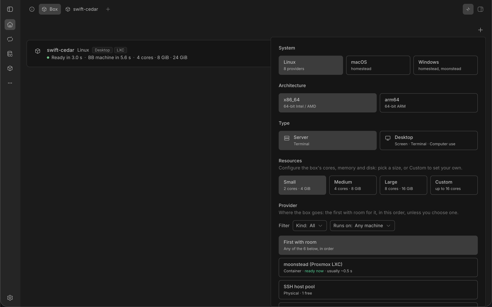
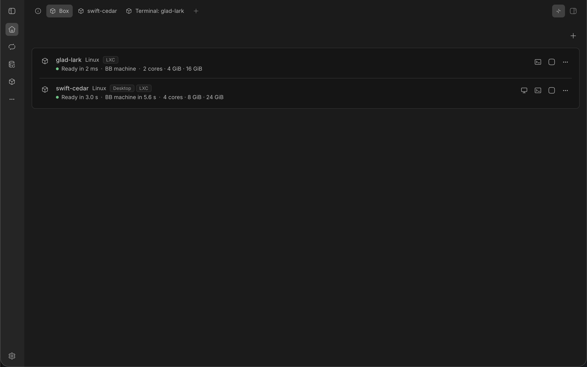

# Making a box

You make a box with the New box form. You choose its system, whether it has a desktop, its image, its size and where it runs. A thread can also start on a new box of its own, from BB's new-thread screen.

## Where to make a box

You can make a box in 4 places:

- the plus in a thread's Box panel: a box for that thread
- **New box** on the Boxes page: one of your machines
- **Add machine** in Settings, BB Box, Machines: one of your machines
- BB's new-thread screen: a box the new thread runs on, which is described in [starting a thread on a new box](#starting-a-thread-on-a-new-box)

Agents make boxes with the `box_acquire` tool: see [agent tools](../reference/tools.md).

## Filling in the form

The form asks what you want, one step at a time. Each step narrows the next, so a choice that no provider offers is greyed out and says 'Not available'.

### System

Choose Linux, macOS or Windows. Each card names the hosts that offer it, or how many providers do. For one of your machines, the form shows only the systems whose boxes can become BB machines.

### Architecture

Choose x86_64, for 64-bit Intel and AMD processors, or arm64, for 64-bit ARM processors. On a Linux arm64 box, programs built only for x86_64, and amd64 container images, do not run. Windows on arm64 runs x64 apps through emulation, more slowly.

### Type

Choose Server, which you reach through a terminal, or Desktop, which also has a screen you can see and that agents can use.

Where Docker was set up from the Box panel, its desktop images are not built until you first ask for a desktop. The X11 and the Wayland desktop are both offered, under Display, and each image is built when that desktop is first asked for. Desktop then says how long it takes, for example 'Builds first, usually 4 to 10 min', or the machine's own last time once it has built one, and the button says **Build and create**: it builds the image, the panel shows how far it is, and the box is made once it is built. The Boxes page's **New box** offers the same for a machine of your own: the button there says **Build and create**, the page shows the build, and the machine is made with the name you gave once the image is built.

For a Linux desktop, you may also see Display, with X11 and Wayland. It shows only where both are on offer. X11 is chosen at first. Apps built only for X11 do not run on a Wayland desktop.

### Image

Image shows when a project's image covers the box you chose. A project's image is the standard image with the project's own setup script run on it, so the box starts with the project's tools.

The menu lists:

- your project's image first, chosen at first
- Standard: the box without any project's tools
- other projects' images, each with its project's name

For a Linux box, if your project has no image, the form offers to make one. Select **Make a box image for this project** at the bottom of the form. This opens BB's new-thread screen with a request for an agent to make it, ready for you to send.

### Resources

Choose Small, Medium or Large, or Custom to set the cores, memory in GiB and disk in GiB yourself. Each field says the most you can ask for. At that most or past it, a line under the fields says it is the largest for the kind, such as 'Up to 64 GiB of memory, the largest for Linux desktop (CPU) boxes.', and **Change it in Settings** opens the kind's sizes in BB Box's settings, where you can raise it. Leave the disk empty to keep the size the box's image comes with. The sizes for each kind are in [kinds and sizes](../reference/kinds.md).

Where a desktop can have a graphics card, a GPU menu offers None or 1 GPU. A desktop needs some of the graphics card's memory free. If you choose 1 GPU when no graphics card had enough free a few minutes ago, a note under the menu says so, with when to try again. Choose None for a desktop drawn without a graphics card.

### Provider

A provider is where the box runs, such as a container host or a pool of physical machines. 'First with room' is chosen at first: BB Box tries the providers in the order listed, and uses the first with room for the box. You can choose one provider instead.

Each provider's row says:

- what its boxes are: Container, VM or Physical
- 'ready now' when a spare box of the image and size you chose is waiting there, so your box is ready at once, or 'ready in seconds' when that spare waits stopped and resumes first, as Windows and macOS VMs' spares do
- how many machines are free
- how long a box usually takes to start

Its information button says what it makes, how much room it has and whether it is working.

Two filters narrow the list:

- Kind: All, Container, VM or Physical
- Runs on: any machine, a Linux machine, a Mac or a Windows PC

If no provider matches the filters, the form says so.

### Name

Name shows only when you add one of your machines. See [your machines](boxes.md#your-machines) for the rules.

### Making it

Select **Create box**. The box shows in the list at once, starting, and is usually ready in seconds. If no provider has room, the form stays open and says why.

Where boxes cannot join BB yet, the form says so above the button, 'Boxes will not join BB yet.', with what to do and a link to [when a box does not join BB](boxes.md#when-a-box-does-not-join-bb). You can still make the box.

The form remembers the system, type and size you chose last, separately for boxes and machines. It does not remember the image.

## Starting a thread on a new box

In BB's new-thread screen, choose **New box** as the thread's machine. BB Box makes a box for the thread and BB copies the project onto it, so the thread runs there from its first message.

The box can be Linux or macOS, not Windows: BB adds the new box as a machine with its installer for Linux and macOS only. For a thread on Windows, start the thread elsewhere and give it a Windows box.

The button beside it shows the box's kind, size and image. Select it to change them. The menu has 3 groups: Kind, Size and Image. In a project, the project's image is chosen at first. Outside a project, no image is chosen until you pick one.

The box belongs to the thread, and goes when the thread is archived or deleted. In the Box panel its row says 'This thread's machine'.
