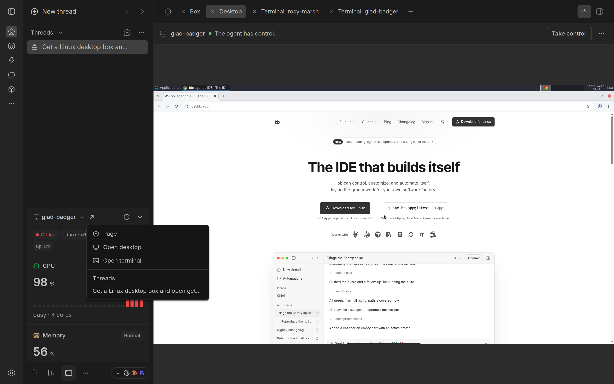
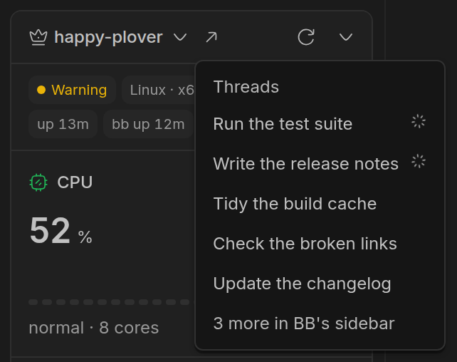

# The Monitor

The Monitor shows how BB's server, your machines and every box are doing: CPU, memory, disk, network and the busiest processes, in BB's sidebar. It can also watch BB's server while nobody looks, and tell you when its CPU or memory stays high.

## Opening it

In BB's sidebar footer, select **Machine status**, which has a server for its icon. The panel opens above it, on the machine you looked at last, or on BB's server the first time.

While the panel is open, it reads the machine every 5 seconds. The circular arrow at its top reloads it at once, and its tooltip says when it last read. The down arrow beside it hides the panel.

## Picking a machine

Select the machine's name at the top of the panel. The list has BB's server first, then your machines, then boxes, each in name order. Type to find a machine by name, then use the arrow keys and Enter, or select it. The panel remembers your choice in this browser.

Each name has an icon for what it is: a crown for BB's server, a server for one of your machines, a box for a box, a monitor for a desktop box and a phone for a device box.

The list has every running Linux or macOS box, whether or not it has joined BB as a machine, and spare boxes too. A Windows box is in the list only while it is a BB machine.

## What it shows

A row of labels at the top gives the machine's health, its system and architecture, its memory, its cores and how long it has been up. For BB's server, it also says how long BB has been running, as in 'bb up 2h 5m'. For a box, it says 'system up', how long its system has run since it booted, or 'host up' for a container or a shared box, whose clock is its host's. The box's own page counts 'up' from when the box last started, so the two can differ.

Health is **Healthy**, **Warning** or **Critical**. Point at it to see why. It is a warning when CPU, memory or disk use reaches 85%, or when the five-minute load average reaches the number of cores. It is critical at 95%, or at a load of 1.5 times the cores. GPU use never changes health: a card at full use is a training run doing its job. It can only make a box [busy](boxes.md#what-a-row-says-on-the-boxes-page).

Below the labels are sections. Point at a section for its details.

- **CPU**: how busy the CPU is, with a chart of the last few minutes and the one-minute load average. Its details give the cores, their speed, and the load over 1, 5 and 15 minutes. On a Mac, they also give its temperature and power.
- **GPU**: on a Mac with Apple silicon, how busy its GPU is, with its temperature and power. On a machine or box with [NVIDIA GPUs](#nvidia-gpus), one section for each card.
- **Memory**: how much is used, marked **Normal**, **High** from 85% or **Critical** from 95%. Its details give what is used, available and cached, and the swap.
- **Free space**: the main disk's free space, with what is used and free.
- **Network**: download and upload speeds, with a chart of the last few minutes, and the totals received and sent.
- **Battery**: on a machine with a battery, its charge and state.
- **Tailscale**: on a machine in a tailnet, its name, MagicDNS name, address and tags, each with a button that copies it. The address shows IPv4 or IPv6; select its label to switch.
- **Top processes**: the 5 using the most CPU, with their memory and share of a core. On a machine with NVIDIA GPUs, a **GPU** column gives the card memory each uses, and a process using a GPU is always listed.

### NVIDIA GPUs

Wherever `nvidia-smi` answers, the Monitor shows each NVIDIA card: a Proxmox LXC or Docker box with a GPU, a BB machine with an NVIDIA card, or BB's server. It reads them in the reading it already takes, with no polling of its own: `nvidia-smi --query-gpu` for the cards, about 30 ms, then `nvidia-smi -q -d PIDS` for the processes using them. A machine with no NVIDIA device is not asked at all.

- Each card's section gives how busy it is, a chart of the last few minutes, and its memory used of its total, with its temperature, or its power draw. Its details give the card's name, its power limit, and the processes using it, compute and graphics, by name and PID only, never arguments.
- Its use is the card's at the moment of each reading, as `nvidia-smi` reports it, not a mean since the last reading.
- Each `nvidia-smi` call has 2 seconds. One that does not answer is stopped, and only the GPU is missing from that reading: the CPU, memory, disk and network are kept. On BB's server or a BB machine, BB Box then does not ask again for 5 minutes, so a driver that hangs costs one stopped call, not one each reading. A card `nvidia-smi` cannot read is left out, and the others still show.
- Once a machine or box has shown a GPU, or is of a GPU kind, its GPU sections, tiles, lines and process column stay. A reading without them says the card was not read, so nothing moves.

A box in a container sees the whole card, but only its own processes on it, its desktop's Xorg and browser included. When the card's memory used is more than its own processes' by 512 MiB or more, other boxes or the host are using it, and the box **shares** it. The section is then called 'GPU, whole card' and marked 'shared card': its use, memory, temperature and power are every user's together, and its footnote gives this box's own memory of the card's, as in 'This box: 612 MiB of 14 GB'.

A GPU at 85% or more for 5 minutes makes a box busy, but never changes its health. A shared card never makes a box busy: `nvidia-smi` gives each card's use, not each process's, so BB Box cannot tell how much of a shared card's use is the box's own.

### Boxes in containers

A box in a container, such as a Docker or Proxmox LXC box, has no load average of its own: the one it sees is its host's. So the Monitor reads the container's own numbers, and judges it by CPU pressure, the share of the last minute that its tasks waited for CPU, in place of load. The CPU section shows 'pressure' and a percentage where it would show 'load'. Its details, and the memory section's, give the pressure over 10 seconds, 1 minute and 5 minutes.

A container is a warning when its tasks waited for CPU for 25% of the last minute, or for memory for 10%, and critical at 50% or 25%.

### Shared iOS boxes

An `ios` box on a shared Mac is a macOS user of its own on that Mac. Its labels also name the Mac it is on, and how much of the Mac's video encoder is in use. Its CPU section says 'host load', as the load is the whole Mac's. Its processes are only its own. Its health is judged on its own CPU and memory, against its share of the Mac, not on the Mac's: see [Activity](boxes.md#activity) on the box's page.

## The Open menu

When the panel shows a box, **Open**, an arrow, is beside its name. Its menu starts with **Open details**, which opens [the box's page](boxes.md#a-boxs-page), then lists the box's views:

- **Open simulator** or **Open emulator**, for a device box
- **Open desktop**, for a desktop box
- **Open terminal**

Each opens on the Boxes page, as the same item on the box's row there does.

After the views come the threads on the box, under **Threads**. A thread's box lists the thread that holds it first, then the threads running on it. One of your machines lists the threads running on it. Of the threads running on a box, those working come first, then the most recently active. A thread that is working has a spinning mark at its right end. Threads archived or hidden in BB's sidebar are left out. The menu lists at most 5, then a line such as '2 more on the Boxes page', which opens the box's page.

When a box is not ready, its views stay in the menu, greyed out, each with the reason, as in 'brisk-wren is stopped'.

BB's server and your other BB machines, the ones that are not boxes, have the arrow while threads are working there, or were active there in the past 24 hours. Its tooltip says 'Threads on' and the machine's name. Its menu lists those threads under **Threads**, those working first, then the most recently active, at most 5, then a note such as '2 more in BB's sidebar'. A machine with no such threads has no arrow.

## Background monitoring and pressure notifications

Background monitoring is off unless you turn it on. When it is on, BB Box checks BB's server's CPU and memory every 30 seconds, even when nobody has the panel open. It keeps diagnostic records, which `bb box monitor logs` shows.

With background monitoring on, pressure notifications tell you when BB's server is under pressure. They are on by default. BB shows a notification in each open BB window:

- when CPU use stays at 95% or more, or memory use at 90% or more, for at least a minute
- when it has been back at 85% or less for a minute

After it is back to normal, BB Box waits at least 5 minutes before it warns about the same thing again. Each notification has **Open Status**, which opens the panel.

To see what a notification looks like, run `bb box monitor test-alert`. It shows a labelled preview, and needs background monitoring and its notifications on.

## Box history

Box history is on by default. BB Box reads every running box once a minute and keeps what it read: each minute for 24 hours, and each hour for 7 days. For a box with NVIDIA GPUs, it keeps each card's use and memory too, and whether it was shared. A box's page shows it over [1 hour, 24 hours and 7 days](boxes.md#over-1-hour-24-hours-and-7-days).

- A reading is light: CPU time, memory, the box's limits in a container, CPU and memory pressure, load, disk and network, with no processes. For a box that is not a BB machine it is one command, whose answer is under 1 KB; for a BB machine, one call to BB Box's host entry. A shared slot reads its own user's processes, and one slot a minute also reads its Mac for all of them. A slot's work that is shorter than a minute may not show on 24 hours and 7 days; Live shows it.
- Each box has its own second in the minute, so readings spread out. Up to 8 run at once, as many as the minute's readings need. A reading that does not answer within 10 s fails. A box whose readings fail 3 times in a row is read again once BB Box finds it answers.
- It keeps its counters between readings, so each point is the mean since the last reading. After a restart of BB Box of under about 2 minutes, nothing is lost.
- It keeps its points in `box-history.db`, beside BB Box's database, capped at 64 MB. A released or forgotten box's points go 24 hours after it. If the file ever fills, box history stops writing and says so in Monitor settings and the doctor, and starts again once old points make room. Nothing else is affected.
- It sends no notifications. It does not read BB's server or your other BB machines that are not boxes: that is background monitoring.

To turn it off, turn off **Keep each box's history** under Monitor in BB Box's settings, or run `bb box option set monitor.boxHistory=false`. Off, BB Box reads no box in the background; a box's page and the Monitor still read it while they are open, and what was kept stays until it ages out. The times it was off show as Not read.

`bb box monitor history` shows whether it reads, how many readings were due, taken, skipped and failed each hour, each box's newest point and the room its file uses.

## Changing the settings or turning it off

In BB's settings, open BB Box, then go to Monitor:

- **Machine status** turns the Monitor on or off. It is on by default.
- **Refresh every** sets the seconds between readings while the panel is open: 5 by default, from 2 to 60.
- **Background monitoring** turns background monitoring on or off. It is off by default.
- **Pressure notifications** turns notifications on or off. They are on by default.
- **Keep each box's history** turns [box history](#box-history) on or off. It is on by default.

When **Machine status** is off, nothing of the Monitor runs: no readings, no background monitoring, no box history and no notifications. The sidebar keeps its entry until BB next loads, so select **Reload BB now** to remove it. Turning it on again adds the entry back after a reload.

From a terminal, `bb box option set monitor.enabled=false` turns it off, and `bb box option list` lists the Monitor's options. See the [command-line reference](../reference/cli.md#bb-box-option-set).

## What it does not do

The Monitor only reads. It changes no settings, stops no process and calls no outside service. It knows each process by its name and process ID, and never reads its arguments or environment.

## From a terminal

- `bb box monitor snapshot` shows BB's server's CPU, load, memory, disk and processes, as the panel reads them.
- `bb box monitor health` shows the pressure on BB's server, and exits with 2 when it is critical.
- `bb box monitor logs` shows background monitoring's records.
- `bb box monitor test-alert` shows a preview notification.
- `bb box monitor history` shows what box history reads and keeps.

Each is in the [command-line reference](../reference/cli.md#bb-box-monitor-snapshot).
