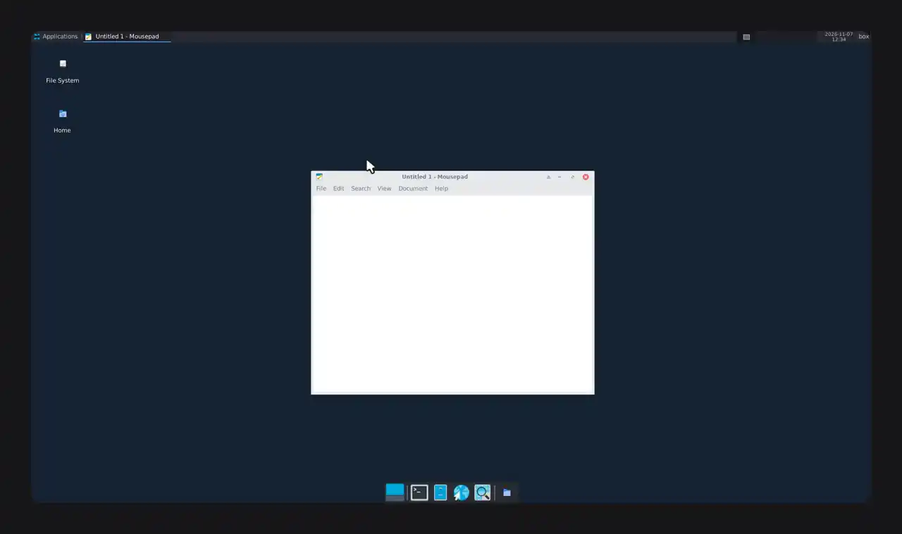
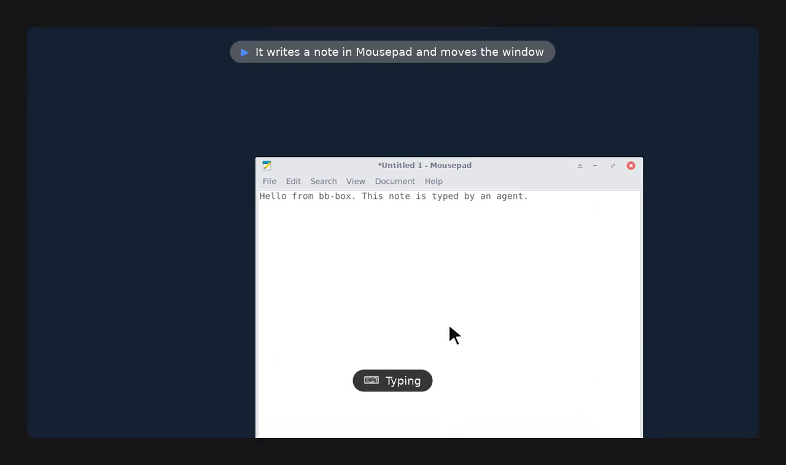
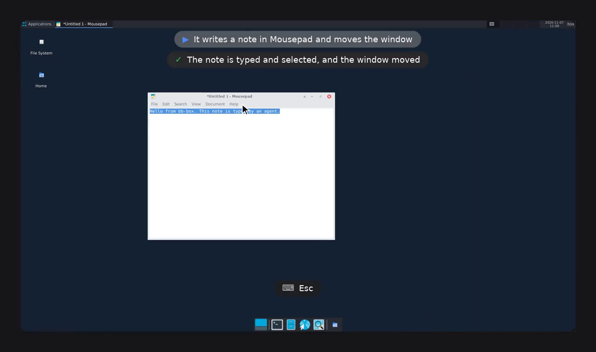

# Recordings

An agent can record a desktop box, or the phone or tablet of a device box, while it works and show you the clip in the thread, rather than describe what it did. When it tests something, it captions each step and its result, so you can see what it checked and whether it passed.

## What a clip shows

A clip shows the box's whole screen, up to 1280 pixels wide and 30 frames a second. The screen sits on a plain background, dark or light to match it, with slightly rounded corners.

### The pointer, clicks and keys

bb-box draws its own pointer over the clip, larger than the screen's. It glides to each place the agent clicks, arriving as the click lands, and follows your pointer smoothly when you have control.

- Each click shows a ring where it lands: white for a left click, blue for a right click, and two quick rings for a double click.
- While a button is held, a soft disc stays under the pointer, so a drag shows as one movement.
- Each shortcut or special key shows in a small pill at the bottom, such as "Ctrl+S", "⌘K", "Enter" or "Tab", for about a second. A key pressed again counts up, such as "↓ ×3".
- Typing shows one "Typing" pill while it goes on. The pill never shows what was typed.
- Typing into a password field, or text that looks like a password, key or token, shows no pill at all.

The pill moves to the top when the pointer is near the bottom of the screen, so it does not cover what was clicked.

On macOS and Windows, the agent's pointer is the one its computer-use driver draws on the screen, and bb-box draws your pointer only once you move it. On a Wayland desktop, bb-box does not sample the pointer yet, so it draws no pointer of its own there. The rings, pills and zooms are drawn everywhere.

### Zooms

The clip zooms in gently, up to 2x, where the agent or you click, drag, scroll or type, and holds still while you read. It zooms back out between bursts of work, and as soon as something opens elsewhere on the screen, such as a dialog. It never zooms in on a password field.

The zooms follow what was actually done, not guesses: the agent's clicks and keys, your input when you have control, and what changed on the screen.

### Still stretches and captions

Still stretches, where nothing on the screen moves, are cut to half a second, so a long session makes a short clip. Where a cut skips 3 seconds or more, a small mark in a bottom corner shows the real time skipped, such as "▶▶ 14 s later", for about a second. A clip the agent speeds up to 2x or 4x shows its speed in that corner the whole time.

When an agent tests something, it captions each check:

- the step, at the top of the video, with a blue ▶, such as "It opens the notes file in TextEdit"
- the result, under the step, with a green tick if it passed or a red cross if it failed, such as "TextEdit shows notes.txt, empty"

The next step replaces both. Each caption stays up long enough to read, even where still stretches are cut or the clip plays faster.

The agent can put the captions at the bottom of the video instead, above the Dock or taskbar, with the step above its result. It does this when what it tests is near the top of the screen, such as a menu bar or a window's title. The marks then go to a top corner.

The page under the clip lists the steps, each with its result and its real time in the recording. Select a step to play the clip from there.

## Recording a device

On an iOS or Android box, a recording shows the device's own screen, not the host's desktop. It needs no viewer open in the panel. Device clips do not have the drawn pointer, key pills, zooms or background yet.

- The device is drawn in its frame, as the panel draws it, and turns in the clip when it turns. A foldable shows its fold.
- Each touch, by the agent or by you, shows as a circle where it landed.
- The captions sit in a band above the device, or below it, so they never cover the app.
- The clip is at most 1280 pixels wide and 1600 pixels tall. When the device turns during a recording, the clip is sized for both shapes, so the device keeps one size throughout.
- If the device restarts, or bb-box's device server in the box restarts, the clip holds the last picture across the gap and says what happened there, such as "The device restarted here". If the box stops, the recording ends there.

## Asking an agent for a recording

Ask in your own words. For example:

- "Record your test run with each step."
- "Record yourself setting up the app, at 2x."
- "Record the menu bar check, with the captions at the bottom."
- "Record it without cutting the pauses."
- "Record it without zooming."
- "Record the whole screen edge to edge, without the background."

Agents record with the `box_record` tool. See [agent tools](../reference/tools.md#box_record).

## Sharing a clip

A clip is an MP4 file in the thread's storage folder. The captions and marks are part of the video, so they stay when you share the file. The list of steps is only on the page in the thread.

## Limits

- A recording runs for at most 5 minutes. It then stops by itself, and the agent still gets the clip.
- Only a desktop box or a device box can be recorded: Linux, on X11 or Wayland, macOS, Windows, iOS or Android.

## What it costs a box

While it records, a box uses about a tenth of a core on an X11 or Windows desktop, a quarter of a core on macOS, and two thirds of a core on Wayland. A device box copies the stream it already encodes for the panel, which added about 0.2% of a core on an iOS box. An `ios` box's recording asks for its device's video at two thirds of the device's size at least, which still fills the clip, at most 1,600 pixels tall; a panel open on it at a larger size makes it larger. The work comes at the stop: framing a minute of an iPhone took 5 to 8 seconds there, and making the clip about 2 more.

A desktop also samples its pointer 30 times a second while it records, on X11, macOS and Windows: on X11 that used under a second of a core in a minute. The agent's answer at the stop says how long each part of making the clip took. For an 11 second recording of a click, typing, three shortcuts and a drag, with its pointer, a ring, four key pills, zooms and the frame:

| Desktop | Stop and analyse | Draw the pills | Draw the rest and encode | Whole stop |
| --- | --- | --- | --- | --- |
| Linux X11 in Docker, 4 cores, 1920 by 1080 | 0.7 s | 0.6 s | 2.4 s | 4.1 s, against 2.9 s before |
| macOS on Tart, 4 cores, 2048 by 1536, 16 s recorded | 1.3 s | 0.7 s | 3.1 s | 5.3 s |
| Windows on Proxmox, 4 cores, 1280 by 800, 29 s recorded | not timed | 0.1 s | 2.5 s | not timed |

A busy 67 second recording on an X11 desktop of 8 cores, six rounds of clicks, typing, shortcuts and drags, took 9.9 seconds to make in all.
