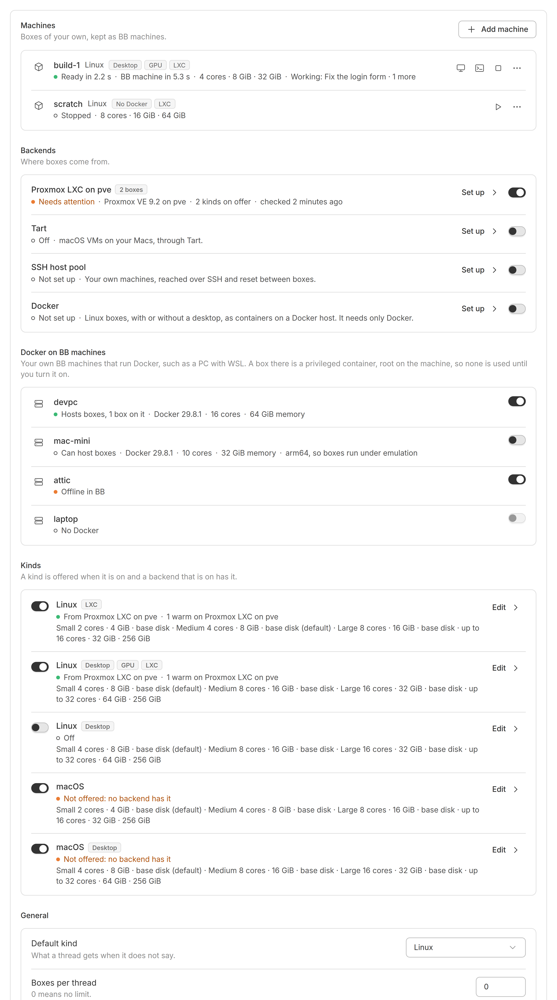

# Settings

BB Box's settings page is where you set up the places boxes come from. You also choose which kinds of box are on offer and how big they are, and manage your machines.

To open it, select the gear on the Boxes page, or open BB Box in BB's settings.

The page has 6 parts, in this order: Machines, Backends, Docker on BB machines, Kinds, General, and Files for every box. A switch saves at once. A form you open, such as a backend's setup, saves when you select **Save**.

When no backend is on yet, the page starts with the same offer as the Box panel: where one of your BB machines has Docker, **Use Docker on this machine** turns it on and builds the Linux image. See [the Box panel](boxes.md).

## Machines

Machines lists your own boxes, kept as BB machines. See [your machines](boxes.md#your-machines).

## Backends

A backend is a place boxes come from, such as Proxmox, a pool of your own machines, Docker or Tart on a Mac. Each backend is a row. Its switch turns it on or off. A backend that is off makes no new boxes, but boxes it already made keep working.

The row says how the backend is:

| What it says | What it means |
| --- | --- |
| Not set up | it has no settings yet |
| Off | it is set up but turned off |
| Needs setting up | a setting is missing or wrong, and the row names it |
| Needs attention | a health check failed |
| Ready | it works, and the row says how many kinds it offers and when it was last checked |

### Setting up a backend

Select **Set up** on the row. Its settings open below it. Each backend needs different settings, which its setup guide explains:

- [Proxmox LXC](../../setup/proxmox-lxc/README.md)
- [Proxmox QEMU](../../setup/proxmox-qemu/README.md)
- [SSH host pool](../../setup/ssh-pool/README.md)
- [Docker](../../setup/docker/README.md), and [Docker in WSL on a Windows PC](../../setup/docker-wsl/README.md)
- [Tart](../../setup/tart/README.md)

Every setting is also in the [configuration reference](../reference/configuration.md).

A secret, such as a password or an API token, never shows its value. Its field says whether it is set, and you can replace or clear it.

A backend with several hosts lists them under Hosts. A new box goes to the first host in the list with room. Each host has its own switch.

Select **Check** to run the backend's health checks with the settings in the form, without saving them. Each check says what is wrong and how to fix it.

Select **Save**, or **Save and turn on** for a backend that is off. If the backend cannot work with these settings, BB Box says what to fix and keeps it off.

## Docker on BB machines

Docker on BB machines lists your own BB machines that run Docker, such as a PC with WSL. BB Box can make boxes there.

A box on such a machine is a container with full access to the machine. So BB Box uses none of these machines until you turn it on. The row says whether the machine hosts boxes, could host them, is offline in BB, or has no Docker.

## Kinds

A kind is a type of box, such as a Linux desktop. A kind is offered when it is on and a backend that is on has it.

Each kind is a row with a switch. The row says which backends offer it, or 'Not offered: no backend has it'. It also lists the kind's sizes, and how many warm and spare boxes it keeps.

Select a kind's row to change it:

- Presets: the cores, memory and disk of Small, Medium and Large. An empty disk keeps the size the image comes with.
- Default preset: the size a box gets when no one says.
- Largest custom size: the most a Custom size can ask for.
- Warm boxes: ready boxes kept waiting on each backend, so a new box is ready at once.
- Spare boxes: ready boxes that are already BB machines and belong to no thread, so a thread can have one at once. See [spare boxes](spares.md).

The kinds and their shipped sizes are in [kinds and sizes](../reference/kinds.md).

## General

- Default kind: the kind a thread gets when it does not say.
- Boxes per thread: the most boxes a thread can have at once. 0 means no limit.
- Enrol boxes as BB machines: when on, each box joins BB as a machine, so the thread's commands and terminals can use it, with the thread's access.
- Rebuild images each night: at 03:00 on BB's server, BB Box rebuilds the standard images that are due, so new boxes have current tools and updates. After a BB update, it also refreshes the Linux images with BB's old app within the hour. **Rebuild now**, beside it, lists the images that are due and why, and starts the same rebuild at once, one image at a time, showing how far each is. It does not start while a rebuild goes on, and says so. See [images](images.md#standard-images-stay-up-to-date). Setting up Docker from the Box panel turns it on; otherwise it is off unless you turn it on.
- Linux desktops as video: a Linux X11 desktop drawn by the CPU shows as video, with **Show as VNC** under **Display** in the viewer's menu to go back. See [video](desktops.md#video). On unless you turn it off.

## Files for every box

Files for every box puts files you choose into the home folder of every Linux and macOS box. See [files for every box](files.md#files-for-every-box).

## When someone else saves first

If someone saves the settings while you are changing them, BB Box reloads the page and asks you to make your change again. A form you have open keeps what you typed.

## From the command line

You can see and change the same settings with `bb box config show`, `bb box config check` and `bb box config apply`. `bb box doctor` runs every health check. See the [command-line reference](../reference/cli.md) and [health checks](../reference/checks.md).
