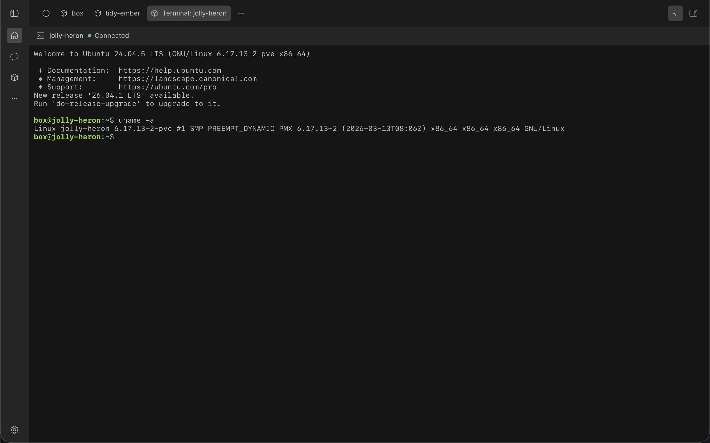

# The terminal

A box's terminal is a shell in the box, as the box user. It is the user's login shell, and PowerShell on Windows.

## Opening a terminal

You can open a box's terminal from:

- the Box panel: select **Open terminal** on the box's row, which opens a tab called 'Terminal:' and the box's name, with a terminal for its icon. On a narrow screen, such as a phone's, the tab is called by the box's name alone
- the thread's Terminal tab: it opens the thread's terminal straight away, lists the boxes when there are several, or offers the Box panel when there is none
- the Boxes page: the terminal shows on the page, with a back arrow to where you opened it: the list or the box's page
- the Monitor's machine status in BB's sidebar: when it shows a box, select **Open** beside the box's name, then **Open terminal**. The terminal shows on the Boxes page

The thread's Terminal tab counts the machine the thread runs on.

## Using the terminal

The terminal works like one on your own computer. It fits the tab, and changes size when the tab does, so full-screen programs redraw. It keeps the last 5,000 lines you can scroll back through.

The shell keeps running when you switch to another tab. When you come back, the terminal shows what the shell printed meanwhile. A shell that no tab has shown for 10 minutes ends.

The toolbar says how the terminal is doing: 'Connecting…', 'Connected', 'Ended', 'Starting', 'Stopped' or 'Released'.

## When the shell ends

A shell ends when you exit it, when its box stops or goes, or when BB Box restarts. The terminal says why. Select **Start a new shell** to carry on.

A stopped box has no terminal until it starts. The terminal offers **Start** where the box can start again.

When a box is released, its terminal says so, with the box's name: close the tab, or, on the Boxes page, select **Back to boxes** or **Back to BB Box settings**.

A few kinds of box have no terminal, because BB Box reaches them without a shell. The terminal says so.

## Agents and commands

Agents do not use this terminal. They run commands in a box with the `box_run` tool. See [agent tools](../reference/tools.md).
