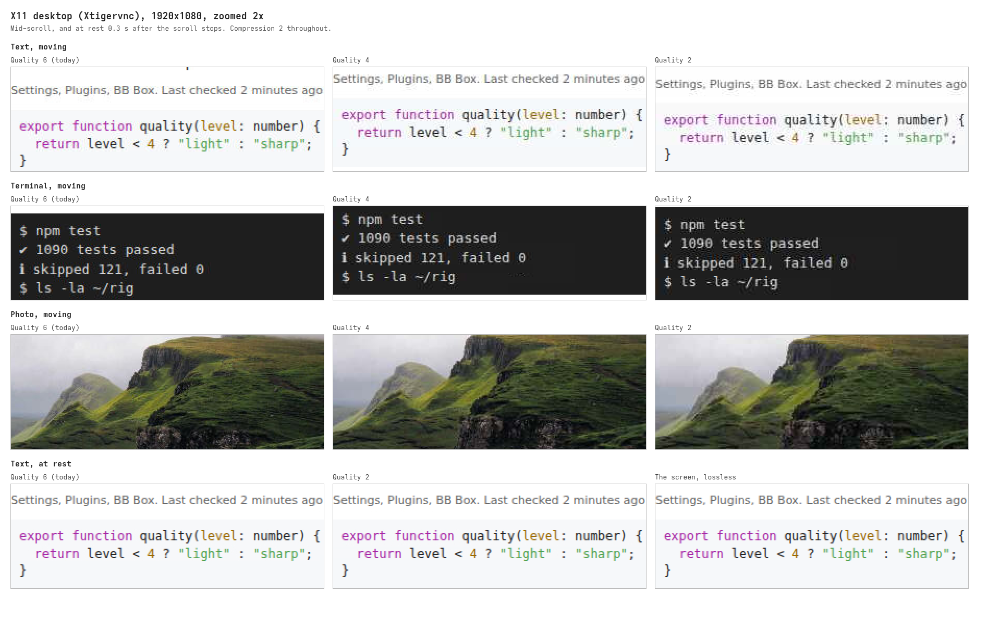
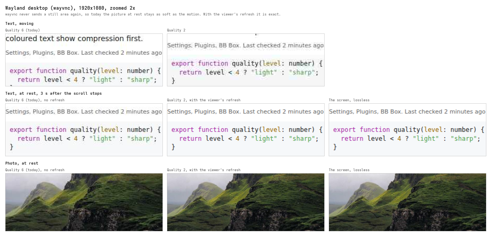
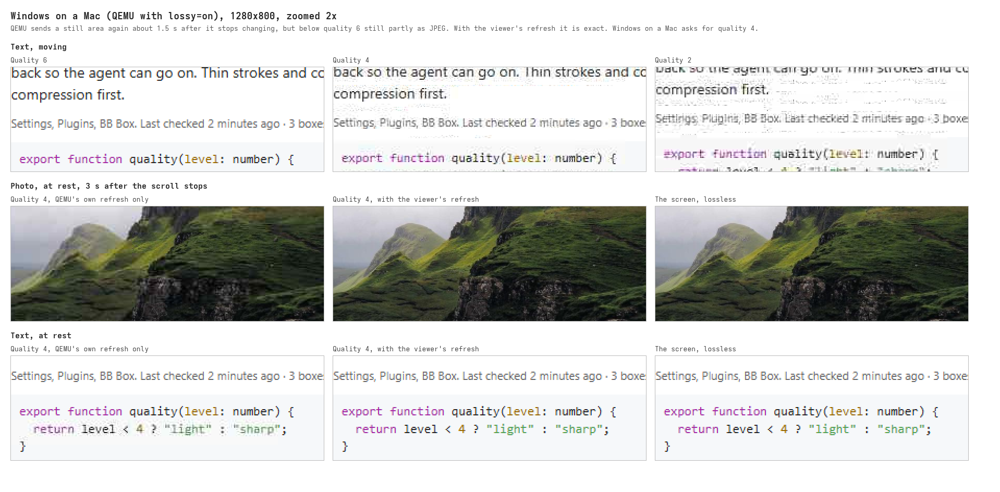

# RFB picture quality

Measured on 7 October 2026, for the first step of
[056](../decisions/056-linux-x11-desktops-add-a-selkies-stream-and-rfb-stays-for-the-rest-tuned.md):
which JPEG quality and compression the viewer should ask each desktop's
server for, and whether each server sends a still area again losslessly.
Windows on a Mac was measured again once its QEMU ran with `lossy=on`
(#569), and macOS once the holder was paced (#567).

## How it was measured

- Each desktop showed a test page full screen: text from 11 to 20 px,
  code, a terminal block and a photo. The page is made of 600 px blocks of
  2 kinds, in turn, so the screen after a scroll is not the one before it.
- A viewer page ran noVNC 1.7.0 in headless Chrome, with 2 connections to
  the desktop's server. One asked for the setting under test. The other
  asked for raw pixels only, as the true screen. The page compared the 2
  pictures pixel by pixel.
- The test page scrolled 1,800 px in 3 s. The viewer counted the bytes it
  received and each rect's encoding. It compared the pictures 0.3 s, 3 s
  and 8 s after the scroll stopped. A pixel is off when a channel differs
  from the screen's by more than 8.
- The Linux desktops were Proxmox LXC boxes with 4 cores, at 1920x1080,
  with the viewer in the same box. macOS (2048x1536) and Windows on arm64
  (1280x800) ran on a Mac, viewed from BB's server through SSH. Windows on
  Proxmox was not measured, as its console needs a ticket from the API. It
  is QEMU's VNC server too.

## Results

Server CPU is in % of one core, while scrolling.

| Desktop | Setting | Mbit/s | Server CPU | Text pixels off at rest |
| --- | --- | --- | --- | --- |
| X11, Xtigervnc 1.16 | quality 6, compression 2 (before) | 65 | 34 | none |
| X11 | quality 4, compression 2 | 41 | - | none |
| X11 | quality 2, compression 2 | 31 | 31 | none |
| X11 | quality 2, compression 9 | 31 | 42 | none |
| Wayland, wayvnc 0.7.2 | quality 6 (before) | 101 | 26 | 17% |
| Wayland | quality 2 | 82 | 26 | 19% |
| Wayland | quality 9 | 227 | - | 11% |
| Wayland | no quality level, so lossless | 211 | 88 | none |
| Wayland | quality 2, with the viewer's refresh | 82 | 26 | none |
| macOS on Tart, through the holder | any | 25 to 29 | - | none |
| macOS on Tart, through the paced holder | any | 82 | - | none |
| Windows on a Mac, QEMU 11.1 | quality 6 or 2, compression 2 | 58 to 63 | 70 | none |
| Windows on a Mac | quality 6 or 2, compression 9 | 24 to 28 | 103 to 195 | none |
| Windows on a Mac, `lossy=on` | quality 6 | 42 to 44 | 75 to 113 | none |
| Windows on a Mac, `lossy=on` | quality 4 | 21 | 72 to 80 | 3.5% |
| Windows on a Mac, `lossy=on` | quality 2 | 24 | 67 to 74 | 3.3% |
| Windows on a Mac, `lossy=on` | quality 4, with the viewer's refresh | 21 | 72 | none |

On a page of text only, Xtigervnc sent 32 Mbit/s at quality 6, 18 at
quality 4, and 14 at quality 2 with compression 2 or 9.

## Findings

- **Xtigervnc sends a still area again**, near losslessly, about 0.12 s
  after it stops changing. So at rest its picture is within 4 levels of
  the screen at every quality, and the quality changes only the picture in
  motion. At quality 2, moving text is softer, with halos on light text on
  dark, but readable. It takes half the traffic of quality 6.
- **Compression 9 saves nothing on Xtigervnc**: under 2% of the traffic,
  for a tenth of a core more. Xtigervnc sends text as JPEG too.
- **wayvnc never sends a still area again.** It sends every rect as JPEG,
  so the picture at rest stays as soft as the motion until the next
  change. Even quality 9 left 11% of text pixels off. With no quality
  level it sends Tight losslessly, at twice the traffic and over 3 times
  the CPU. The compression level changes nothing.
- **The viewer's own refresh makes wayvnc exact at rest.** Once nothing
  has come for 250 ms, the viewer asks for the area it drew as JPEG again
  with no quality level, and wayvnc answers losslessly: about 1 MB for the
  whole screen, 0.3 s after the scroll stops. Motion keeps quality 2's
  traffic and CPU. The code is in `src/app/rfb-refresh.ts`.
- **The Tart holder sends Zlib**, whatever the viewer asks, so its picture
  is exact at any setting. Its stream ran 1 to 2 s behind the scroll.
  Paced, it sent 3 times the pixels while scrolling, and its last update
  came 0.9 s after the scroll stopped.
- **QEMU without `lossy=on` sends Tight losslessly**, exact at any quality.
  Compression 9 cut its traffic by about 60%, but it sent half the frames
  while scrolling (9.7 against 19 to 20 megapixels) and took 1.5 to 3
  times the CPU.
- **QEMU with `lossy=on` sends a still area again**, about 1.5 s after it
  stops changing, but below quality 6 partly as JPEG still. At quality 4
  and 2, a photo stayed lossy at rest (23% and 34% of its pixels off), and
  so did some text. With the viewer's refresh it is exact at every
  quality: QEMU's own refresh comes after the viewer's and sends some JPEG
  again, and the viewer asks once more. This costs about 1.2 MB each time
  the screen goes still, at 1280x800.
- **QEMU's JPEG at quality 2 breaks text up while it moves**: stray blocks
  beside each line, and small grey text hard to read. Quality 4 is clean
  enough to read, and cost QEMU no more: 21 Mbit/s against 24. So Windows
  on a Mac asks for quality 4, with the viewer's refresh.

## Pictures

Crops of the viewer's canvas, zoomed 2 times with no smoothing.

